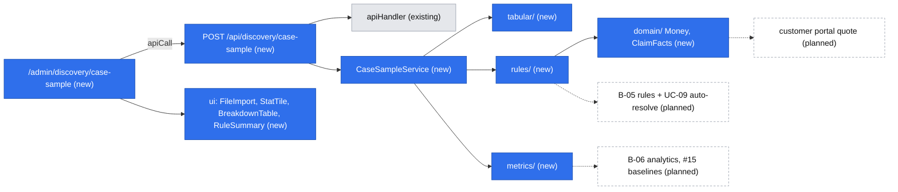

# Case sample lab (E00-T01) and the platform primitives under it

Status: Approved: confirmed by the owner in session on 2026-10-23 (revised after review the same day, and again after the second architectural review: catalog moved to `doc/platform-primitives.md`, only Phase 1 step 1 gates the return specs, `multiplyMoney`, a DB-free lab and a sampling caveat in the note). The metric definitions and the R10b complaint restriction were accepted as written by the owner on 2026-10-23 (defaults taken as accepted; the note still records them under "Method and limits"). Source issue: #14 (E00-T01, epic #13). Design authority: `.ai/specs/product-brief.md`.

## 📝 TLDR
The product owner and the head of customer service need to test A01 (follow-ups are the main service cost) and A04
(≥ 35% of cases can be settled by simple rules) on ~50 recent mail/phone cases. Today (current behavior) nothing in the
app can hold, measure or rule-check historical cases, and the rules R08–R10 exist only as prose in the brief and as
mockup code. Proposed (future behavior): an admin page `/admin/discovery/case-sample` that takes an anonymised CSV,
computes the follow-up share, message exchanges and time to resolution, dry-runs R08–R10 (with what-if thresholds), and
hands back the `[DATA]` note for `.ai/specs/research/`. Nothing is stored. The page is built on reusable primitives
(rules engine, money, claim facts, metrics, tabular import, stat and rule components) that UC-09, UC-14/B-05 "Symuluj",
B-06 analytics and #15 reuse. This overrides #14's "Out of scope: building anything" (owner decision, 2026-10-22).

## 📝 Resolved decisions
Owner (Adam Adamczyk) accepted all recommendations on 2026-10-22:

| Id | Decision |
|---|---|
| Scope | Build tooling for #14 plus the primitives; catalog every primitive the backlog needs, build only those this feature uses |
| Q1 | Admin page only, no CLI |
| Q2 | Stateless: upload → compute → note; no table, nothing persisted |
| Q3 | CSV columns as listed under Data Model (whitelist; unknown columns dropped and reported); review removed `delivered_on` (unused) and requires `case_ref` to start with a letter |
| Q4 | R08–R10 read-only plus what-if threshold overrides for the settling rules, shown beside the baseline |
| Q5 | The primitives catalog lives in `doc/platform-primitives.md` (moved out of this spec after review, so one map is kept current across the specs; the spec keeps only its own primitives) |
| Q6 | `papaparse` added to `@easyrms/core` |
| Metrics, R10b | The metric definitions table and the R10b complaint restriction are accepted as written (owner, 2026-10-23) |
| Q7 | Of this spec only **Phase 1 step 1** (`Money`, `formatMoney`, `multiplyMoney`, domain types) must merge before `2026-10-22-return-customer-portal.md`'s PR A; it ships as its own early PR, and Phases 1 steps 2–4, 2 and 3 run in parallel with the return specs. The portal reuses `Money` (it defines its own order and quote input types, not `ClaimFacts`) and adds `addMoney` and `applyRate` itself, extending `money.ts` without changing the existing exports |
| Language | The whole app is Polish-only (decision D07 in the product brief, confirmed by Adam Adamczyk 2026-10-23): lab copy, `describeRule` text and the note are Polish; `ui` components take all text through props and keep no default strings. N04 (English version) stays a non-goal |

## 📝 Problem Statement
The brief rests on untested assumptions: A01 and A04 are both `high` importance, and Problems and Goals have no data
(Coverage: interview 0, data 0). Collection plan item 1 asks for exactly this sample. A spreadsheet would answer #14 once,
but the same machinery comes back: rule simulation is B-05 (`POST /bo/rules/simulate`), the aggregates are B-06 and #15,
and the rules engine is UC-09. Building it once, behind stable contracts, makes discovery the first consumer of the
platform instead of throwaway work.

With n ≈ 50, a share has a 95% interval of roughly ±13 points, so the note must show intervals, not bare percentages.
Otherwise a 30% result would read as "A04 failed" when 35% is still inside its range. The interval also assumes random sampling, which "the most recent ~50 cases" is not, so the note says its uncertainty is a lower bound.

## 📝 Proposed Solution
1. The user downloads a CSV template, fills it from mail/phone history (anonymous rows) and uploads it.
2. The browser reads the file as text and posts it to `POST /api/discovery/case-sample`.
3. `core` parses and validates every row (all-or-nothing), projects each row to `ClaimFacts`, runs the brief's rule set
   (baseline and, when given, what-if thresholds), computes the metrics and renders the note as Markdown.
4. The page shows stat tiles, breakdowns, the rule table (baseline vs what-if) and the anonymised per-case table, and
   offers "Pobierz notatkę" (`YYYY-MM-DD-case-sample.md`) and "Kopiuj". The user commits the note to `.ai/specs/research/`.

**Settling definition.** A case is *rule-settled* when at least one enabled rule with a settling action (`auto_approve`,
`keep_item`) matches. R10's actions (`high_priority`, `require_evidence`, `assign`) route or ask for evidence but do not
settle. The note also shows *agreement* (below). A high settled share full of false approvals does not support A04.

**Metric definitions** (defaults proposed in review and accepted as written by the owner on 2026-10-23; the note states them under "Method and limits" so the head of customer service reads the numbers with them):

| Metric | Numerator | Denominator | Notes |
|---|---|---|---|
| Follow-up share (A01) | cases with `follow_up_requests ≥ 1` | all cases (n), open ones included | Wilson 95% interval |
| Rule-settled share (A04) | cases where ≥ 1 settling rule matches | all cases (n), including `cancelled` and `open` | Wilson 95% interval; also shown beside it: share among resolved cases only |
| Agreement | rule-settled cases by real outcome | rule-settled cases | `agrees`: `approved` for `auto_approve`; `approved` or `partial` for `keep_item`. `rejected` = false approval. `cancelled`/`open` = `other` (not counted as agreeing or disagreeing). Shown as counts, no interval |
| Messages median / p75, follow-ups median | `messages_exchanged`, `follow_up_requests` | all cases | `—` when empty |
| Days to resolve | `resolved_on − opened_on` in days | resolved cases only | median by kind |

**Alternatives that lost:** a spreadsheet (one-off, no reuse; the brief's next steps need the same engine); a CLI script
(Q1: no frontend primitives exercised, harder for the head of customer service to run); persisting samples (Q2: a
personal-data surface and a migration for a one-time exercise); evaluating rules as JavaScript expressions (unsafe, and
B-05 cannot render or edit code).

**Research against market leaders.**
- [json-rules-engine](https://github.com/CacheControl/json-rules-engine) (the common OSS rules engine): we take JSON-serializable conditions,
  rule priority and "all matching rules fire". We skip async fact resolution, nested `any`/`all` trees and custom
  operators: a closed vocabulary is what a no-code builder (B-05) can render and validate.
- Returns platforms with no-code workflows (Claimlane, the brief's reference, and peers such as Loop and AfterShip
  Returns) express rules as IF conditions on return type, value, product category → THEN actions like auto-approve or keep
  item. Our vocabulary covers that shape. Testing a rule against history before enabling it is a common feature there and
  is exactly `simulate` here. Not re-checked for this spec (the brief records the benchmark as deferred).

## 📝 Architecture
New cross-cutting primitives in `core` sit next to the existing `http/` folder (they are not domain concepts, so they do
not follow the per-concept folder rule). The feature is a new `discovery` concept with a service, a validator, a route and
a page, and no `db` part. "Stateless" means nothing is stored, and the route does not need Postgres: `app/src/server/container.ts` gains `getCoreContainer()`, a container with `registerCore` only (no `getOrm()`), memoized on `globalThis` like the root container, and `resolveCaseSampleService()` uses it. The existing root container and request scope are unchanged; the composition root stays in `app`. Discovery is the tool you want before the product has a database.

`core` exports added to `core/src/index.ts` (needed by `app`): `CaseSampleService`, `caseSampleAnalyzeSchema`,
`describeRule`, `BRIEF_RULES`, and the domain types, `Money` helpers (including `multiplyMoney`) and `Rule` types.



Takeaway: everything new is pure TypeScript in `core` plus props-only components in `ui`. Planned consumers are
expected to extend these modules (new facts, condition types, a persistence layer), not replace them; their own specs
confirm or revise the contracts.

Layout:

| Path | Content |
|---|---|
| `core/src/domain/money.ts` | `Money { amountMinor, currency: "PLN" }`, `parseMoney()`, `compareMoney()`, `multiplyMoney(m, qty)` (non-negative integer quantity, safe-integer checked), `formatMoney()` (`addMoney` and `applyRate` are added by the customer-portal quote, their first consumer) |
| `core/src/domain/claim-kind.ts` | `CLAIM_KINDS = ["return","complaint","transport","missing"]`, `ClaimKind` (the agent spec types its `kind` column as the literal `"return"` for now and has no code dependency on this spec; a later spec widens it to `ClaimKind`) |
| `core/src/domain/claim-facts.ts` | `ClaimFacts { kind, value: Money, categories: ProductCategory[] }`, `PRODUCT_CATEGORIES` |
| `core/src/rules/` | `rule.schema.ts` (Zod vocabulary), `evaluate.ts`, `simulate.ts`, `with-thresholds.ts`, `describe.ts`, `brief-rules.ts` (R08–R10 as data) |
| `core/src/metrics/` | `share()` with Wilson 95% interval, `median()`, `percentile()`, `groupBy()` |
| `core/src/tabular/` | `parseTable(text, rowSchema, { maxRows, cellGuard })` on `papaparse` |
| `core/src/services/discovery/case-sample.service.ts` | `CaseSampleService.analyze(input)` |
| `core/src/services/discovery/case-sample-note.ts` | `renderCaseSampleNote(report)` → Markdown |
| `core/src/validators/discovery/` | `case-sample-row.schema.ts`, `case-sample-analyze.schema.ts` |
| `core/src/http/parse.ts` (changed) | `parseJsonBody(request, schema, { maxBytes })`: optional byte cap, `PayloadTooLargeError` (413) |
| `app/src/app/api/discovery/case-sample/route.ts` | `POST` via `apiHandler` (a workflow endpoint, not CRUD) |
| `app/src/app/admin/discovery/case-sample/` | `page.tsx` (Server Component, rule summaries) + colocated `case-sample-lab.tsx` (client) |
| `ui/src/admin/forms/file-import.tsx`, `ui/src/admin/stats/`, `ui/src/admin/rules/` | UI primitives |

Wiring: `caseSampleService: asClass(CaseSampleService).singleton()` in `registerCore` (no dependencies, no request state).
It is added to `Cradle` and exposed through `resolveCaseSampleService()` in `app/src/server/container.ts`, which resolves it from `getCoreContainer()`; the scoped registrations (`returnService` and others) are never resolved there.

### Rules engine (the primitive with the longest life)
```ts
// Closed vocabulary, Zod-validated; JSON-serializable so B-05 can store and edit it later.
type Condition =
  | { type: "kind_in"; kinds: ClaimKind[] }
  | { type: "category_in"; categories: ProductCategory[] }        // any item category matches
  | { type: "value_lte"; amountMinor: number; tunable?: boolean }
  | { type: "value_gte"; amountMinor: number; tunable?: boolean };
type Action =
  | { type: "auto_approve" } | { type: "keep_item" }               // settling
  | { type: "high_priority" } | { type: "assign"; to: "manager" }
  | { type: "require_evidence"; evidence: "video" };   // members are added by the spec that first needs them
interface Rule { schemaVersion: 1; id: string; name: string; enabled: boolean; order: number; when: Condition[]; then: Action[] }

evaluate(facts: ClaimFacts, rules: Rule[]): RuleMatch[]   // enabled rules by `order`; all conditions AND; every match fires
simulate(cases: ClaimFacts[], rules: Rule[]): { total, matchedByRule: Record<id, number>, settled: number, perCase: RuleMatch[][] }
withThresholds(rules, overrides: Record<ruleId, amountMinor>): Rule[]   // replaces the single tunable value condition
describeRule(rule): { conditions: string[]; actions: string[]; settles: boolean }  // Polish text for UI and note
```
- An empty `when` matches everything; a rule with no `then` is invalid.
- `withThresholds` throws `ValidationError` for an unknown rule id or a rule without a tunable condition.
- Adding a condition type later (reason, days since delivery, supplier) is additive: one union member, one evaluator
  branch, one `describe` line. Nothing in this spec stores rules, so `schemaVersion` exists for when B-05 does.
- The vocabulary is **provisional** until the B-05 rules spec confirms it; nothing stores it before then.
- `brief-rules.ts` encodes R08 (`kind_in [return]`, `value_lte 15000` tunable → `auto_approve`), R09 (`kind_in
  [complaint, transport]`, `value_lte 6000` tunable → `keep_item`) and R10 as three rules with ids `R10a` (concept R3:
  transport → `high_priority`), `R10b` (R4: complaint ∧ electronics/appliances → `require_evidence video`; the brief says only "elektronika/AGD → wideo" and the complaint restriction is this spec's reading of it, accepted as written by the owner on 2026-10-23 and stated in the note's method section; it changes only the matched-by-rule counts, never the settled share) and `R10c` (R5:
  `value_gte 200000` → `assign manager`). All are enabled in the simulation; R5's "disabled in mockup" state does not affect the settled share because
  its action does not settle.

## 📝 Data Model
No entities, tables or migrations: nothing is persisted (Q2). The data-model graph is skipped for that reason.

**CSV contract** (template downloadable from the page; header row required; `,` or `;` delimiter; UTF-8 with or without BOM):

| Column | Rule |
|---|---|
| `case_ref` | required, `^[A-Za-z][A-Za-z0-9-]{0,19}$` (must start with a letter, so raw order/ticket numbers are refused: the collector assigns refs such as `S01`), unique in the file; never echoed into the response or the note (rows become `C01…Cnn`) |
| `channel` | `mail` \| `phone` |
| `kind` | `return` \| `complaint` \| `transport` \| `missing` |
| `category` | `electronics` \| `appliances` \| `home` \| `clothing` \| `hygiene` \| `other` |
| `value_pln` | ≥ 0 and ≤ 1 000 000, `149.99` or `149,99`, parsed to minor units |
| `opened_on`, `resolved_on` | `YYYY-MM-DD` or `DD.MM.YYYY`; `resolved_on` empty = still open (a case counts as *resolved* whenever `resolved_on` is set, whatever its outcome, so `cancelled` cases with a date are resolved); `resolved_on ≥ opened_on` |
| `follow_up_requests` | integer 0–50: times the team asked the customer for missing data |
| `messages_exchanged` | integer 0–200: all messages and calls in the case, both directions |
| `outcome` | `approved` \| `rejected` \| `partial` \| `cancelled` \| `open` (must be `open` when `resolved_on` is empty, and the reverse) |

Limits: ≤ 512 KB (524 288 UTF-8 bytes, measured on the encoded text, not characters) and 1–500 data rows. Column names are case-insensitive and trimmed.

**Sensitive data:**
- The whitelist means names, e-mails, phones, addresses and free-text comments have nowhere to go. Unknown columns are
  dropped and listed in the response by name (never their values). `delivered_on` was dropped from the contract: no
  metric or rule reads it (data minimisation).
- Second guard: `parseTable`'s `cellGuard` runs over every raw cell, including dropped columns, **before** they are
  discarded. Any cell matching an e-mail pattern, or a phone pattern after stripping spaces, dashes, dots, brackets and a
  leading `+48`/`0048` (exactly 9 digits, and only when the raw cell contains no decimal point or comma, so a `value_pln` such as `1000000.00` is never taken for a phone number), fails the whole upload with "wiersz N wygląda na dane osobowe" (row, never the value); the message adds a hint: "usuń tę kolumnę z pliku i wczytaj go ponownie" (for example when an internal id of nine digits sits in a dropped column).
- Error messages from `parseTable`, the schemas and the service name rows and columns, never cell values, so the
  `apiHandler` error log cannot carry them.
- The committed note is **pseudonymised, not anonymous**: someone with order-system access could try to match cases.
  To make that impractical, the note shows value bands (`≤ 60`, `60–150`, `150–500`, `500–2000`, `> 2000 zł`) instead
  of exact amounts and the period by month; exact values appear only on screen. The residual risk is stated in the note.
- The CSV and the report live only in the request and the open browser tab.

## 📝 API Contracts
`POST /api/discovery/case-sample`, envelope as today, schema `caseSampleAnalyzeSchema`:

```jsonc
// request
{ "csv": "<text, ≤ 512 KB>", "thresholds": { "R08": "200,00", "R09": "60" } }   // optional, zł strings parsed by parseMoney, 0–1 000 000 zł; only R08/R09
// 200
{
  "sampleSize": 48, "period": { "from": "2026-07", "to": "2026-09" }, "droppedColumns": ["customer_name"],
  // Interval = { value, low, high } with Wilson 95%. Intervals: followUp.share and rules.*.settledShare / settledShareResolved
  // (null when the denominator is 0). Breakdown rows (byKind/byChannel/byOutcome) carry a plain `share: number` (0–1) of n, no interval.
  // rules.*.agreement is counts only: { agrees, falseApprovals, other }.
  "followUp": { "share": { "value": 0.42, "low": 0.29, "high": 0.56 }, "messagesMedian": 4, "messagesP75": 7, "followUpsMedian": 1 },
  "resolution": { "resolved": 45, "open": 3, "daysMedianByKind": { "return": 6, "complaint": 12 } },
  "byKind": [{ "label": "return", "count": 30, "share": 0.63, "valueMedian": "129,00 zł" }], "byChannel": [ … ], "byOutcome": [ … ],
  "rules": {
    "baseline": { "settledShare": { … }, "settledShareResolved": { … }, "matchedByRule": { "R08": 14, "R10a": 3, … }, "agreement": { "agrees": 13, "falseApprovals": 2, "other": 0 },
                  },
    "whatIf": { … same shape; its `definitions` show the overridden thresholds … } | null,
    // rules.definitions is the single baseline list (also used by the note); whatIf carries its own, with the overridden thresholds
    "definitions": [{ "id": "R08", "name": "…", "conditions": ["rodzaj: zwrot", "wartość ≤ 150,00 zł"], "actions": ["automatyczna akceptacja"], "settles": true }]  // Polish (D07)
  },
  "cases": [{ "id": "C01", "kind": "return", "channel": "mail", "value": "89,00 zł", "followUps": 2, "messages": 5, "daysToResolve": 4, "outcome": "approved", "rules": ["R08"] }],
  "note": "<Markdown>"
}
```

Errors:
- Body over 1 MiB (checked from `Content-Length` and by a capped stream read before `JSON.parse`) → 413
  `payload_too_large`. The cap is 2× the CSV limit because JSON escaping (`\n`, `\"`) can nearly double the size of a legitimate CSV
  that is within its own limit (control characters escape to more bytes, which the cap does not try to bound); the exact CSV limit (524 288 bytes) is enforced afterwards by `caseSampleAnalyzeSchema`
  with a 400.
- Body is not JSON or `csv` is missing, empty or too long → 400 `validation_error`.
- Bad rows → 400 `validation_error` with `fieldErrors` keyed `row.<line>.<column>`. At most 50 are listed, plus
  `form: "Jeszcze N błędów"` when there are more. Nothing is computed.
- A threshold for any rule other than R08/R09, or an unparsable amount → 400 with `fieldErrors["thresholds.<id>"]`.
- Personal-data guard hit → 400 with `fieldErrors["row.<line>"]`.

All amounts in the response are pre-formatted strings (pl-PL), so `ui` needs no money logic (it cannot import `core`).
CSRF: the route is a mutating `POST`, so it is covered by the same-origin check the customer-portal spec adds to the shared HTTP layer (its Phase 1 step 0); the lab page therefore posts through `apiCall`, and the route passes `httpOptions` (the portal spec says "every route under `app/api`", so this route is covered when it lands); the manual `curl` check needs `-H 'x-requested-with: easyrms'` once that step exists. Until that lands there is no check, as on every other route.

## 📝 UI/UX
Admin (shadcn) page `/admin/discovery/case-sample`:
All visible copy is Polish (D07); the strings below are the Polish source text and the stories and manual checks use them.
1. **Intro card:** what to collect, a "Pobierz szablon CSV" link (static file in `app/public/`), and the rule
   definitions via `RuleSummary` (rendered server-side from `describeRule`).
2. **Import:** `FileImport` (drop zone + button, `.csv`, 512 KB). It reads `file.text()`. On a `U+FFFD` replacement
   character it shows "Zapisz plik jako CSV UTF-8 i spróbuj ponownie" without calling the API. Row errors appear as a list
   (line, column, message).
3. **Results:** `StatRow` of tiles: sample size, follow-up share (with interval as a hint), median messages, rule-settled
   share baseline. `BreakdownTable`s for kind, channel and outcome. Rule table: rule, matches, settles, baseline, what-if.
   Agreement line. Per-case table via `DataTable`. A dropped-columns notice when any were dropped.
4. **What-if:** two text inputs (zł, for example `200,00`) for R08 and R09 thresholds plus "Przelicz ponownie". The CSV stays
   in memory, so it re-posts with `thresholds` as typed; the server parses them, so the page has no money logic. The what-if column is empty until used.
5. **Note:** "Pobierz notatkę" (Blob, `YYYY-MM-DD-case-sample.md`) and "Kopiuj". A line tells the user to commit it to
   `.ai/specs/research/` (the user creates the folder when committing the first note; it does not exist yet).

States: idle (intro), parsing/calculating (`LoadingMessage`), errors (`ErrorMessage` plus the row list), results.
Leaving the page discards everything, and the page says so.

Accessibility: the drop zone is a labelled `<button>` with an equivalent file input. Tables have captions. Tile values
are text, not only colour. The result region is `aria-live="polite"`. Copy language: Polish.

UI primitives (props only, no data access):
- `FileImport` `{ accept, maxBytes, label, disabled?, onText(text, fileName) }`
- `StatTile` `{ label, value, hint? }`
- `StatRow` `{ children }`
- `BreakdownTable` `{ caption, rows: { label, count, share }[] }`, built on `DataTable`, which gains an optional
  `caption` prop (rendered as a plain `<caption>` inside the shadcn `Table`; `ui/src/admin/table.tsx` has no `TableCaption` today, so a small shadcn-style `TableCaption` is added there; see the `DataTable` change below)
- `RuleSummary` `{ rules: { id, name, enabled, conditions, actions, settles }[] }`

**The `[DATA]` note** (`renderCaseSampleNote`):
- Title: `Próba przypadków — follow-upy i pokrycie regułami [DATA]` (the `[DATA]` tag stays literal).
- Header: date, n, period by month, channels, "Właściciel: kierownik obsługi klienta", source "anonimowa próba, zebrana z
  mail/phone history".
- Findings for A01: follow-up share with its interval, the messages median and p75, plus the brief's suggested kill
  line (< ~20%), marked as not agreed.
- Findings for A04: the settled share with its interval versus 35%, agreement, and what-if if used.
- Per-case table (`C01…`) with value bands, not exact amounts.
- Breakdowns.
- Method and limits: the settling definition, the R08–R10 versions, sample size, the sampling caveat ("the 95% interval assumes a random sample; this sample is the most recent cases, so seasonality and selection are not covered and the true uncertainty is larger"), and the pseudonymisation note (no
  direct identifiers; bands and months reduce, but do not remove, re-identification risk).

**Polish strings and label map (G9).** `ui` holds no strings and shared code defaults are English, so the lab page passes every visible text as a prop, including `LoadingMessage`'s message and `DataTable`/`BreakdownTable` `emptyMessage` and `caption`. Labels live in one constant object in the page: kind (`return` "Zwrot", `complaint` "Reklamacja", `transport` "Szkoda transportowa", `missing` "Brak w przesyłce"), channel (`mail` "E-mail", `phone` "Telefon"), outcome (`approved` "Zaakceptowane", `rejected` "Odrzucone", `partial` "Częściowo", `cancelled` "Anulowane", `open` "Otwarte"), the four tile labels ("Liczba spraw", "Sprawy z dopytaniem", "Mediana wiadomości", "Rozstrzygnięte regułą"), table column headers and captions. The server never sends English text for display: `PayloadTooLargeError` uses the Polish message "Plik jest zbyt duży (limit 512 KB)", and the page maps `error.code` (`validation_error`, `payload_too_large`, `internal_error`, and `apiCall`'s `network_error` and `unexpected_response`) to Polish copy instead of showing `error.message` or the English `apiCall` fallbacks; `parseJsonBody`'s "Invalid JSON body" is reachable only by a malformed request, which the page never sends.

## 📝 Edge Cases & Failure Scenarios
- **Oversized or CPU-heavy upload:** the body is capped before `JSON.parse` (413); ≤ 500 rows and pure functions, so
  analysis runs in milliseconds.
- **Excel exports:** a `;` delimiter, a BOM, a `,` decimal and `DD.MM.YYYY` dates are all accepted. Any other encoding is
  rejected client-side (U+FFFD) and server-side (the same check), with a message.
- **Duplicate `case_ref`:** a row error on the second occurrence.
- **Open cases:** counted in n and follow-ups, excluded from time-to-resolution, and the note says how many.
- **Zero cases of a kind:** the breakdown row is omitted and medians are `—`, never `NaN`.
- **Empty or one-row files:** the interval is still computed (Wilson behaves at n = 1). An empty file is an error.
- **Database unreachable:** the lab still works, because it resolves its service from the core-only container and never builds the ORM; only the return routes fail with their usual 500.
- **Personal data:** a guard hit fails the upload and names the row, not the value.
- **What-if for another rule:** 400; the UI only offers R08 and R09.
- **A real order number in `case_ref`:** refused by the leading-letter rule, with a hint to number cases `S01…`.

## 📝 Risks & Impact Review
Evidenced deviations from repository rules, each approved by the owner as part of this spec's purpose:
- **Component placement** (`doc/engineering-standards.md` §2 rule 4, "used by one page → colocate"): `FileImport`,
  `StatTile`/`StatRow`, `BreakdownTable` and `RuleSummary` have one consumer today but go to `ui/src/admin/`. Building
  shared primitives ahead of their second consumer is the explicit goal of this spec (owner, 2026-10-22); each has a
  named second consumer in the catalog (B-05, B-06).
- **YAGNI** (§4): the catalog's "design" rows are documentation only; nothing is built for them.

Otherwise no violations found against `AGENTS.md`, `doc/code-review-checklist.md` or `BACKWARD_COMPATIBILITY.md`. The
changes are additive: a new route, a new page, an optional `parseJsonBody` cap, an optional `DataTable` caption and no
schema change. New primitive folders sit beside `http/` and are not concept folders.

Product direction calls and accepted risks:
- **Overrides #14's out-of-scope line** (owner decision 2026-10-22). This is recorded on the issue (comment of
  2026-10-22). The `[DATA]` note is still the issue's done-when, and the page only produces it.
- **No admin authentication** (existing, carried by both return specs). Anyone who can reach `/admin` can use the lab.
  Low impact: nothing is stored or readable afterwards, and uploads are anonymous by contract.
- **Heuristic personal-data guard:** it cannot catch every identifier (for example a name typed into `case_ref` within the
  regex). The column whitelist is the real control, and the guard is a backstop.
- **Second container:** `getCoreContainer()` is a second composition path in `app`. It registers only `core` and must not resolve scoped registrations; a test in `app` is not possible (no runner), so this is guarded by the page's manual check with Postgres stopped.
- **Contracts that later become hard to reverse:** the rule vocabulary, `ClaimKind`/`ProductCategory` values and `Money`
  in minor units. Nothing stores them in this spec, so they stay provisional; they harden when B-05 or the return specs
  persist them, and those specs must confirm or revise them first.
- **New dependency:** `papaparse` (+ `@types/papaparse`) in `core` is framework-agnostic and well maintained. It must pass
  `npm run audit`.

## 📝 Decisions in play
- **Relies on:** R08, R09 and R10 (encoded as data, values unchanged; all `active` in the brief since the owner's confirmation of 2026-10-23); A01, A04 and Q02 (the hypotheses this tests);
  Q12 (rules only, no AI); D07 (Polish only); D09 (one Next.js app with routes per shell, so the lab lives at `/admin/discovery/case-sample`); Collection plan item 1; N01–N04 (untouched).
- **Supersedes:** no brief entry. The #14 scope override is an issue-level change, approved by the owner (Adam Adamczyk).
- **Writes back:** none automatically. The owner records results in the brief's Riskiest assumptions `Result` column after
  reading the note.

## 📝 Platform primitives catalog
Moved to `doc/platform-primitives.md` (non-binding map; statuses kept in step with the specs that build each primitive). What this spec builds: the rules engine, `ClaimKind`/`ProductCategory`/`ClaimFacts`, `Money` (parse, compare, `multiplyMoney`, `formatMoney`), metrics and tabular import in `core`; `FileImport`, `StatTile`/`StatRow`, `BreakdownTable` and `RuleSummary` in `ui`. Everything else in the map is built by another spec or is a non-binding design sketch, and approving this spec approves none of it.

## 📝 Fixture and expected values
The oracle for Phase 2 and Phase 3, hand-computed from the metric definitions and R08–R10 *before* any code exists; the implementer reproduces it, never derives it from the service output. File `packages/core/src/services/discovery/__fixtures__/case-sample.csv` (12 rows; `opened_on`/`resolved_on` in July 2026; `value_pln` in zł; `—` = empty):

| case_ref | channel | kind | category | value | opened | resolved | follow_ups | messages | outcome | settling rule |
|---|---|---|---|---|---|---|---|---|---|---|
| S01 | mail | return | clothing | 89,00 | 07-01 | 07-04 | 2 | 5 | approved | R08 |
| S02 | phone | return | electronics | 149,99 | 07-02 | 07-02 | 0 | 2 | approved | R08 |
| S03 | mail | return | home | 150,00 | 07-03 | 07-08 | 1 | 4 | rejected | R08 (boundary) |
| S04 | mail | return | appliances | 150,01 | 07-05 | 07-12 | 3 | 8 | approved | none (boundary) |
| S05 | mail | complaint | electronics | 59,99 | 07-06 | 07-20 | 2 | 7 | partial | R09 (also R10b) |
| S06 | phone | complaint | home | 60,00 | 07-07 | 07-09 | 0 | 3 | approved | R09 (boundary) |
| S07 | mail | complaint | appliances | 60,01 | 07-08 | 07-22 | 4 | 10 | rejected | none (R10b only) |
| S08 | mail | transport | other | 45,00 | 07-09 | 07-11 | 1 | 4 | approved | R09 (also R10a) |
| S09 | phone | transport | home | 2500,00 | 07-10 | 07-17 | 2 | 6 | partial | none (R10a, R10c) |
| S10 | mail | missing | other | 20,00 | 07-11 | — | 1 | 2 | open | none |
| S11 | mail | return | hygiene | 30,00 | 07-12 | 07-13 | 0 | 1 | cancelled | R08 |
| S12 | phone | return | electronics | 2000,00 | 07-13 | 07-16 | 1 | 3 | approved | none (R10c) |

Expected report (baseline thresholds): `sampleSize` 12, period `2026-07`–`2026-07`, `resolved` 11, `open` 1.
- Follow-up share 9 of 12 = 0.75, Wilson 95% interval 0.47–0.91; `messagesMedian` 4, `messagesP75` 6.25 (linear interpolation between closest ranks), `followUpsMedian` 1.
- `daysMedianByKind`: return 3, complaint 14, transport 4.5; `missing` has no resolved case and is omitted.
- Rule-settled 7 of 12 = 0.58, interval 0.32–0.81; among resolved 7 of 11 = 0.64, interval 0.35–0.85. `matchedByRule`: R08 4, R09 3, R10a 2, R10b 2, R10c 2.
- Agreement over the 7 settled cases: `agrees` 5 (S01, S02, S05, S06, S08), `falseApprovals` 1 (S03), `other` 1 (S11, cancelled).
- `byKind` return 6 (0.50), complaint 3 (0.25), transport 2 (0.17), missing 1 (0.08); `byChannel` mail 8, phone 4; `byOutcome` approved 6, rejected 2, partial 2, cancelled 1, open 1.
- What-if R08 = 200 zł: R08 matches 5 (S04 joins), rule-settled 8 of 12 = 0.67, interval 0.39–0.86, `agrees` 6, `falseApprovals` 1, `other` 1; nothing else changes.
Phase 3 manual acceptance uses the same numbers: tiles "Liczba spraw 12", follow-up 75% (47–91%), median messages 4, rule-settled 58% (32–81%).

## 📝 Migration & Backward Compatibility
All surfaces of `BACKWARD_COMPATIBILITY.md` were checked; no protected surface is broken.

| # | Surface | Phase/step | Change | Path |
|---|---------|-----------|--------|------|
| 1 | §1 HTTP API | Phase 2 step 4 | New route `POST /api/discovery/case-sample`; new error code `payload_too_large` (413) | Additive; the route falls under the customer portal's later CSRF 403, which this spec acknowledges |
| 2 | §3 Internal packages (`core`) | Phase 1, Phase 2 step 1 | New exports (`Money`, rules, metrics, tabular, `CaseSampleService`, schemas); `parseJsonBody` gains an optional `maxBytes` (`PayloadTooLargeError` is already exported through `export * from "./errors"`) | Additive; a test proves callers without `maxBytes` behave as before |
| 3 | §3 Internal packages (`ui/admin`) | Phase 3 step 1 | `DataTable` gains an optional `caption`; with a caption and no rows it renders the caption table before the `EmptyState`, without it the output is unchanged | Low; checked by stories of an existing caller's props (the admin returns table) beside the captioned variants |
| 4 | §4 Config / scripts | all | No variable or script changed; `papaparse` is a dependency only | None |
| 5 | §2 Database, §5 Process | all | No schema change; specs and run logs follow the naming convention | Compliant |

## 📋 Phasing
- **Phase 1: core primitives.** Domain types, money, rules engine, metrics, tabular import. Pure and unit-tested; nothing
  consumes them yet, so the app is unchanged. No dependencies. Step 1 (domain types and `Money`) merges first as its own PR and is the only part the return specs depend on (Q7); steps 2–4 follow in their own PR. Exit: `npm test`, `typecheck`, `lint`, `audit` green (including the `papaparse` audit).
- **Phase 2: case sample backend.** Schemas, `CaseSampleService`, note renderer, container wiring, route. Needs Phase 1 merged. Exit: `npm test` green including the fixture values and every metric-definition test; the `curl` check recorded in `.ai/runs/`.
- **Phase 3: UI primitives and the lab page.** Needs Phase 2 merged. Exit: `storybook:build` green and the manual walkthrough against the fixture recorded in `.ai/runs/`.
- **Phase 4: close-out.** Needs Phase 3 merged. Docs, lessons, spec moved. Exit: `doc/platform-primitives.md` rows final and linked, the issue #14 comment posted, and the spec in `.ai/specs/implemented/`.

## 📋 Implementation Plan
Every step ends with the validation gate (`typecheck`, `test`, `lint`, `audit`, production build). Tests are Vitest in
`@easyrms/core`.

### Phase 1: Core primitives
1. **Domain types and `Money` (its own early PR: the only part of this spec the return specs wait for).** `claim-kind.ts`, `claim-facts.ts` (with `PRODUCT_CATEGORIES`) and `money.ts`, exported
   from `core/src/index.ts`. Tests: `multiplyMoney` (quantity 0 and 3, rejects negative or non-integer quantity and safe-integer overflow), parse `149,99`/`149.99`/`1 299,00`, reject negatives and > 2 decimals, safe-integer
   overflow, compare, pl-PL formatting pinned to exact strings including the non-breaking space (`149,99 zł` and `1 299,00 zł` with U+00A0 between digit groups and before `zł`), which relies on Node's ICU data.
2. **Rules engine.** `rule.schema.ts`, `evaluate.ts`, `simulate.ts`, `with-thresholds.ts`, `describe.ts` and
   `brief-rules.ts`. Tests:
   - Each condition at its boundary: `value_lte` 150.00 matches, 150.01 does not.
   - Every matching rule fires, in `order`; disabled rules are skipped; an empty `when` matches.
   - `settles` is true only for `auto_approve`/`keep_item`.
   - `withThresholds` replaces only the tunable value and rejects unknown or non-tunable ids.
   - R10's three rules have ids `R10a`–`R10c`.
   - `brief-rules` parses with the schema and every rule has a description.
3. **Metrics.** `share` (Wilson, including n = 0 → `null` and n = 1), `median`/`percentile` on even and odd sets and on
   empty → `null`, `groupBy`. Tests against hand-computed values.
4. **Tabular import.** Add `papaparse` and `@types/papaparse` to `@easyrms/core`. `parseTable` handles header
   normalization, `,`/`;`, BOM, U+FFFD rejection, dropped columns, per-row Zod errors keyed by line, the max row count, and
   `cellGuard` over raw cells before columns are dropped. Tests use small inline CSVs for each case, including PII present
   only in a dropped column, the boundary `value_pln` `1000000.00` and `1000000,00` (accepted, not flagged), and assert that no error message contains a cell value.

### Phase 2: Case sample backend
1. **Body cap and schemas.** `PayloadTooLargeError` (413) in `core/src/errors.ts` and an optional `maxBytes` on
   `parseJsonBody` (`Content-Length` check plus a capped stream read; existing callers unchanged). `caseSampleRowSchema`
   (Data Model contract, both date formats, leading-letter `case_ref`, outcome ↔ `resolved_on` consistency) and
   `caseSampleAnalyzeSchema` (size limit, zł threshold strings for R08/R09 only). Tests: the CSV byte limit measured in UTF-8 bytes through a byte refine (Zod `.max()` counts characters): 524 288 bytes passes, 524 289 returns 400, and a Polish-text CSV whose character count is under the limit but byte count over it returns 400; the no-`maxBytes` path of `parseJsonBody` behaves exactly as before; oversized body with and without
   `Content-Length` → 413; each column's invalid/valid edge; the consistency rules.
2. **`CaseSampleService.analyze`.** Parse (with the personal-data `cellGuard`) → unique `case_ref` → facts → baseline and what-if
   simulation → agreement → metrics → anonymised cases → note. Uses the synthetic fixture defined under "Fixture and expected values". Tests: exact counts on the fixture (including `byOutcome`),
   every metric in the Metric definitions table (numerator, denominator, open/cancelled handling, agreement for `keep_item`) with the expected values recorded in the test and in `.ai/runs/`,
   the guard (e-mail and a formatted phone such as `+48 600-123-456` in a dropped column), duplicate ref, `case_ref` absent
   from the output and the note, what-if changes only the what-if block and carries its own definitions, shares are
   `null` for empty groups.
3. **Note renderer.** `renderCaseSampleNote` produces the sections from UI/UX. Tests: the `[DATA]` tag, interval text, the sampling-caveat sentence,
   the "not agreed" kill-line remark, `—` for empty medians, no raw `case_ref`, value bands and months only (no exact
   amount or day appears).
4. **Wiring and route.** `registerCore` singleton, `Cradle` entry, `getCoreContainer()` and `resolveCaseSampleService`, and
   `app/src/app/api/discovery/case-sample/route.ts` using `apiHandler` + `parseJsonBody` with `maxBytes` (`force-dynamic`). Test: the
   service-level tests cover behavior; a manual `curl` against `npm run dev` checks 200, 400 with row `fieldErrors`, and
   400 for the guard, once with Postgres stopped (200 still returned, recorded in `.ai/runs/`).

### Phase 3: UI primitives and the lab page
1. **UI primitives.** Optional `caption` on `DataTable`. Today `DataTable` returns `EmptyState` before rendering any table, so this is a behavior change, specified exactly: with `caption` and no rows it renders `<table><caption>…</caption></table>` followed by the `EmptyState`; without `caption` the output is unchanged for every existing caller (loading and error states are unchanged too). `ui` has no test runner, so this is checked by stories that render an existing caller's props (the admin returns table) beside the captioned variants, plus the typecheck. Stories cover both. Then `FileImport`,
   `StatTile`/`StatRow`, `BreakdownTable`, `RuleSummary`, exported from `@easyrms/ui/admin`, each with a story in `ui/src/storybook/`
   (`2026-10-22-storybook-integration.md`). Acceptance: stories for `FileImport` (idle, dragging, too large, wrong
   encoding, disabled), `StatTile` (with and without hint), `BreakdownTable` (rows, empty with caption; `ui` holds no default strings, so the empty message is always passed in Polish) and
   `RuleSummary` (settling and non-settling rules), with no Accessibility-panel violations in light and dark; manual
   check that keyboard-only file selection works.
2. **Lab page.** `page.tsx` (Server Component with rule summaries and the template link; template at
   `app/public/case-sample-template.csv`) and `case-sample-lab.tsx` (upload → results → what-if → download/copy).
   Acceptance (manual, recorded in `.ai/runs/`): the fixture renders the tiles listed under "Fixture and expected values"; a bad row lists its
   line/column; what-if R08 = 200 zł changes only the what-if column; the downloaded note opens and contains no `case_ref`.

### Phase 4: Close-out
1. **Docs.** `doc/platform-primitives.md` already exists (moved out of this spec); update the rows this spec built to their final status, link it from `doc/engineering-standards.md` §2 and
   from `AGENTS.md` ("Reusable API & UI layer"). Update `AGENTS.md` "Current state" with the lab. No new env variables,
   so the README only gets a line about the lab.
2. **Issue.** Comment on #14: the lab exists, how to use it, the done-when is unchanged (the note in `.ai/specs/research/`).
3. **Close-out.** Add lessons to `.ai/lessons.md` and move this spec to `.ai/specs/implemented/`.
