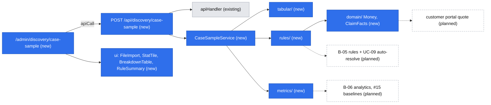

# Case sample lab (E00-T01) and the platform primitives under it

Status: draft for review. Source issue: #14 (E00-T01, epic #13). Design authority: `.ai/specs/product-brief.md`.

## 📝 TLDR
The product owner and the head of customer service need to test A01 (follow-ups are the main service cost) and A04
(≥ 35% of cases can be settled by simple rules) on ~50 recent mail/phone cases. Today (current behavior) nothing in the
app can hold, measure or rule-check historical cases, and the rules R08–R10 exist only as prose in the brief and as
mockup code. Proposed (future behavior): an admin page `/admin/discovery/case-sample` that takes an anonymised CSV,
computes the follow-up share, message exchanges and time to resolution, dry-runs R08–R10 (with what-if thresholds), and
hands back the `[DATA]` note for `.ai/specs/research/`. Nothing is stored. The page is built on reusable primitives
(rules engine, money, claim facts, metrics, tabular import, stat and rule components) that UC-09, UC-14/B-05 "Symuluj",
B-06 analytics and #15 reuse. This overrides #14's "Out of scope: building anything" (owner decision, 2026-10-22).

## 📝 Resolved decisions
Owner (Adam Adamczyk) accepted all recommendations on 2026-10-22:

| Id | Decision |
|---|---|
| Scope | Build tooling for #14 plus the primitives; catalog every primitive the backlog needs, build only those this feature uses |
| Q1 | Admin page only, no CLI |
| Q2 | Stateless: upload → compute → note; no table, nothing persisted |
| Q3 | CSV columns as listed under Data Model (whitelist; unknown columns dropped and reported); review removed `delivered_on` (unused) and requires `case_ref` to start with a letter |
| Q4 | R08–R10 read-only plus what-if threshold overrides for the settling rules, shown beside the baseline |
| Q5 | The primitives catalog lives in this spec and is promoted to `doc/platform-primitives.md` at close-out |
| Q6 | `papaparse` added to `@easyrms/core` |
| Q7 | This spec merges before the two return specs; `2026-10-22-return-customer-portal.md` reuses `Money` and `ClaimFacts` |

## 📝 Problem Statement
The brief rests on untested assumptions: A01 and A04 are both `high` importance, and Problems and Goals have no data
(Coverage: interview 0, data 0). Collection plan item 1 asks for exactly this sample. A spreadsheet would answer #14 once,
but the same machinery comes back: rule simulation is B-05 (`POST /bo/rules/simulate`), the aggregates are B-06 and #15,
and the rules engine is UC-09. Building it once, behind stable contracts, makes discovery the first consumer of the
platform instead of throwaway work.

With n ≈ 50, a share has a 95% interval of roughly ±13 points, so the note must show intervals, not bare percentages.
Otherwise a 30% result would read as "A04 failed" when 35% is still inside its range.

## 📝 Proposed Solution
1. The user downloads a CSV template, fills it from mail/phone history (anonymous rows) and uploads it.
2. The browser reads the file as text and posts it to `POST /api/discovery/case-sample`.
3. `core` parses and validates every row (all-or-nothing), projects each row to `ClaimFacts`, runs the brief's rule set
   (baseline and, when given, what-if thresholds), computes the metrics and renders the note as Markdown.
4. The page shows stat tiles, breakdowns, the rule table (baseline vs what-if) and the anonymised per-case table, and
   offers "Download note" (`YYYY-MM-DD-case-sample.md`) and "Copy". The user commits the note to `.ai/specs/research/`.

**Settling definition.** A case is *rule-settled* when at least one enabled rule with a settling action (`auto_approve`,
`keep_item`) matches. R10's actions (`high_priority`, `require_evidence`, `assign`) route or ask for evidence but do not
settle. The note also shows *agreement*: rule-settled cases whose real outcome was `approved` versus those the team
actually `rejected` (false approvals) or settled `partial`. A high settled share full of false approvals does not
support A04.

**Alternatives that lost:** a spreadsheet (one-off, no reuse; the brief's next steps need the same engine); a CLI script
(Q1: no frontend primitives exercised, harder for the head of customer service to run); persisting samples (Q2: a
personal-data surface and a migration for a one-time exercise); evaluating rules as JavaScript expressions (unsafe, and
B-05 cannot render or edit code).

**Research against market leaders.**
- [json-rules-engine](https://github.com/CacheControl/json-rules-engine) (the common OSS rules engine): we take JSON-serializable conditions,
  rule priority and "all matching rules fire". We skip async fact resolution, nested `any`/`all` trees and custom
  operators: a closed vocabulary is what a no-code builder (B-05) can render and validate.
- Returns platforms with no-code workflows (Claimlane, the brief's reference, and peers such as Loop and AfterShip
  Returns) express rules as IF conditions on return type, value, product category → THEN actions like auto-approve or keep
  item. Our vocabulary covers that shape. Testing a rule against history before enabling it is a common feature there and
  is exactly `simulate` here. Not re-checked for this spec (the brief records the benchmark as deferred).

## 📝 Architecture
New cross-cutting primitives in `core` sit next to the existing `http/` folder (they are not domain concepts, so they do
not follow the per-concept folder rule). The feature is a new `discovery` concept with a service, a validator, a route and
a page, and no `db` part.



Takeaway: everything new is pure TypeScript in `core` plus props-only components in `ui`. Planned consumers are
expected to extend these modules (new facts, condition types, a persistence layer), not replace them; their own specs
confirm or revise the contracts.

Layout:

| Path | Content |
|---|---|
| `core/src/domain/money.ts` | `Money { amountMinor, currency: "PLN" }`, `parseMoney()`, `compareMoney()`, `formatMoney()` (arithmetic such as `applyRate` is added by its first consumer, the customer-portal quote) |
| `core/src/domain/claim-kind.ts` | `CLAIM_KINDS = ["return","complaint","transport","missing"]`, `ClaimKind` (the agent spec's `kind` column uses it) |
| `core/src/domain/claim-facts.ts` | `ClaimFacts { kind, value: Money, categories: ProductCategory[] }`, `PRODUCT_CATEGORIES` |
| `core/src/rules/` | `rule.schema.ts` (Zod vocabulary), `evaluate.ts`, `simulate.ts`, `describe.ts`, `brief-rules.ts` (R08–R10 as data) |
| `core/src/metrics/` | `share()` with Wilson 95% interval, `median()`, `percentile()`, `groupBy()` |
| `core/src/tabular/` | `parseTable(text, rowSchema, { maxRows, cellGuard })` on `papaparse` |
| `core/src/services/discovery/case-sample.service.ts` | `CaseSampleService.analyze(input)` |
| `core/src/services/discovery/case-sample-note.ts` | `renderCaseSampleNote(report)` → Markdown |
| `core/src/validators/discovery/` | `case-sample-row.schema.ts`, `case-sample-analyze.schema.ts` |
| `core/src/http/parse.ts` (changed) | `parseJsonBody(request, schema, { maxBytes })`: optional byte cap, `PayloadTooLargeError` (413) |
| `app/src/app/api/discovery/case-sample/route.ts` | `POST` via `apiHandler` (a workflow endpoint, not CRUD) |
| `app/src/app/admin/discovery/case-sample/` | `page.tsx` (Server Component, rule summaries) + colocated `case-sample-lab.tsx` (client) |
| `ui/src/admin/forms/file-import.tsx`, `ui/src/admin/stats/`, `ui/src/admin/rules/` | UI primitives |

Wiring: `caseSampleService: asClass(CaseSampleService).singleton()` in `registerCore` (no dependencies, no request state).
It is added to `Cradle` and exposed through `resolveCaseSampleService()` in `app/src/server/container.ts`.

### Rules engine (the primitive with the longest life)
```ts
// Closed vocabulary, Zod-validated; JSON-serializable so B-05 can store and edit it later.
type Condition =
  | { type: "kind_in"; kinds: ClaimKind[] }
  | { type: "category_in"; categories: ProductCategory[] }        // any item category matches
  | { type: "value_lte"; amountMinor: number; tunable?: boolean }
  | { type: "value_gte"; amountMinor: number; tunable?: boolean };
type Action =
  | { type: "auto_approve" } | { type: "keep_item" }               // settling
  | { type: "high_priority" } | { type: "assign"; to: "manager" }
  | { type: "require_evidence"; evidence: "video" };   // members are added by the spec that first needs them
interface Rule { schemaVersion: 1; id: string; name: string; enabled: boolean; order: number; when: Condition[]; then: Action[] }

evaluate(facts: ClaimFacts, rules: Rule[]): RuleMatch[]   // enabled rules by `order`; all conditions AND; every match fires
simulate(cases: ClaimFacts[], rules: Rule[]): { total, matchedByRule: Record<id, number>, settled: number, perCase: RuleMatch[][] }
withThresholds(rules, overrides: Record<ruleId, amountMinor>): Rule[]   // replaces the single tunable value condition
describeRule(rule): { conditions: string[]; actions: string[]; settles: boolean }  // English text for UI and note
```
- An empty `when` matches everything; a rule with no `then` is invalid.
- `withThresholds` throws `ValidationError` for an unknown rule id or a rule without a tunable condition.
- Adding a condition type later (reason, days since delivery, supplier) is additive: one union member, one evaluator
  branch, one `describe` line. Nothing in this spec stores rules, so `schemaVersion` exists for when B-05 does.
- The vocabulary is **provisional** until the B-05 rules spec confirms it; nothing stores it before then.
- `brief-rules.ts` encodes R08 (`kind_in [return]`, `value_lte 15000` tunable → `auto_approve`), R09 (`kind_in
  [complaint, transport]`, `value_lte 6000` tunable → `keep_item`) and R10 as three rules with ids `R10a` (concept R3:
  transport → `high_priority`), `R10b` (R4: complaint ∧ electronics/appliances → `require_evidence video`) and `R10c` (R5:
  `value_gte 200000` → `assign manager`). All are enabled in the simulation; R5's "disabled in mockup" state does not affect the settled share because
  its action does not settle.

## 📝 Data Model
No entities, tables or migrations: nothing is persisted (Q2). The data-model graph is skipped for that reason.

**CSV contract** (template downloadable from the page; header row required; `,` or `;` delimiter; UTF-8 with or without BOM):

| Column | Rule |
|---|---|
| `case_ref` | required, `^[A-Za-z][A-Za-z0-9-]{0,19}$` (must start with a letter, so raw order/ticket numbers are refused: the collector assigns refs such as `S01`), unique in the file; never echoed into the response or the note (rows become `C01…Cnn`) |
| `channel` | `mail` \| `phone` |
| `kind` | `return` \| `complaint` \| `transport` \| `missing` |
| `category` | `electronics` \| `appliances` \| `home` \| `clothing` \| `hygiene` \| `other` |
| `value_pln` | ≥ 0 and ≤ 1 000 000, `149.99` or `149,99`, parsed to minor units |
| `opened_on`, `resolved_on` | `YYYY-MM-DD` or `DD.MM.YYYY`; `resolved_on` empty = still open; `resolved_on ≥ opened_on` |
| `follow_up_requests` | integer 0–50: times the team asked the customer for missing data |
| `messages_exchanged` | integer 0–200: all messages and calls in the case, both directions |
| `outcome` | `approved` \| `rejected` \| `partial` \| `cancelled` \| `open` (must be `open` when `resolved_on` is empty, and the reverse) |

Limits: ≤ 512 KB of text and 1–500 data rows. Column names are case-insensitive and trimmed.

**Sensitive data:**
- The whitelist means names, e-mails, phones, addresses and free-text comments have nowhere to go. Unknown columns are
  dropped and listed in the response by name (never their values). `delivered_on` was dropped from the contract: no
  metric or rule reads it (data minimisation).
- Second guard: `parseTable`'s `cellGuard` runs over every raw cell, including dropped columns, **before** they are
  discarded. Any cell matching an e-mail pattern, or a phone pattern after stripping spaces, dashes, dots, brackets and a
  leading `+48`/`0048` (9 digits), fails the whole upload with "row N looks like personal data" (row, never the value).
- Error messages from `parseTable`, the schemas and the service name rows and columns, never cell values, so the
  `apiHandler` error log cannot carry them.
- The committed note is **pseudonymised, not anonymous**: someone with order-system access could try to match cases.
  To make that impractical, the note shows value bands (`≤ 60`, `60–150`, `150–500`, `500–2000`, `> 2000 zł`) instead
  of exact amounts and the period by month; exact values appear only on screen. The residual risk is stated in the note.
- The CSV and the report live only in the request and the open browser tab.

## 📝 API Contracts
`POST /api/discovery/case-sample`, envelope as today, schema `caseSampleAnalyzeSchema`:

```jsonc
// request
{ "csv": "<text, ≤ 512 KB>", "thresholds": { "R08": "200,00", "R09": "60" } }   // optional, zł strings parsed by parseMoney, 0–1 000 000 zł; only R08/R09
// 200
{
  "sampleSize": 48, "period": { "from": "2026-07", "to": "2026-09" }, "droppedColumns": ["customer_name"],
  // every share below is Interval | null (null when its denominator is 0)
  "followUp": { "share": { "value": 0.42, "low": 0.29, "high": 0.56 }, "messagesMedian": 4, "messagesP75": 7, "followUpsMedian": 1 },
  "resolution": { "resolved": 45, "open": 3, "daysMedianByKind": { "return": 6, "complaint": 12 } },
  "byKind": [{ "label": "return", "count": 30, "share": 0.63, "valueMedian": "129,00 zł" }], "byChannel": [ … ], "byOutcome": [ … ],
  "rules": {
    "baseline": { "settledShare": { … }, "matchedByRule": { "R08": 14, "R10a": 3, … }, "agreement": { "approved": 12, "rejected": 2, "partial": 1, "other": 0 },
                  "definitions": [ … as below … ] },
    "whatIf": { … same shape, definitions show the overridden thresholds … } | null,
    "definitions": [{ "id": "R08", "name": "…", "conditions": ["kind is return", "value ≤ 150,00 zł"], "actions": ["auto-approve"], "settles": true }]
  },
  "cases": [{ "id": "C01", "kind": "return", "channel": "mail", "value": "89,00 zł", "followUps": 2, "messages": 5, "daysToResolve": 4, "outcome": "approved", "rules": ["R08"] }],
  "note": "<Markdown>"
}
```

Errors:
- Body over 600 KB (checked from `Content-Length` and by a capped stream read before `JSON.parse`) → 413
  `payload_too_large`.
- Body is not JSON or `csv` is missing, empty or too long → 400 `validation_error`.
- Bad rows → 400 `validation_error` with `fieldErrors` keyed `row.<line>.<column>`. At most 50 are listed, plus
  `form: "N more errors"` when there are more. Nothing is computed.
- A threshold for any rule other than R08/R09, or an unparsable amount → 400 with `fieldErrors["thresholds.<id>"]`.
- Personal-data guard hit → 400 with `fieldErrors["row.<line>"]`.

All amounts in the response are pre-formatted strings (pl-PL), so `ui` needs no money logic (it cannot import `core`).
No CSRF header check: there is no cookie auth yet, as on every other route.

## 📝 UI/UX
Admin (shadcn) page `/admin/discovery/case-sample`:
1. **Intro card:** what to collect, a "Download CSV template" link (static file in `app/public/`), and the rule
   definitions via `RuleSummary` (rendered server-side from `describeRule`).
2. **Import:** `FileImport` (drop zone + button, `.csv`, 512 KB). It reads `file.text()`. On a `U+FFFD` replacement
   character it shows "Save the file as CSV UTF-8 and try again" without calling the API. Row errors appear as a list
   (line, column, message).
3. **Results:** `StatRow` of tiles: sample size, follow-up share (with interval as a hint), median messages, rule-settled
   share baseline. `BreakdownTable`s for kind, channel and outcome. Rule table: rule, matches, settles, baseline, what-if.
   Agreement line. Per-case table via `DataTable`. A dropped-columns notice when any were dropped.
4. **What-if:** two text inputs (zł, for example `200,00`) for R08 and R09 thresholds plus "Recalculate". The CSV stays
   in memory, so it re-posts with `thresholds` as typed; the server parses them, so the page has no money logic. The what-if column is empty until used.
5. **Note:** "Download note" (Blob, `YYYY-MM-DD-case-sample.md`) and "Copy". A line tells the user to commit it to
   `.ai/specs/research/`.

States: idle (intro), parsing/calculating (`LoadingMessage`), errors (`ErrorMessage` plus the row list), results.
Leaving the page discards everything, and the page says so.

Accessibility: the drop zone is a labelled `<button>` with an equivalent file input. Tables have captions. Tile values
are text, not only colour. The result region is `aria-live="polite"`. Copy language: English.

UI primitives (props only, no data access):
- `FileImport` `{ accept, maxBytes, label, disabled?, onText(text, fileName) }`
- `StatTile` `{ label, value, hint? }`
- `StatRow` `{ children }`
- `BreakdownTable` `{ caption, rows: { label, count, share }[] }`, built on `DataTable`, which gains an optional
  `caption` prop (rendered as `<caption>`, kept when the table is empty)
- `RuleSummary` `{ rules: { id, name, enabled, conditions, actions, settles }[] }`

**The `[DATA]` note** (`renderCaseSampleNote`):
- Title: `Case sample — follow-ups and rule coverage [DATA]`.
- Header: date, n, period by month, channels, "Owner: head of customer service", source "anonymised sample, collected from
  mail/phone history".
- Findings for A01: follow-up share with its interval, the messages median and p75, plus the brief's suggested kill
  line (< ~20%), marked as not agreed.
- Findings for A04: the settled share with its interval versus 35%, agreement, and what-if if used.
- Per-case table (`C01…`) with value bands, not exact amounts.
- Breakdowns.
- Method and limits: the settling definition, the R08–R10 versions, sample size, and the pseudonymisation note (no
  direct identifiers; bands and months reduce, but do not remove, re-identification risk).

## 📝 Edge Cases & Failure Scenarios
- **Oversized or CPU-heavy upload:** the body is capped before `JSON.parse` (413); ≤ 500 rows and pure functions, so
  analysis runs in milliseconds.
- **Excel exports:** a `;` delimiter, a BOM, a `,` decimal and `DD.MM.YYYY` dates are all accepted. Any other encoding is
  rejected client-side (U+FFFD) and server-side (the same check), with a message.
- **Duplicate `case_ref`:** a row error on the second occurrence.
- **Open cases:** counted in n and follow-ups, excluded from time-to-resolution, and the note says how many.
- **Zero cases of a kind:** the breakdown row is omitted and medians are `—`, never `NaN`.
- **Empty or one-row files:** the interval is still computed (Wilson behaves at n = 1). An empty file is an error.
- **Database unreachable:** the route still needs the container, which builds the ORM on first use, so the lab fails
  with the usual 500 like every other route. This is accepted; documented in Risks.
- **Personal data:** a guard hit fails the upload and names the row, not the value.
- **What-if for another rule:** 400; the UI only offers R08 and R09.
- **A real order number in `case_ref`:** refused by the leading-letter rule, with a hint to number cases `S01…`.

## 📝 Risks & Impact Review
Evidenced deviations from repository rules, each approved by the owner as part of this spec's purpose:
- **Component placement** (`doc/engineering-standards.md` §2 rule 4, "used by one page → colocate"): `FileImport`,
  `StatTile`/`StatRow`, `BreakdownTable` and `RuleSummary` have one consumer today but go to `ui/src/admin/`. Building
  shared primitives ahead of their second consumer is the explicit goal of this spec (owner, 2026-10-22); each has a
  named second consumer in the catalog (B-05, B-06).
- **YAGNI** (§4): the catalog's "design" rows are documentation only; nothing is built for them.

Otherwise no violations found against `AGENTS.md`, `doc/code-review-checklist.md` or `BACKWARD_COMPATIBILITY.md`. The
changes are additive: a new route, a new page, an optional `parseJsonBody` cap, an optional `DataTable` caption and no
schema change. New primitive folders sit beside `http/` and are not concept folders.

Product direction calls and accepted risks:
- **Overrides #14's out-of-scope line** (owner decision 2026-10-22). This is recorded on the issue (comment of
  2026-10-22). The `[DATA]` note is still the issue's done-when, and the page only produces it.
- **No admin authentication** (existing, carried by both return specs). Anyone who can reach `/admin` can use the lab.
  Low impact: nothing is stored or readable afterwards, and uploads are anonymous by contract.
- **Heuristic personal-data guard:** it cannot catch every identifier (for example a name typed into `case_ref` within the
  regex). The column whitelist is the real control, and the guard is a backstop.
- **Container needs the database:** the stateless lab still fails when Postgres is down. A DB-free scope would be a new
  composition path for one page; not worth it now.
- **Contracts that later become hard to reverse:** the rule vocabulary, `ClaimKind`/`ProductCategory` values and `Money`
  in minor units. Nothing stores them in this spec, so they stay provisional; they harden when B-05 or the return specs
  persist them, and those specs must confirm or revise them first.
- **New dependency:** `papaparse` (+ `@types/papaparse`) in `core` is framework-agnostic and well maintained. It must pass
  `npm run audit`.

## 📝 Decisions in play
- **Relies on:** R08, R09 and R10 (encoded as data, values unchanged); A01, A04 and Q02 (the hypotheses this tests);
  Q12 (rules only, no AI); Collection plan item 1; N01–N04 (untouched).
- **Supersedes:** no brief entry. The #14 scope override is an issue-level change, approved by the owner (Adam Adamczyk).
- **Writes back:** none automatically. The owner records results in the brief's Riskiest assumptions `Result` column after
  reading the note.

## 📝 Platform primitives catalog
Taken from UC-01…UC-15, screens K/Z/B/D/X and the API catalog (`docs/05`) via the brief. Primitives marked "design"
are **non-binding proposals**: a sketch of the contract, built and approved by the first spec that needs it (YAGNI,
`doc/engineering-standards.md` §4). Approving this spec does not approve them. That spec starts from the sketch and
may change it, but should not build a parallel mechanism. Promoted to `doc/platform-primitives.md` at close-out as a
map of the platform, with the same non-binding status.

### Backend (`core`; persistence in `db`)

| Primitive | Contract sketch | Consumers in the backlog | Status |
|---|---|---|---|
| Rules engine | see Architecture: closed, provisional `Condition`/`Action` vocabulary, `evaluate`, `simulate`, `withThresholds`, `describeRule` | UC-09, UC-14/B-05, R07 evidence, R10 routing | **this spec** |
| `ClaimKind`, `ProductCategory`, `ClaimFacts` | normalized rule input: kind, value, categories; later + reasons, days since delivery, supplier | rules, eligibility (UC-02…05), quote (Z-04) | **this spec** |
| `Money` | integer minor units, `PLN` only for now; parse (pl/en), compare, format pl-PL; arithmetic added by its first consumer | quote, R11 limits, refunds, supplier notes, analytics | **this spec** |
| Metrics | `share` (Wilson 95%), `median`, `percentile`, `groupBy` over plain rows | B-06, #15 KPI baselines, this report | **this spec** |
| Tabular import | `parseTable(text, rowSchema, { maxRows, cellGuard }) → rows \| errors[{ line, column, message }], droppedColumns` | this lab; later bulk import / B2B (N01) | **this spec** |
| State machine | `defineStateMachine({ states, transitions, guards }) → { can, assert, next }`; throws `ConflictError` | claims (9 statuses; the agent spec's table becomes its first instance), supplier claims DRAFT→SENT→ACCEPTED/REJECTED→CREDITED, uploads | design |
| Domain events + timeline | `DomainEvent { id: "concept.entity.action", aggregateId, actor, at, payload }`; one typed in-process emitter in `core/src/events`; timeline = events projected per aggregate | K-05, B-02, R11 audit, mail triggers | design |
| Ports & adapters | `<Name>Port` + mock adapter, env-selected, fail closed in production | `OrderLookup`, `MailPort` (customer spec), carrier, payments, vouchers, AV scan | design |
| Policy settings | typed, clamped settings with an effective date ("applies to new claims") | B-07, R01, R03, R12 | design |
| Business calendar / SLA | `addBusinessDays`, `dueAt`, `escalateAt` (holiday calendar pluggable) | Q10 2-day target, R04 14 days, Q07 escalation | design |
| Evidence requirements | `requirements(facts, product, supplier, rules) → { photos, video, serial, sources[] }`, using the rules engine's `require_evidence` | Z-03, R07, Q14 | design |
| Attachments | upload intent → scan → ready/error; per-type limits (`docs/05` §5.9) | Z-03, K-05 messages, B-03, D-01 | design |
| Identity & permissions | actors `customer`/`agent`/`warehouse`/`supplier`/`system`; permissions (`MANAGE_RULES`, Q05); per-record scope check | every shell; agent-auth prerequisite | design |
| Reference numbers | sequence-backed `PREFIX-YYYY-NNNNN` | RMA (agent spec), `SC-` supplier claims | design |
| Notifications & templates | template id + variables (`{imie}`, `{rma}`) rendered and sent via `MailPort` | B-02, B-07, status mails | design |
| Idempotency & rate limiting | idempotency key per mutation; limiter port (in-memory first) | Z-06 submit, K-01/K-04 lookup (R14) | design |

### Frontend (`ui`; admin = shadcn, public = Tailwind)

| Primitive | Where | Consumers | Status |
|---|---|---|---|
| `FileImport` | `ui/src/admin/forms/` | this lab; later B-03, B-07 | **this spec** |
| `StatTile`, `StatRow` | `ui/src/admin/stats/` | this lab, B-06 KPI tiles | **this spec** |
| `BreakdownTable` | `ui/src/admin/stats/` | this lab, B-06 "show as table" | **this spec** |
| `RuleSummary` | `ui/src/admin/rules/` | this lab, B-05 list, B-02 "applied rules" | **this spec** |
| `Wizard` / stepper | `ui/src/public/wizard/` | Z-01…Z-06, Z-00 | design |
| `StatusTracker` | `ui/src/public/tracker/` | K-05 | design |
| `Timeline` | `ui/src/admin/timeline/` | B-02, K-05 | design |
| `Inbox` filters + SLA badge | `ui/src/admin/inbox/` | B-01, B-03, B-04, D-01 | design |
| `RuleBuilder` (drawer) | `ui/src/admin/rules/` | B-05 | design |
| `EvidenceUpload` | `ui/src/public/evidence/` | Z-03, K-05 | design |
| `formatMoney` for client-side amounts | `ui/src/lib/` | the first client-side amount (wizard quote preview) | design |

## 📋 Phasing
- **Phase 1: core primitives.** Domain types, money, rules engine, metrics, tabular import. Pure and unit-tested; nothing
  consumes them yet, so the app is unchanged.
- **Phase 2: case sample backend.** Schemas, `CaseSampleService`, note renderer, container wiring, route.
- **Phase 3: UI primitives and the lab page.**
- **Phase 4: close-out.** Catalog promoted to `doc/`, docs, lessons, spec moved.

## 📋 Implementation Plan
Every step ends with the validation gate (`typecheck`, `test`, `lint`, `audit`, production build). Tests are Vitest in
`@easyrms/core`.

### Phase 1: Core primitives
1. **Domain types and `Money`.** `claim-kind.ts`, `claim-facts.ts` (with `PRODUCT_CATEGORIES`) and `money.ts`, exported
   from `core/src/index.ts`. Tests: parse `149,99`/`149.99`/`1 299,00`, reject negatives and > 2 decimals, safe-integer
   overflow, compare, pl-PL formatting.
2. **Rules engine.** `rule.schema.ts`, `evaluate.ts`, `simulate.ts`, `with-thresholds.ts`, `describe.ts` and
   `brief-rules.ts`. Tests:
   - Each condition at its boundary: `value_lte` 150.00 matches, 150.01 does not.
   - Every matching rule fires, in `order`; disabled rules are skipped; an empty `when` matches.
   - `settles` is true only for `auto_approve`/`keep_item`.
   - `withThresholds` replaces only the tunable value and rejects unknown or non-tunable ids.
   - R10's three rules have ids `R10a`–`R10c`.
   - `brief-rules` parses with the schema and every rule has a description.
3. **Metrics.** `share` (Wilson, including n = 0 → `null` and n = 1), `median`/`percentile` on even and odd sets and on
   empty → `null`, `groupBy`. Tests against hand-computed values.
4. **Tabular import.** Add `papaparse` and `@types/papaparse` to `@easyrms/core`. `parseTable` handles header
   normalization, `,`/`;`, BOM, U+FFFD rejection, dropped columns, per-row Zod errors keyed by line, the max row count, and
   `cellGuard` over raw cells before columns are dropped. Tests use small inline CSVs for each case, including PII present
   only in a dropped column, and assert that no error message contains a cell value.

### Phase 2: Case sample backend
1. **Body cap and schemas.** `PayloadTooLargeError` (413) in `core/src/errors.ts` and an optional `maxBytes` on
   `parseJsonBody` (`Content-Length` check plus a capped stream read; existing callers unchanged). `caseSampleRowSchema`
   (Data Model contract, both date formats, leading-letter `case_ref`, outcome ↔ `resolved_on` consistency) and
   `caseSampleAnalyzeSchema` (size limit, zł threshold strings for R08/R09 only). Tests: oversized body with and without
   `Content-Length` → 413; each column's invalid/valid edge; the consistency rules.
2. **`CaseSampleService.analyze`.** Parse (with the personal-data `cellGuard`) → unique `case_ref` → facts → baseline and what-if
   simulation → agreement → metrics → anonymised cases → note. Uses a synthetic fixture `__fixtures__/case-sample.csv`
   (~12 rows covering every kind, an open case and a rule boundary). Tests: exact counts on the fixture (including `byOutcome`),
   the guard (e-mail and a formatted phone such as `+48 600-123-456` in a dropped column), duplicate ref, `case_ref` absent
   from the output and the note, what-if changes only the what-if block and carries its own definitions, shares are
   `null` for empty groups.
3. **Note renderer.** `renderCaseSampleNote` produces the sections from UI/UX. Tests: the `[DATA]` tag, interval text,
   the "not agreed" kill-line remark, `—` for empty medians, no raw `case_ref`, value bands and months only (no exact
   amount or day appears).
4. **Wiring and route.** `registerCore` singleton, `Cradle` entry, `resolveCaseSampleService`, and
   `app/src/app/api/discovery/case-sample/route.ts` using `apiHandler` + `parseJsonBody` with `maxBytes` (`force-dynamic`). Test: the
   service-level tests cover behavior; a manual `curl` against `npm run dev` checks 200, 400 with row `fieldErrors`, and
   400 for the guard.

### Phase 3: UI primitives and the lab page
1. **UI primitives.** Optional `caption` on `DataTable` (existing callers unchanged), then `FileImport`,
   `StatTile`/`StatRow`, `BreakdownTable`, `RuleSummary`, exported from `@easyrms/ui/admin`, each with a story in `ui/src/storybook/`
   (`2026-10-22-storybook-integration.md`). Acceptance: stories for `FileImport` (idle, dragging, too large, wrong
   encoding, disabled), `StatTile` (with and without hint), `BreakdownTable` (rows, empty with caption) and
   `RuleSummary` (settling and non-settling rules), with no Accessibility-panel violations in light and dark; manual
   check that keyboard-only file selection works.
2. **Lab page.** `page.tsx` (Server Component with rule summaries and the template link; template at
   `app/public/case-sample-template.csv`) and `case-sample-lab.tsx` (upload → results → what-if → download/copy).
   Acceptance (manual, recorded in `.ai/runs/`): the fixture renders the expected tiles; a bad row lists its
   line/column; what-if R08 = 200 zł changes only the what-if column; the downloaded note opens and contains no `case_ref`.

### Phase 4: Close-out
1. **Docs.** Promote the catalog to `doc/platform-primitives.md` and link it from `doc/engineering-standards.md` §2 and
   from `AGENTS.md` ("Reusable API & UI layer"). Update `AGENTS.md` "Current state" with the lab. No new env variables,
   so the README only gets a line about the lab.
2. **Issue.** Comment on #14: the lab exists, how to use it, the done-when is unchanged (the note in `.ai/specs/research/`).
3. **Close-out.** Add lessons to `.ai/lessons.md` and move this spec to `.ai/specs/implemented/`.
