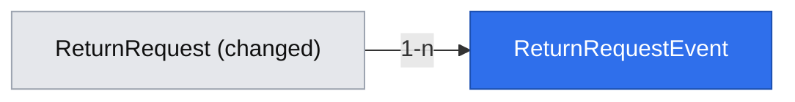

# Return agent decision: status model, timeline, inbox and decision card

Status: Approved. Decisions P1–P3 confirmed by the owner in session on 2026-10-23; revised after the architectural review and re-audit the same day. It builds on the catalog section of the case-sample lab spec (documentation only; there is no code dependency on the lab, so Phase 1 is not blocked on the lab being implemented).

## 📝 TLDR
Support agents who process return requests need a controlled workflow instead of an unconstrained status select. Today (current behavior) `/admin/returns` lists requests and lets anyone set any of five statuses in any order, with no history and no notion of an agent decision. Proposed (future behavior): a nine-status model with an enforced state machine, an RMA number, a per-request timeline, an inbox with a two-business-day due marker, and a decision card (approve, reject with a reason, then move the return manually through shipping to resolved). The existing public form keeps working unchanged. This is the first of two specs; the customer wizard and tracker are in `2026-10-22-return-customer-portal.md`, which depends on this one.

## 📝 Resolved decisions
From the brief and from accepting the proposals for this slice (2026-10-22):

| Id | Decision |
|---|---|
| Q04 | Evolve `ReturnRequest` by migration (`kind`, new statuses, `requested` → `submitted`); no parallel `Claim` entity |
| Q05 | Manager is a `MANAGE_RULES` permission on `AGENT`; nothing in this spec needs it yet (no rules screens) |
| Q06 | Agent read-only preview of the customer tracker belongs to the customer spec |
| Q07 | Escalation after 10 days is complaint-only (R04) and out of scope |
| AD-A1 | Agent moves a return manually `approved → in_transit → received → resolved` (no carrier or warehouse integration) |
| AD-A2 | No agent login in this spec; a separate prerequisite spec; flagged as a risk |
| Q10 | "We'll reply within 2 business days" is an internal target; surfaced to agents as a due marker |
| Q12 | No recommendation engine (rules or AI) in this slice |
| AD-N3 | UI copy in Polish (the whole app is Polish-only, decision D07 in the product brief, confirmed by Adam Adamczyk 2026-10-23); strings colocated per page in one constant object; `ui` components take all text through props and keep no default strings |
| AD-N4 | Vitest approved for `@easyrms/core` (pure unit tests) with root `npm test` in `validation.commands`. **Already done** (commit `be8c37a`); `app` and `ui` have no runner, so logic that needs tests lives in `core` and reaches components as props |
| AD-R1 | Agent side and customer side are separate specs |

Added after review 2026-10-23, **confirmed by the owner in session on 2026-10-23** (P1, P2, P3 and P4 below; P4 adopted on the owner's instruction to apply the audit's suggestions):

| Id | Decision |
|---|---|
| P1 | This spec builds `defineStateMachine` and `addBusinessDays`/`dueAt` in `core` as the first instances of the catalog primitives in `2026-10-22-case-sample-lab-and-platform-primitives.md` (small, pure). The events table stays per concept (`return_request_events`); a generic domain-event emitter is not built here, and the catalog row is amended to say so |
| P2 | The rollback is **forward-only after first agent use** (see Data Model); the PR states this |
| P4 | Raw SQL is limited to the `nextval('return_rma_seq')` call and the migration (neither can use the entity API), both parameterised and inside `db`; the conditional status UPDATE uses `em.nativeUpdate` and its affected-row count, so compare-and-set stays on a MikroORM API (adopted on the owner's instruction of 2026-10-23 to apply the audit's suggestions; `doc/engineering-standards.md` §5 "no raw SQL concatenation" is respected) |
| P3 | No database test runner is added. Logic is tested in `core` against an in-memory fake of the repository port; the migration and the concurrency guard are verified by a scripted manual run recorded in `.ai/runs/` |

## 📝 Problem Statement
The concept's agent flow (UC-10) assumes a defined status model and an auditable decision. The current code allows any status change from any status (`return-status-actions.tsx` offers the whole enum), records no history, and has no reference number to quote to a customer. That the ensuing follow-up is the main support cost is an unproven assumption (A01); this spec only builds the workflow that makes decisions consistent and auditable, so the later sample and KPI baselines have something to measure against.

## 📝 Proposed Solution
Evolve the existing `returns` concept in place:

- `core`: a status enum of nine values, a transition table built with `defineStateMachine` (`{ can, assert, next, allowed }`, throws `ConflictError`), `addBusinessDays`/`dueAt`/`overdue` pure functions (all take the clock as a parameter), and `ReturnService.transition(id, status, note?)` enforcing both plus the reject-note rule.
- `db`: a migration adding `rma`, `kind`, `decision_note`, a `return_request_events` table and the status rewrite; the repository writes an event for every change.
- `app`/`ui`: `/admin/returns` becomes an inbox (RMA, status, due marker, status filter) and `/admin/returns/[id]` a decision card with timeline and only the allowed actions.

Alternatives that lost: a new `Claim` entity (duplicates the concept, brief Q04); keeping the free status select and only adding history (does not give the agent a decision workflow, leaves invalid states reachable).

## 📝 Architecture
Primary module: the existing `returns` concept across `db`, `core`, `app`, `ui`. No new ports and no new dependencies. Reused: `apiHandler`, `makeCrudRoute` (PATCH only; `GET /api/returns` is written with `apiHandler` directly because `makeCrudRoute`'s `list` handler never receives the `Request` and so cannot read `?status=`, and standards §2 allows workflow routes on `apiHandler`; the shared layer is not extended), `DataTable`, feedback components, `apiCall`, the Awilix request scope, `ConflictError`/`NotFoundError`/`ValidationError`. New in `ui` (no dependency): `Timeline` and `Textarea`, see UI/UX. The generic primitives live in `core/src/state-machine/` and `core/src/calendar/` (cross-cutting, beside `http/`, not concept folders, so the naming table does not apply).

- **Status model** (lower snake_case, matching the existing convention): `submitted`, `awaiting_customer`, `approved`, `in_transit`, `received`, `in_service`, `resolved`, `rejected`, `cancelled`. Allowed transitions in this spec: `submitted → approved | rejected`, `approved → in_transit`, `in_transit → received`, `received → resolved`. The other three values exist for later specs (ask-for-info, repair, customer cancel) and have no transitions yet. Any other move throws `ConflictError` (409). Legacy rows map `requested → submitted`, `refunded → resolved`; `approved`, `rejected`, `received` are unchanged.
- **Reject rule** (R15): `rejected` requires `decisionNote` of at least 30 characters (trimmed); approval accepts an optional note through the API only (the card has no approve-note field in this slice). A short reject note is a `ValidationError` (400 `validation_error`, `fieldErrors.decisionNote`); no 422 error class exists today and none is added (it would be a breaking error-status change).
- **RMA**: `formatRma(sequence, createdAt)` in `core` produces `RMA-YYYY-NNNNN`, generated from a Postgres sequence (`return_rma_seq`), monotonic and not reset per year, unique index. `YYYY` is the year of `created_at` in `Europe/Warsaw` (backfilled rows use their own `created_at`; the SQL backfill uses `extract(year from created_at at time zone 'Europe/Warsaw')`, so app and migration agree around New Year, with a boundary test for 31 Dec 23:30 UTC), so the year is informational and the sequence is the identity. `NNNNN` is zero-padded to at least 5 digits and grows beyond that (`formatRma(7, …)` → `RMA-2026-00007`, `formatRma(100000, …)` → `RMA-2026-100000`, unit-tested); the column is `varchar(32)`. Assigned on create (also by the legacy form's path); the backfill assigns numbers in `created_at` order, ties broken by `id`, and the migration formats each RMA with the same `formatRma` logic (a TypeScript loop in the migration; `db` may import `core`), never SQL `lpad`, which would truncate `100000` to `10000`.
- **Due marker**: `dueAt(createdAt) = addBusinessDays(createdAt, 2)` (Mon–Fri in `Europe/Warsaw`, no holiday calendar, time of day kept; expected values: Thursday +2 → Monday, Friday +2 → Tuesday, Saturday +2 → Tuesday, Sunday +2 → Tuesday); `overdue(status, dueAt, now)` takes `now` as an argument and is true when `status = submitted` and `now` is past `dueAt`. A display aid only; no escalation or notification.
- **Transition concurrency**: the repository's `transition(id, from, to, note)` runs in one transaction: `em.nativeUpdate` of `{ id, status: from }` to `status: to` (P4), then inserts the event only if one row was updated. It returns `{ result: "moved", request } | { result: "conflict", currentStatus } | { result: "not_found" }` (on zero rows it re-reads the stored status in the same transaction); the service maps `conflict` to `ConflictError` (409) carrying `currentStatus` and `not_found` to `NotFoundError`. Status change and event are therefore atomic and never diverge. `ReturnService.transition(id, status, note?)` validates with the state machine against the status it read, then calls the port's `transition(id, from, to, note)` with that `from`. Names are fixed: service `transition(id, status, note?)`, port `transition(id, from, to, note)`; the portal spec's prerequisite `transition()` is the service method.
- **Types and read paths**: the domain `ReturnRequest` (mapped in `db`) is `{ id, rma, kind, orderNumber, customerEmail, reason, status: ReturnStatus | "unknown", hasDecisionNote, createdAt, updatedAt }`; the service builds `ReturnListItem = ReturnRequest & { dueAt, overdue, allowedTransitions }` from the clock (these three are never mapped in `db`); `findDetail(id)` returns `ReturnDetail = { request, decisionNote, events[] } | null` and is the only read that includes the note; `ReturnService.getDetail(id)` throws `NotFoundError`, which the card turns into `notFound()`. `updateStatus` and `findById` leave the port and the service's `updateStatus` is renamed: the port's `transition` replaces the former and `findDetail` the latter. `?status=` is validated against the nine values plus `unknown` (corrupt rows can be listed); anything else is 400 `validation_error`.
- **Timeline**: one `return_request_events` row on creation (`type = submitted`, `actor = system` for the legacy form) and on every status change (`type = status_changed`, `actor = agent`, from/to status, note). Agents are anonymous (AD-A2), so `actor = agent` carries no identity.

## 📝 Data Model
Changes to `return_requests` (expand, then migrate; not purely additive, because the status rewrite changes the meaning of existing values). Migration order, in one transaction: create the sequence → add `rma` nullable → backfill `rma` (in `created_at`, `id` order), `kind`, and the status rewrite → insert the synthesized `submitted` events → set `rma` `not null` and create the unique index.

| Column | Change |
|---|---|
| `rma` varchar(32) | new, `not null` (after backfill), unique, from the sequence |
| `kind` varchar(16) | new, default `return`; typed as the literal `"return"` for now |
| `status` varchar(32) | default `submitted`; existing values rewritten by the migration; unknown values rejected in code |
| `decision_note` text | new, null |

New table `return_request_events`: `id`, `return_request_id` (FK, restrict), `type` (`submitted` | `status_changed`), `from_status` null, `to_status`, `note` null, `actor` (`customer` | `agent` | `system`), `created_at`. The `customer` actor is reserved for the customer spec.

Sensitive data: no new personal fields. `decision_note` is free text about a customer's purchase, and `return_request_events.note` copies it, so both follow one rule:
- never logged: the 400 and 500 paths build their log context from ids and statuses only, never from the request body or a Zod issue that echoes input; because `apiHandler` logs `{ error }` verbatim today and driver errors can embed bound SQL values, Phase 1 step 1 changes its 500 path to log `error.name` and a fixed message ("Unhandled API error") only, with no `error.message` and no stack text, because driver errors embed bound values (additive, BC §3 checked, with a test: a thrown error whose message contains a recognisable note leaves it out of the logger call);
- shown only on the agent card (and later to the owning customer);
- `GET /api/returns` (the list) returns only `hasDecisionNote: boolean`; the note text is read only for one request, by the card's Server Component through the service.

Migration: a new hand-written MikroORM migration (the sequence and backfill are not in the entity model); the merged one is not edited and has no `down`, so this is the first to define one. `db/src/migrations/.snapshot-easyrms.json` is updated, and the new `return-request-event.entity.ts` is added to `entities/index.ts` (which drives the ORM config), so the next `migration:create` does not diff wrongly. The status rewrite in one migration is a deliberate departure from expand → migrate → contract (`BACKWARD_COMPATIBILITY.md` §2) for a pre-1.0 private package with no other deployed consumer; P2 and the PR rollback note cover the consequence. **Rollback is forward-only after first agent use.** `down` restores the old columns, drops the new ones and maps `submitted → requested`, `resolved → refunded`, but it refuses to run (throws, changes nothing) when any row is in `in_transit`, `awaiting_customer`, `in_service` or `cancelled`, or any `return_request_events` row other than the synthesized and creation events exists, because that would lose agent work. For the same reason `resolved → refunded` is only trusted before first use; the PR description states both limits.

## 📝 API Contracts
Envelope and schemas as today (`core/src/validators/returns/`); the same-origin/CSRF check on mutating routes is added by `2026-10-22-return-customer-portal.md` (Phase 1 step 0), nothing validates the header yet.

| Route | Change |
|---|---|
| `GET /api/returns` | optional `?status=` filter; each item adds `rma`, `kind`, `hasDecisionNote`, `dueAt`, `overdue`, `allowedTransitions` (additive; no note text in the list) |
| `PATCH /api/returns/[id]` | body `{ status, decisionNote? }`; success → 200 with the updated `ReturnListItem` (same shape as a list item, no note text); invalid transition or lost race → 409 `conflict` whose `fieldErrors.status` carries the stored status (`ConflictError` gains an optional second argument `fields`, additive, same shape as `ValidationError`); reject without a ≥ 30-character note → 400 `validation_error` with `fieldErrors.decisionNote`; unknown id → 404 |
| `POST /api/returns` | unchanged request; response gains `rma` (additive); new rows are `submitted`. The customer spec later replaces this request and response (its PR C), see its Migration & Backward Compatibility section |

See "Migration & Backward Compatibility" below. In short: the `status` value set changes (`requested`/`refunded` replaced), which is breaking for the PATCH request and every response containing `status` (`BACKWARD_COMPATIBILITY.md` §1). All in-repo consumers (the admin page, `ReturnStatus` badge map, status actions) are updated in the same PR and the PR body lists it under "Breaking changes".

## 📝 UI/UX
Only what is unique; list and card reuse `DataTable`, `Card`, `Badge`, `Button`, `Input`, feedback components. Two components do not exist yet and are built by this spec:

- **`Textarea`** (`ui/src/admin/textarea.tsx`, added with `npx shadcn@latest add textarea`; a plain element, no new dependency). Story (`ui/src/storybook/admin/textarea.stories.tsx`): default, disabled, invalid.
- **`Timeline`** (`ui/src/admin/timeline/timeline.tsx`): props `{ events: { id, label, actor, at, note? }[]; emptyMessage }`, rendered as an ordered list, newest last, `at` is a pre-formatted string (formatting happens in `core`/`app`, not in `ui`). Story (`ui/src/storybook/admin/timeline/timeline.stories.tsx`): empty, one event, several events with and without a note. It is the first instance of the catalog's `Timeline` primitive in `2026-10-22-case-sample-lab-and-platform-primitives.md` (marked there as built by this spec); the customer tracker reuses it with a public variant.

- **Inbox:** RMA, order, customer e-mail, status badge, due marker (red "Overdue" for overdue `submitted` rows), `?status=` filter links; newest first. `ui` is Next-free, so the filter is rendered in `app` with `next/link` around plain `Badge`/`Button` styling; no link abstraction is added to `ui`.
- **Card:** order and customer details, legacy reason when present, timeline, and one button per allowed transition only. Reject opens a required note field with a live ≥ 30-character counter and a disabled submit until valid; this is a bespoke form because `CrudForm` has no hook for the counter or its `aria-live` announcement (stated reason, per the review checklist). After a 409 the card refreshes and shows the current status with a short message.
- **Accessibility:** labelled inputs, the counter announced through `aria-live="polite"`, buttons are real `<button>`s with visible focus.
- **Copy language:** Polish (AD-N3): status names, "Po terminie" for the overdue marker, the reject-note counter and every message. Status values stay language-neutral; labels are a colocated constant in the page.

## 📝 Edge Cases & Failure Scenarios
- Two agents act at once: both may pass the state-machine check on the status they read; the conditional `UPDATE … WHERE status = :from` lets only one succeed, the other gets 409 with the current status and writes no event; the card refreshes.
- Reject note shorter than 30 trimmed characters: 400 `validation_error`, nothing written, no event.
- Legacy rows: mapped statuses, backfilled RMA and a synthesized `submitted` event dated `created_at`, so every row has a timeline.
- Concurrent creates (legacy form): RMA comes from the sequence, so no duplicates; a gap is possible after a rolled-back insert and is acceptable.
- Migration failure: one transaction, the schema is unchanged.
- Unknown status in the database (hand edit): the mapper does not fall back to `submitted` (that would make a corrupt row approvable). It keeps the row in the list with status `unknown` (badge "Nieznany", no actions, `allowedTransitions` empty), logs once per list call with the row id, never throws in the list; `PATCH` on it returns 409.

## 📝 Risks & Impact Review
Evidenced violations of repository rules: none found against `doc/engineering-standards.md` and `BACKWARD_COMPATIBILITY.md`; the breaking `status` change follows the required path above.

Product direction calls and accepted risks:
- **No agent authentication (AD-A2):** anyone reaching `/admin` or `PATCH /api/returns/[id]` can approve or reject, and events cannot name the agent. Acceptable only while the app is not exposed publicly; the auth spec must land before a public deployment.
- **Hard-to-reverse:** the status value names and the `rma` format and sequence become long-term contracts.
- **Rollback:** forward-only after first agent use (P2); `down` refuses rather than lose the timeline or `decision_note`. Before first use it is a safe approximation.
- **No UI test runner:** `Timeline` and the reject-note form are verified by stories and manual acceptance; the note-length rule and the due marker are tested in `core`.

## 📝 Decisions in play
Relies on: R13 (one request = one type, one order), R15 (reject reason ≥ 30 characters), D06 (narrowed to this slice by Q13). Supersedes nothing. Owner for confirmation: Adam Adamczyk.

## 📝 Migration & Backward Compatibility
All five surfaces of `BACKWARD_COMPATIBILITY.md` were checked against every phase; no Critical violation. The PR body lists "Breaking changes" and the rollback note (P2).

| # | Surface | Phase/step | Change | Path |
|---|---------|-----------|--------|------|
| 1 | §1 HTTP API | P1 step 2 | `status` value set replaced (`requested`, `refunded` out; `submitted`, `awaiting_customer`, `in_transit`, `in_service`, `resolved`, `cancelled` in) in the PATCH request and every response with `status` | In-repo consumers updated in the same PR; listed as breaking |
| 2 | §1 HTTP API | P1 step 2 | PATCH enforces the state machine (409 `conflict`, with `fieldErrors.status`) and the reject-note rule (400 `validation_error`) for calls that used to succeed; `decisionNote` is a new optional field | Listed as breaking; no dual-run window is practical pre-1.0 |
| 3 | §1 HTTP API | P1 step 2 | `GET /api/returns` gains `rma`, `kind`, `hasDecisionNote`, `dueAt`, `overdue`, `allowedTransitions` and optional `?status=`; `POST` response gains `rma`; the 409 envelope gains `fieldErrors.status` | Additive |
| 4 | §2 Database | P1 step 2 | New columns, `return_request_events`, `return_rma_seq`, in-place status rewrite, `rma` `not null` after backfill, unique index, first `down` | Single migration (departure from expand/migrate/contract, stated under Data Model); snapshot updated; forward-only after first agent use (P2) |
| 5 | §3 Internal packages | P1 steps 1–2 | `RETURN_STATUSES`/`ReturnStatus` change; `ReturnRequest` gains fields and `status` widens with `"unknown"`; `ReturnRepository` gains `list`, `transition`, `findDetail` and loses `updateStatus`/`findById`; `ReturnService` changes and takes `clock`; `ConflictError` gains an optional `fields` argument; `apiHandler` 500 path logs less (additive); `returnStatusUpdateSchema` changes | Consumers updated in the same PR (typecheck, lint green): `db` repository, the `core` test fake, `admin/returns/page.tsx`, `return-status-actions.tsx`, `api/returns/[id]/route.ts`, `api/returns/route.ts` |
| 6 | §4 Config / scripts | all | No variable or script added or renamed | Untouched |
| 7 | §5 Process | P2 step 4 | Spec moves to `implemented/`; run logs named `YYYY-MM-DD-slug.md` | Compliant |

## 📋 Phasing
- **Phase 1:** additive primitives; then the status cut-over (state machine, migration, repository, routes, existing admin page) as one change set; then the scripted Postgres run as the merge gate (backend, legacy form keeps working).
- **Phase 2:** agent inbox and decision card.

## 📋 Implementation Plan
### Phase 1: Status model and timeline
Dependencies: none beyond the current code; no code from the case-sample lab spec is used.
Step 2 is one commit that ends with the full gate green (`typecheck`, `test`, `lint`, `build`); it is not proven working until the step 3 Postgres run, which is a pre-merge gate, and no intermediate commit is deployed. The `.ai/scripts/` script is written within the PR and its commit is part of step 3. Step 1 is purely additive and green on its own.
1. **Additive `core` pieces (no change to `RETURN_STATUSES`).** `defineStateMachine` in `core/src/state-machine/`; `addBusinessDays`/`dueAt`/`overdue(status, dueAt, now)` in `core/src/calendar/` (`Europe/Warsaw`, clock passed in); `formatRma(sequence, createdAt)`; `toReturnStatus(value)` → `ReturnStatus | "unknown"`; `formatEventTime` (pl-PL, `Europe/Warsaw`); `ConflictError`'s optional `fields` argument; the `apiHandler` 500-path logging change. `overdue` and `toReturnStatus` are typed over `string` (and `defineStateMachine` generically), so step 1 compiles against the old five-value `ReturnStatus`. Tests: `defineStateMachine` with a small local table (every allowed move, forbidden moves, `allowed(status)`, `ConflictError` on `assert`); the weekday table (Thu/Fri/Sat/Sun +2) and DST in Warsaw, `overdue(status: string, dueAt, now)` compares the status with the literal `"submitted"` (so it compiles before the enum changes) and is false for any other string, with the boundary at exactly `dueAt`; `formatRma` padding, growth to six digits and the 31 Dec 23:30 UTC year boundary; `toReturnStatus` for a value in the supplied list, a legacy value and garbage; `ConflictError` carrying `fieldErrors.status` through `apiHandler`; a thrown error containing a recognisable note never reaches the logger call.
2. **Status cut-over (one change set).** In `core`: `RETURN_STATUSES` (9), the return transition table via `defineStateMachine`, the reject-note rule in the schema and service, `ReturnService` (`updateStatus` renamed `transition`, plus `getDetail`, `list` building `ReturnListItem`, `clock` registered in `registerCore` as `asValue(() => new Date())`), the repository port as defined under Architecture, the in-memory fake and the existing test assertions. In `db`: the entity, `return-request-event.entity.ts` and `entities/index.ts`, the migration (order under Data Model, `down`, snapshot), the repository (create inserts the row, takes the RMA from `nextval`, inserts the `submitted` event, and uses `em.transactional` with `propagation: TransactionPropagation.REQUIRED` (join the caller's transaction when one exists, else open one; the default is NESTED, a savepoint, which is not what the portal's `withOrderLock` needs); `transition` via `nativeUpdate` run inside `em.transactional` on the callback's EntityManager (the repository's own `this.em` is a plain fork and would run outside the transaction), with the data setting `status`, `updatedAt` and `decisionNote` explicitly (`nativeUpdate` skips the `onUpdate` hook, so `updated_at` would go stale), the event insert on the same em, and the stored status re-read with `refresh: true` on zero rows (the identity map is not updated by `nativeUpdate`, so a managed entity would carry a stale `currentStatus`); `list`; `findDetail`; mapper with `unknown` and a logger injected from the `app` composition root, typed `ApiLogger`, added to `Cradle`). In `app`: `GET /api/returns` on `apiHandler` with `?status=`, `PATCH` with `decisionNote` and 409/400 mapping, the admin page and badge map on the new statuses, and `ReturnStatusActions` restricted to `allowedTransitions` minus `rejected` (rejection needs a note, whose field arrives with the card in Phase 2, so the old component offers only approve and the shipping steps and cannot produce 409s or 400s). Timeline strings come from `formatEventTime`; the portal spec's `formatDatePl` may later replace it. Tests in `core` against the fake (the return transition table and nine-status assertions live here, not in step 1: every allowed return transition, a sample of forbidden ones, `allowed("unknown")` empty, `toReturnStatus` for each of the nine statuses, `overdue` only for `submitted`): 409 path (fake `transition` returns `conflict` with the stored status), 404 path, `PATCH` on an `unknown` row is 409, the note never in an error or logger call, `list` computes `dueAt`/`overdue`/`allowedTransitions` with an injected clock, invalid `?status=` is 400; typecheck proves every consumer updated.
3. **Scripted Postgres run (merge gate).** A script committed under `.ai/scripts/` and run against a seeded Postgres: `up`, status mapping, RMA backfill order (`created_at`, `id`), synthesized events, the `down` refusal after agent use, and two concurrent `transition` calls producing exactly one event with the loser's 409 carrying the winner's `currentStatus`; every backfilled RMA equals `formatRma(seq, created_at)`, including a row dated 31 Dec 23:30 UTC and a sequence past 99999 (no `lpad`); and, once the portal's PR A lands, `create` running on its transaction-scoped repository. The log is saved as `.ai/runs/YYYY-MM-DD-return-agent-decision-db-run.md`; Phase 1 does not merge without it.

### Phase 2: Inbox and card
Dependencies: Phase 2 needs Phase 1 merged (and its Postgres run log). Phase 1 depends only on the existing code.
1. **UI primitives.** `Textarea` (shadcn add) and `Timeline`, each with a story under `ui/src/storybook/admin/` (`timeline/timeline.stories.tsx`, `textarea.stories.tsx`) covering the states listed under UI/UX, exported from `@easyrms/ui/admin`. Acceptance: `storybook:build` passes, no Accessibility-panel violations in light and dark.
2. **Inbox.** RMA, due marker, status filter. Acceptance (manual, no UI test runner in the repo): legacy rows show mapped statuses and RMA; overdue rows show the badge; filter links narrow the list.
3. **Decision card.** `/admin/returns/[id]` with timeline and allowed-transition buttons, reject note, labelled "Notatka widoczna dla klienta" (the note becomes customer-visible in the customer spec, S4). Acceptance (manual): walk submitted → approved → in_transit → received → resolved; reject with 29 characters is blocked, 30 succeeds; a stale tab gets the 409 message.
4. **Close-out.** Update the README (statuses, RMA), add lessons to `.ai/lessons.md`, move the spec to `.ai/specs/implemented/`.
