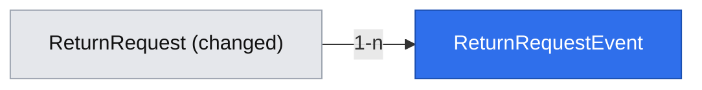

# Return agent decision: status model, timeline, inbox and decision card

## 📝 TLDR
Support agents who process return requests need a controlled workflow instead of an unconstrained status select. Today (current behavior) `/admin/returns` lists requests and lets anyone set any of five statuses in any order, with no history and no notion of an agent decision. Proposed (future behavior): a nine-status model with an enforced state machine, an RMA number, a per-request timeline, an inbox with a two-business-day due marker, and a decision card (approve, reject with a reason, then move the return manually through shipping to resolved). The existing public form keeps working unchanged. This is the first of two specs; the customer wizard and tracker are in `2026-10-22-return-customer-portal.md`, which depends on this one.

## 📝 Resolved decisions
From the brief and from accepting the proposals for this slice (2026-10-22):

| Id | Decision |
|---|---|
| Q04 | Evolve `ReturnRequest` by migration (`kind`, new statuses, `requested` → `submitted`); no parallel `Claim` entity |
| Q05 | Manager is a `MANAGE_RULES` permission on `AGENT`; nothing in this spec needs it yet (no rules screens) |
| Q06 | Agent read-only preview of the customer tracker belongs to the customer spec |
| Q07 | Escalation after 10 days is complaint-only (R04) and out of scope |
| Q7 | Agent moves a return manually `approved → in_transit → received → resolved` (no carrier or warehouse integration) |
| Q8 | No agent login in this spec; a separate prerequisite spec; flagged as a risk |
| Q10 | "We'll reply within 2 business days" is an internal target; surfaced to agents as a due marker |
| Q12 | No recommendation engine (rules or AI) in this slice |
| N3 | UI copy in English, strings colocated per page in one constant object |
| N4 | Vitest approved for `@easyrms/core` (pure unit tests) with root `npm test` appended to `validation.commands`, landing as a prerequisite PR |
| R1 | Agent side and customer side are separate specs |

## 📝 Problem Statement
The concept's agent flow (UC-10) assumes a defined status model and an auditable decision. The current code allows any status change from any status (`return-status-actions.tsx` offers the whole enum), records no history, and has no reference number to quote to a customer. That the ensuing follow-up is the main support cost is an unproven assumption (A01); this spec only builds the workflow that makes decisions consistent and auditable, so the later sample and KPI baselines have something to measure against.

## 📝 Proposed Solution
Evolve the existing `returns` concept in place:

- `core`: a status enum of nine values, a transition table, `canTransition`, a `dueAt`/`overdue` pure function, and `ReturnService.updateStatus` enforcing both plus the reject-note rule.
- `db`: a migration adding `rma`, `kind`, `decision_note`, a `return_request_events` table and the status rewrite; the repository writes an event for every change.
- `app`/`ui`: `/admin/returns` becomes an inbox (RMA, status, due marker, status filter) and `/admin/returns/[id]` a decision card with timeline and only the allowed actions.

Alternatives that lost: a new `Claim` entity (duplicates the concept, brief Q04); keeping the free status select and only adding history (does not give the agent a decision workflow, leaves invalid states reachable).

## 📝 Architecture
Primary module: the existing `returns` concept across `db`, `core`, `app`, `ui`. No new ports and no new dependencies. Reused: `apiHandler`, `makeCrudRoute` (PATCH, GET), `DataTable`, feedback components, `apiCall`, the Awilix request scope, `ConflictError`/`NotFoundError`/`ValidationError`.

- **Status model** (lower snake_case, matching the existing convention): `submitted`, `awaiting_customer`, `approved`, `in_transit`, `received`, `in_service`, `resolved`, `rejected`, `cancelled`. Allowed transitions in this spec: `submitted → approved | rejected`, `approved → in_transit`, `in_transit → received`, `received → resolved`. The other three values exist for later specs (ask-for-info, repair, customer cancel) and have no transitions yet. Any other move throws `ConflictError` (409). Legacy rows map `requested → submitted`, `refunded → resolved`; `approved`, `rejected`, `received` are unchanged.
- **Reject rule** (R15): `rejected` requires `decisionNote` of at least 30 characters (trimmed); approval accepts an optional note.
- **RMA**: `RMA-YYYY-NNNNN` generated from a Postgres sequence (`return_rma_seq`), monotonic and not reset per year, unique index; assigned on create (also by the legacy form's path) and backfilled for existing rows in `created_at` order.
- **Due marker**: `dueAt = createdAt + 2 business days` (Mon–Fri, no holiday calendar); `overdue` when `status = submitted` and now is past `dueAt`. A display aid only; no escalation or notification.
- **Timeline**: one `return_request_events` row on creation (`type = submitted`, `actor = system` for the legacy form) and on every status change (`type = status_changed`, `actor = agent`, from/to status, note). Agents are anonymous (Q8), so `actor = agent` carries no identity.

## 📝 Data Model
Changes to `return_requests` (expand-only):

| Column | Change |
|---|---|
| `rma` varchar(20) | new, `not null`, unique, backfilled from the sequence |
| `kind` varchar(16) | new, default `return` |
| `status` varchar(32) | default `submitted`; existing values rewritten by the migration; unknown values rejected in code |
| `decision_note` text | new, null |

New table `return_request_events`: `id`, `return_request_id` (FK, restrict), `type` (`submitted` | `status_changed`), `from_status` null, `to_status`, `note` null, `actor` (`customer` | `agent` | `system`), `created_at`. The `customer` actor is reserved for the customer spec.

Sensitive data: no new personal fields. `decision_note` is free text about a customer's purchase: never logged, shown only on the agent card (and later to the owning customer). Migration: a new MikroORM migration with a working `down` (drops the new columns, table and sequence and restores `requested`/`refunded`; `resolved` rows that were not originally `refunded` map back to `refunded`, which the PR states as a known approximation). The merged migration is not edited. Status rewrite and `rma` backfill run in one transaction.

## 📝 API Contracts
Envelope, CSRF header and schemas as today (`core/src/validators/returns/`).

| Route | Change |
|---|---|
| `GET /api/returns` | optional `?status=` filter; each item adds `rma`, `kind`, `decisionNote`, `dueAt`, `overdue` (additive) |
| `PATCH /api/returns/[id]` | body `{ status, decisionNote? }`; invalid transition → 409 with the current status; reject without a ≥ 30-character note → 422; unknown id → 404 |
| `POST /api/returns` | unchanged request; response gains `rma` (additive); new rows are `submitted` |

Compatibility: the `status` value set changes (`requested`/`refunded` replaced), which is breaking for the PATCH request and every response containing `status` (`BACKWARD_COMPATIBILITY.md` §1). All in-repo consumers (the admin page, `ReturnStatus` badge map, status actions) are updated in the same PR and the PR body lists it under "Breaking changes".

## 📝 UI/UX
Only what is unique; list and card reuse `DataTable`, `Card`, `Badge`, `Button`, `Input`, feedback components.

- **Inbox:** RMA, order, customer e-mail, status badge, due marker (red "Overdue" for overdue `submitted` rows), `?status=` filter links; newest first.
- **Card:** order and customer details, legacy reason when present, timeline, and one button per allowed transition only. Reject opens a required note field with a live ≥ 30-character counter and a disabled submit until valid. After a 409 the card refreshes and shows the current status with a short message.
- **Accessibility:** labelled inputs, the counter announced through `aria-live="polite"`, buttons are real `<button>`s with visible focus.
- **Copy language:** English (N3).

## 📝 Edge Cases & Failure Scenarios
- Two agents act at once: the second transition is invalid for the stored status, 409, card refreshes.
- Reject note shorter than 30 trimmed characters: 422, nothing written, no event.
- Legacy rows: mapped statuses, backfilled RMA and a synthesized `submitted` event dated `created_at`, so every row has a timeline.
- Concurrent creates (legacy form): RMA comes from the sequence, so no duplicates; a gap is possible after a rolled-back insert and is acceptable.
- Migration failure: one transaction, the schema is unchanged.
- Unknown status in the database (hand edit): the mapper falls back to `submitted` and logs once with the row id, never throws in the list.

## 📝 Risks & Impact Review
Evidenced violations of repository rules: none found against `doc/engineering-standards.md` and `BACKWARD_COMPATIBILITY.md`; the breaking `status` change follows the required path above.

Product direction calls and accepted risks:
- **No agent authentication (Q8):** anyone reaching `/admin` or `PATCH /api/returns/[id]` can approve or reject, and events cannot name the agent. Acceptable only while the app is not exposed publicly; the auth spec must land before a public deployment.
- **Hard-to-reverse:** the status value names and the `rma` format and sequence become long-term contracts.
- **Rollback:** the migration's `down` is an approximation for `refunded` as noted; after real use, rollback loses the timeline and `decision_note`.
- **Tooling (N4):** the test runner changes the validation gate; it lands as a prerequisite PR first.

## 📝 Decisions in play
Relies on: R13 (one request = one type, one order), R15 (reject reason ≥ 30 characters), D06 (narrowed to this slice by Q13). Supersedes nothing. Owner for confirmation: Adam Adamczyk.

## 📋 Phasing
- **Prerequisite PR:** test runner (N4).
- **Phase 1:** status model and state machine, migration, timeline (backend, legacy form keeps working).
- **Phase 2:** agent inbox and decision card.

## 📋 Implementation Plan
### Prerequisite: Test runner
1. **Vitest.** Add Vitest to `@easyrms/core`, root `npm test`, append to `validation.commands` in `.ai/agentic.config.json`. Test: a trivial pure-function test passes under `npm test`.

### Phase 1: Status model and timeline
1. **Status model in `core`.** `RETURN_STATUSES` (9), transition table, `canTransition`, `updateStatus` throws `ConflictError`, reject-note rule in the schema and service. Tests: every allowed transition, a sample of forbidden ones, note length boundary (29/30, whitespace).
2. **Due marker.** `dueAt`/`overdue` pure function. Tests: Friday submit → Tuesday, weekend boundaries, overdue only for `submitted`.
3. **Migration, entities, repository.** Columns, `return_request_events`, sequence, status rewrite, RMA backfill, synthesized events, `down`. Repository assigns RMA on create and writes an event per create/change. Tests: repository integration test against a database seeded with legacy rows (up, mapping, backfill, down); the app builds without a database.
4. **Routes.** `GET` filter, `PATCH` with `decisionNote`, 409/422 mapping. Admin page and badge map updated to the new statuses so the build stays green. Test: service-level tests for 409/422/404; typecheck proves every consumer is updated.

### Phase 2: Inbox and card
1. **Inbox.** RMA, due marker, status filter. Acceptance (manual, no UI test runner in the repo): legacy rows show mapped statuses and RMA; overdue rows show the badge; filter links narrow the list.
2. **Decision card.** `/admin/returns/[id]` with timeline and allowed-transition buttons, reject note. Acceptance (manual): walk submitted → approved → in_transit → received → resolved; reject with 29 characters is blocked, 30 succeeds; a stale tab gets the 409 message.
3. **Close-out.** Update the README (statuses, RMA), add lessons to `.ai/lessons.md`, move the spec to `.ai/specs/implemented/`.
