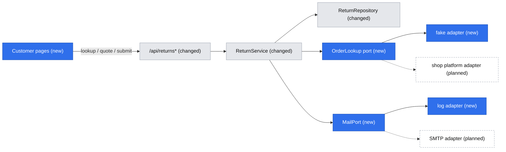
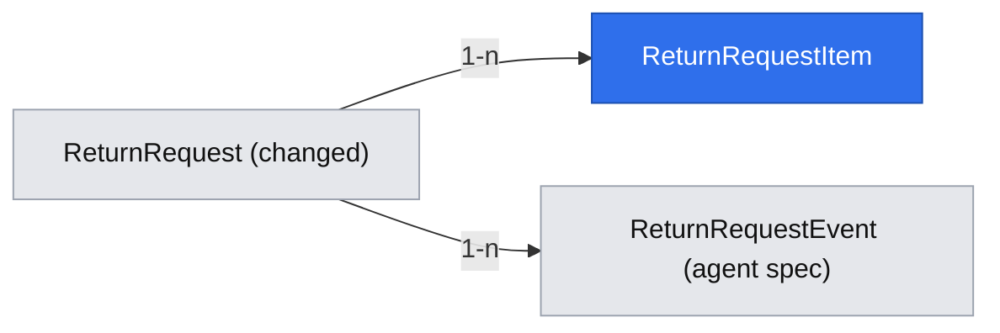

# Return customer portal: order lookup, return wizard, status tracker

Status: Approved: decisions S1–S5, S6–S7 and the R14 supersession confirmed by the owner in session on 2026-10-23; revised twice after the pre-implementation audit (`.ai/analysis/pre-implement-return-customer-portal.md`). Implementation starts only after that audit returns go or conditional, and after the two prerequisite specs (case-sample lab, agent decision) are approved and merged as listed under Implementation Plan. Revised a third time on 2026-10-23 after the architectural review (decisions S8–S11 and the D05 supersession, all **confirmed in session on 2026-10-23**).

## 📝 TLDR
Shop customers need to request a return with complete data and follow it without calling support. Today (current behavior) `/` is a three-field form (order number, e-mail, free-text reason) and the customer gets no reference number or status view. Proposed (future behavior): the customer side of the first slice — UC-01 identify the order, UC-02 return wizard (items, reasons, return method, resolution), UC-06 status tracker (viewable while the 2 h guest session lasts; this slice sends no real notifications and has no link back to the tracker, so after the session the customer repeats the lookup, see Risks) — on top of the status model, RMA and timeline from `2026-10-22-return-agent-decision.md`; each of the three PRs lists which parts of that spec and of the case-sample spec it needs (see Implementation Plan). The agent side of the same slice lives in that spec.

## 📝 Resolved decisions
Ids in these tables are local to this spec; a brief id is always written "brief Q06", "R14" etc. with the brief named.

| Id | Decision |
|---|---|
| Q2 | `OrderLookup` port in `core` plus a seeded fake adapter now; the real platform adapter comes later |
| Q3 | Items are in this slice: `return_request_items` |
| Q4 | Customer picks refund, store credit +10% or exchange; the system records the choice and a server-computed amount; money moves manually |
| Q5 | Guest lookup only (order number + e-mail → order-scoped session, 2 h); magic link later |
| Q6 | No auto-acceptance (R08 not implemented); every return goes to an agent |
| N1 | Return shipping fee is a flat `EASYRMS_RETURN_SHIPPING_FEE` (PLN, default 0, documented in the README); store credit is always free |
| N2 | `MailPort` in `core` with a mock adapter only (logs template id and masked recipient, sends nothing); a real SMTP adapter is a later small PR |
| N3 | UI copy in Polish (the whole app is Polish-only, decision D07 in the product brief, confirmed by Adam Adamczyk 2026-10-23); strings colocated per page in one constant object; `ui` components take all text through props and keep no default strings |
| N5 | `ui` is Next-free and has no test runner, so money, dates and plurals are formatted in `core`/`app` and passed to components as strings; logic that needs tests (stage mapping, plural form, step validity) lives in `core`. Vitest in `ui` is not introduced |
| N4 | Vitest approved for `@easyrms/core` (already installed, commit `be8c37a`); extended by S10 to a small DB integration suite in `@easyrms/db` (runner from the agent spec's P5) |
| R1 | Agent side and customer side are separate specs |
| R2 | Phase 1 stays UI-less, verified by `core` tests of lookup → quote → submit against in-memory fakes of the repository and ports, plus (S10) a Vitest suite in `@easyrms/db` against a real Postgres for the lock, the unique indexes and the migration `down`; the scripted manual run against a seeded Postgres stays as an end-to-end check, recorded in `.ai/runs/` |
| Brief | Single app, routes per shell (Q03); shop platform + e-mail only (Q11); tracker banners (Q09); 2-day reply target (Q10); read-only agent preview of the tracker is deferred with agent auth (Q06) |

Added after review 2026-10-23, **confirmed by the owner in session on 2026-10-23** (also confirmed: the R14 supersession in Decisions in play, the tracker reading local data only, and that the fake order adapter always fails closed in production, so the PR C walkthrough runs under `next dev`):

| Id | Decision |
|---|---|
| S1 | **Shippable as four PRs, in one spec:** PR A0 = Phase 1 step 0 (the CSRF check and response passthrough in the shared HTTP layer, a breaking change for every mutating route, so it ships alone; no customer feature); PR A = Phase 1 steps 1–6 (customer backend; no public UI; needs the agent spec's Phase 1 `transition()` for the mail hook); PR B = Phase 2 step 1 (public primitives and formatters; no customer flow); PR C = Phase 2 steps 2–6 and Phase 3 (needs the agent spec fully merged, since the agent-card extension builds on its decision card) (pages and the breaking `POST /api/returns` switch). Each leaves the app working. Splitting into three spec files is a possible later move |
| S2 | CSRF protection is **new** (nothing validates `x-requested-with` today): a check of that header plus `Origin` is added to the shared HTTP layer for mutating requests, first step of Phase 1 |
| S3 | Eligibility and quote do not take `ClaimFacts` (it has no lines, quantities or dates); this spec defines its own `ReturnOrder`/`ReturnQuoteInput` types. `Money` is still reused |
| S4 | All `decision_note` text is customer-visible on the tracker (for approve and reject); the agent card labels the field accordingly. No internal-only notes exist in this slice |
| S5 | Legacy requests (no items) do not consume line quantity: a line returned through the old form can be requested again. Accepted, small, stated as a risk; PR C removes the legacy form, which ends it |
| S6 | **Tracker and the order platform:** the tracker (`/returns/[rma]`) reads only local data (request, items snapshot, events); the order platform is called only for lookup, quote, submit and the overview's eligibility, so the status page works when the platform is down |
| S7 | A request with status `cancelled` or `rejected` releases its claimed quantity; every other status keeps it claimed |

Added after the architectural review of 2026-10-23 (applied as recommended; **confirmed in session on 2026-10-23**):

| Id | Decision |
|---|---|
| S8 | **Canonical order number:** only `ReturnOrder.orderNumber` as returned by the port is ever stored, signed into the session JWT, used as the `withOrderLock` key, for the claimed-quantity sum and for idempotency scoping; the number typed by the customer is used only to call `lookup`. A case or whitespace variant therefore cannot open a second lock or quantity pool |
| S9 | **`EASYRMS_TRUST_PROXY` is explicit in production:** it must be `true` or `false`; unset in `NODE_ENV=production` is a configuration error (fail closed on first use, like `EASYRMS_ORDER_SOURCE`), replacing the earlier warning. In development and tests unset means `false`. With `false` all clients share one bucket (see Risks) |
| S10 | **DB integration tests:** a small Vitest suite in `@easyrms/db` against a real Postgres (local `npm run db:start`) covers the advisory lock, the unique indexes and the migration `down`. The runner (Vitest in `@easyrms/db`, the root `test:db` script, the AGENTS.md/README entry) is introduced by `2026-10-22-return-agent-decision.md` (its decision P5, Phase 1 step 2), which merges first; this spec only adds its own tests to it. If that spec does not adopt P5, this spec's Phase 1 step 1 introduces the runner instead. It is not added to the CI gate unless a Postgres service exists there: until then it runs through `npm run test:db` (documented) and its result is recorded in `.ai/runs/` |
| S11 | **Shipping fee depends on the return method:** the flat fee applies only to `parcel_locker` and `courier`; `store` drop-off has no fee. So the wizard asks for the return method before the resolution, and `quote` takes `returnMethod` |

## 📝 Problem Statement
Customers do not know which order lines are returnable, what evidence or choices are needed, or what happens next (brief, Problems). The belief that this causes repeated follow-up and is the main support cost is an assumption (A01) untested until the sample is collected, and the KPI baselines (Q02) are still being gathered. For returns, no evidence upload is needed (concept §2.2), so completeness means: right order, right lines and quantities, a reason per line, a chosen resolution and return method.

## 📝 Proposed Solution
- **Customer pages (Tailwind, public):** `/` order lookup (K-01) → `/returns` order overview with existing requests and "Start a return" → `/returns/new` wizard (items, reasons, return method, resolution with quote, summary: Z-02…Z-06; method before resolution because the fee depends on it, S11) → `/returns/[rma]` tracker (K-05, doubling as the confirmation Z-07). The Z-01 "type" step is dropped because only returns exist.
- **Core:** eligibility and quote as pure functions, a guest-session service, ports `OrderLookup` and `MailPort`, and `ReturnService.submit`.
- **Agent card:** extended to show items, resolution, amount and the customer's return method.

Alternatives that lost: client-side quote math in `ui` (`ui` cannot import `core`, amounts must be server-recomputed, so a quote endpoint is used); a per-claim reason instead of per-line reasons (does not match UC-02); a magic-link login now (Q5).

## 📝 Architecture
Primary module: the `returns` concept. New in `core`: an `orders` concept folder holding only the `OrderLookup` port, plus a `mail` port. Reused: `apiHandler`, `makeCrudRoute`, `apiCall`, feedback components, `Timeline` (agent spec), Awilix request scope, and from `2026-10-22-case-sample-lab-and-platform-primitives.md`: `Money` (`core/src/domain/money.ts`) for every amount. Eligibility and quote take this spec's own types (S3): `ReturnOrder { orderNumber, deliveredAt: Date | null, trackingUrl?: string, lines: OrderLine[] }`, `OrderLine { lineRef, sku, name, quantity, unitPrice: Money, returnable }` and `ReturnQuoteInput { lines: { lineRef, quantity }[], resolution, returnMethod }`; `ClaimFacts` is not used.

`OrderLookup` contract (in `core/src/services/orders/`): `lookup(orderNumber, email) → { status: "found", order: ReturnOrder } | { status: "not_found" } | { status: "unavailable" }`, with a 5-second timeout that yields `unavailable`. The port also has `getByNumber(orderNumber) → ReturnOrder | not_found | unavailable` (no e-mail: ownership is already proven by the session, whose JWT carries only the order number), used by `quote`, `submit` and the overview (not the tracker, S6); they treat `unavailable` like `lookup` does. The order is fetched before `withOrderLock` is entered, so the 5-second call never holds a transaction.

Takeaway: every rule lives in `core` behind `ReturnService`; both integrations are replaceable ports, so the slice runs end to end with no external system.

Mechanics unique to this feature:
- **Eligibility** (pure): a line is returnable when the order is delivered, `returnable` is true (R06), delivery is within the window (R01: `EASYRMS_RETURN_WINDOW_DAYS`, default 30, clamped to 14–365; counted in calendar days in `Europe/Warsaw`, delivery day = day 0, so with 30 days the last returnable day is delivery date + 30), and quantity is not already claimed by non-rejected requests for that order line.
- **Quote** (pure, `Money` in integer minor units; this spec adds `addMoney` and a half-up `applyRate` for the +10% to `money.ts`, as additive exports): `refund = Σ qty × unitPrice − fee`, floored at 0, where `fee` is `EASYRMS_RETURN_SHIPPING_FEE` for `parcel_locker`/`courier` and 0 for `store` (S11); `store_credit = Σ qty × unitPrice × 1.10`, no fee (R12); `exchange` has no amount, only an `exchangeNote` (for example a size). Recomputed on submit; client amounts are ignored.
- **Guest session:** `POST /api/returns/lookup` verifies order number + e-mail through `OrderLookup` and sets an `httpOnly`, `sameSite=lax`, `secure`-in-production cookie holding an HS256 JWT (`jose`, secret `EASYRMS_GUEST_SESSION_SECRET` of at least 32 bytes, `exp` 2 h, claim = the canonical order number from the port, S8). A missing or short secret fails closed, except in `NODE_ENV=development`, where a missing secret yields a random per-process secret, held on `globalThis` like the container so that every `next dev` route bundle and HMR reload shares the same one, and one console warning (sessions end when the dev server restarts); in production and in tests a missing or short secret is a configuration error and no cookie is issued. Every customer read or write re-checks that the cookie's order matches the request's order; the customer e-mail always comes from the order, never from the request body. `lookup` sets the cookie only on 200 with order data (not for the `{ tracking }` response, not on failure), and `DELETE /api/returns/session` clears it ("Wyloguj", for shared devices). The JWT is stateless and cannot be revoked server-side before `exp`; accepted for a 2 h, order-scoped session.
- **Setting the cookie:** `apiHandler` always builds `Response.json` today and cannot set headers. It gains one additive behaviour: when the handler returns a `Response`, it is passed through unchanged (existing routes return plain data and are unaffected). `core/src/http` exports `okResponse(data, init?)` to build the standard envelope with extra headers; the cookie string is built by a helper in `app/src/server/`.
- **CSRF (S2):** the shared HTTP layer rejects mutating requests (`POST`/`PATCH`/`DELETE`) that lack `x-requested-with` or whose `Origin` host (when present) differs from the request host, with 403 `csrf_rejected`. The request host is the `Host` header, or `x-forwarded-host` only when `EASYRMS_TRUST_PROXY=true`; `Origin: null` is rejected. External scripts calling mutating routes now get 403 (call it out under "Breaking changes" in the PR A body). `apiCall` already sends the header. Test in `core` for the pure check; every customer and admin mutation goes through it.
- **Concurrency:** submit runs through a repository port `withOrderLock(orderNumber, fn)` (in `db`: one transaction taking a parameterised `pg_advisory_xact_lock(hashtext(orderNumber))`, the single sanctioned raw statement, no string concatenation; `core` cannot open transactions itself). Inside the lock the order is: (1) look up `idempotency_key` scoped to the session's order and return the original request if found; (2) re-check remaining quantities; (3) insert. So a retry never trips over its own consumed quantity. The lock key is the canonical order number (S8). Two different orders submitting the same `idempotency_key` take different locks, so the unique index can fire at insert: the repository maps that unique violation to `ConflictError` (409 `conflict`), never to a 500.
- **Rate limiting (R14):** one neutral error for any lookup failure (not found and wrong e-mail run the same code path and the e-mail comparison is constant-time, to avoid timing signals). In-memory fixed-window limiters, each returning 429: `lookup` 10 per minute per client IP and 5 failed attempts per 10 minutes per (order number, IP) pair (against distributed guessing without letting a stranger lock the real customer out); `quote` and `submit` 30 per minute per session. The client IP comes from the pure function `clientIp(headers, { trustProxy })` in `core` (the route passes the request headers), which trusts the first `x-forwarded-for` entry only when `EASYRMS_TRUST_PROXY=true` (documented env variable, parsed once in `httpOptions`) and otherwise uses one shared bucket, so a spoofed header cannot bypass the limit. In production the variable must be set to `true` or `false` explicitly (S9): a pure `parseTrustProxy({ nodeEnv, value })` in `core` returns the boolean or throws a configuration error when `NODE_ENV=production` and the value is unset or not `true`/`false`; `httpOptions` calls it once. With `false`, one shared bucket means 11 lookups a minute from all customers together return 429, and a stranger can exhaust the per-(order, IP) failure budget of a real customer's order; that is why the explicit setting is required and why `false` is only for deployments without a proxy where the socket address is not available to the app. The limiters are a pure class in `core` taking a clock and a size cap on its maps; `app` holds one instance per process. `unavailable` results do not count toward the limits. CAPTCHA after five attempts is deferred (see Decisions in play).
- **Order platform down:** `unavailable` maps to 503 `service_unavailable` with Polish copy ("Nie możemy teraz sprawdzić zamówienia, spróbuj za chwilę"), never to the neutral 404, so customers are not told their order does not exist.
- **Mail (mocked for now):** `return_submitted` after submit and `return_status_changed` after an agent transition, both through `MailPort`; a failure is logged (template id, masked recipient, never body or tokens) and never fails the request.

## 📝 Data Model
Changes to `return_requests` (expand-only, on top of the agent spec's columns):

| Column | Change |
|---|---|
| `reason` text | relaxed to nullable (not lossy); new submissions leave it null, legacy rows keep it |
| `resolution` varchar(16) | new, null; `refund` / `store_credit` / `exchange` |
| `resolution_amount` numeric(12,2), `currency` char(3) | new, null / default `PLN` |
| `exchange_note` text | new, null |
| `return_method` varchar(24) | new, null; `parcel_locker` / `courier` / `store` |
| `idempotency_key` uuid | new, null, unique |
| index on `order_number` | new (the claimed-quantity sum, `listByOrder` and the lock path all filter by it); `return_request_items` also gets an index on `line_ref` |

New table `return_request_items`: `id`, `return_request_id` (FK, restrict), `line_ref` varchar(100) (order line id from the platform), `sku`, `name`, `quantity` int, `unit_price` numeric(12,2), `reason_code` varchar(32), `comment` text null; unique `(return_request_id, line_ref)`. Name and price are a snapshot: the platform stays the source of truth for orders (D03), the snapshot serves display and audit.

Sensitive data: `customer_email` (existing) stays the only personal field; no phone and no address are collected. Item `comment` is free text about a purchase: never logged, shown only to the owning customer's session and to agents. Retention and anonymisation after three years (R16) is not implemented (see Risks). Migration: a new MikroORM migration with a working `down` (drops the new columns and table; restores `reason not null` only when no row has a null reason, otherwise fails with an explicit message).

## 📝 API Contracts
Envelope as today; the CSRF check is new (S2, see Architecture); schemas in `core/src/validators/returns/`.

| Route | Who | Request | Response / errors |
|---|---|---|---|
| `POST /api/returns/lookup` | public | `{ orderNumber, email }` | sets the session cookie; `{ orderNumber, deliveredAt, lines[] }` where each line is `{ lineRef, name, quantity, remainingQuantity, unitPriceText, eligible, ineligibleReason? }` (`remainingQuantity` = ordered minus quantity held by non-released requests; the wizard caps the picker with it), `ineligibleReason` one of `outside_window`, `already_claimed`, `not_returnable` (the wizard renders ineligible lines disabled with the reason). Any mismatch → 404 with one neutral message; limiter → 429; platform down → 503; order not delivered → 200 `{ orderNumber, deliveredAt: null, lines: [], trackingUrl: string \| null }` (`trackingUrl` comes from `ReturnOrder.trackingUrl`, which the port fills when the platform has one) and **no** session cookie |
| `POST /api/returns/quote` | session | `{ items:[{lineRef, quantity}], returnMethod, resolution }` | `{ amountMinor, feeMinor, currency, amountText, feeText }`, the `*Text` fields formatted pl-PL by `formatMoney` in `core` (for example `1 234,50 zł`), the client shows them verbatim and never does money math; 401 `unauthorized` without session; ineligible lines → 400 `validation_error` with `fieldErrors["items.<lineRef>"]` = the `ineligibleReason` code |
| `POST /api/returns/submit` | session | same body as `POST /api/returns` below | transitional (PR A to PR C): identical behaviour and errors, no UI consumer; removed in PR C step 5 |
| `DELETE /api/returns/session` | any | none | `200 { ok }`; clears the cookie; idempotent; CSRF-checked like every mutation |
| `POST /api/returns` | session | `{ items:[{lineRef, quantity, reasonCode, comment?}], resolution, exchangeNote?, returnMethod, acknowledged: true, idempotencyKey }` | `201 { rma, status, resolution, resolutionAmount }`; repeated `idempotencyKey` → 200 with the same body; 409 `conflict` when quantity was claimed meanwhile; 400 `validation_error` for ineligible lines or the legacy request shape (no 422 class exists and none is added, matching the agent spec); a replay with the same key but a different payload returns the original silently; an `idempotencyKey` already used by a different order → 409 `conflict` |

Error rule for quantities: a line that is ineligible when checked (outside the window, not returnable, quantity above `remainingQuantity` as read at that moment) is 400 `validation_error`; a quantity that was still available at lookup but is found taken by another request inside the lock at submit is 409 `conflict`. Request validation (`core/src/validators/returns/`): `items` 1–20 entries, no duplicate `lineRef`, `quantity` a positive integer ≤ `remainingQuantity`, `reasonCode` one of `size`, `not_as_described`, `changed_mind`, `better_price`, `mistake`, `other` (the concept's six return reasons from `doc/portal-reklamacje/mockup/src/data.ts`, stored language-neutral, Polish labels on the page), `comment` ≤ 500 characters, `exchangeNote` ≤ 200 and required only for `exchange`, `idempotencyKey` a UUID, `acknowledged` must be `true`.

New errors (additive `AppError` subclasses in `core/src/errors.ts`): `UnauthorizedError` (401 `unauthorized`), `ForbiddenError` (403, code `csrf_rejected` for the CSRF check), `TooManyRequestsError` (429 `rate_limited`). The page maps `error.code` to Polish copy, including `network_error` and `unexpected_response` from `apiCall`, `unauthorized` ("Sesja wygasła"), `rate_limited`, `service_unavailable`, `csrf_rejected`, `conflict` and `validation_error`.

`POST /api/returns` becomes a workflow handler written with `apiHandler` directly (standards §2 allows it) because `makeCrudRoute`'s `create.handler(service, input)` cannot read the cookie; `GET /api/returns` stays on `makeCrudRoute`. The idempotent replay's 200 uses `okResponse(data, { status: 200 })`.

Compatibility: `POST /api/returns` changes request shape (breaking, `BACKWARD_COMPATIBILITY.md` §1). It ships with every consumer in Phase 2 (legacy form removed) and is listed under "Breaking changes" in the PR body.

## 📝 UI/UX
Only what is unique; feedback reuses existing components. `ui/src/public/` has one component today and the admin (shadcn) components must not be used on public pages, so this spec first builds the public Tailwind primitive set, props only, every text through props, each with a story in `ui/src/storybook/public/`:

| Component | Props (sketch) | Notes |
|---|---|---|
| `Field` | `{ label, hint?, error?, children }` | label bound to the control, error in `aria-describedby` |
| `TextInput`, `Textarea` | native input props | visible focus, invalid state |
| `ChoiceGroup` | `{ legend, options: { value, label, description?, disabled?, disabledReason? }[], value, onChange }` | radio cards in a `fieldset`; disabled options show the reason as text |
| `Banner` | `{ tone: info \| warning \| error, children }` | `role` chosen by tone |
| `Stepper` | `{ steps: { id, label }[], currentId }` | ordered list, `aria-current="step"` |
| `StageList` (`StatusTracker`) | `{ stages: { id, label, state: done \| current \| upcoming }[], closed?: { label, reason? } }` | ordered list; the stage-to-status mapping is computed in `core` |
| `Timeline` (public variant) | same props as the admin `Timeline` | Tailwind styling, no shadcn |

Dates, money and plural forms (`1 dzień / 2 dni / 5 dni`) are formatted by `core` helpers (`formatMoney` from the case-sample spec, plus `formatDatePl` in `Europe/Warsaw` and `pluralPl`, added here with unit tests) and arrive as strings.

- **Loading, empty and error states:** every `ui` text is passed in Polish, including the `LoadingMessage` text (its default is English). Lookup, quote and submit show a loading state and a disabled button with a Polish label while pending; the overview with no requests shows "Nie masz jeszcze zgłoszeń" and the "Start a return" action; failures show `ErrorMessage` with the Polish copy mapped from `error.code`; layouts are mobile-first (brief D02).
- **Wizard:** steps in the order items → reasons → return method → resolution (with the quote) → summary (S11); each step validates before "Next"; ineligible lines render disabled with the reason (outside window, already claimed, not returnable). The idempotency key is generated when the wizard mounts; on a network error the entered data stays and "Try again" resubmits with the same key.
- **Tracker (K-05):** five stages `Submitted → Approved → In transit → Received → Resolved` (`in_service` shows under Received); `awaiting_customer` is a banner on the current stage; `rejected` and `cancelled` replace the stages with a closed state and the reason (brief Q09). A "What now?" line per status, the timeline, and the chosen resolution with its amount; "Odpowiemy w ciągu 2 dni roboczych" for `submitted` (Q10).
- **Accessibility:** WCAG 2.1 AA target (R16): labelled inputs, focus moved to the step heading on step change, the stage list is an ordered list with `aria-current="step"`.
- **Copy language:** Polish (N3, N5): reason labels, status names, "Co teraz?" lines, banners, closed states and the neutral lookup error; stored values (`refund`, `store_credit`, `parcel_locker`, …) stay language-neutral. Server error messages are mapped from `error.code` to Polish copy on the page, so English core messages never reach the customer. Legal-adjacent wording ("Odpowiemy w 2 dni robocze") is marked for the legal review pending in the brief.

## 📝 Edge Cases & Failure Scenarios
- Wrong order number or wrong e-mail: the same neutral message and code path; limiters as under Rate limiting.
- Order platform timeout or error: 503 with its own message, no cookie, not counted by the limiter (see Order platform down).
- Legacy rows have no items, so they do not consume line quantity (S5): a line already returned through the old form can be requested again. Accepted.
- Order exists but is not delivered: information plus the tracking link, no wizard.
- The window passes between lookup and submit, or another request takes the quantity: server revalidates → 400 (`validation_error`, ineligible) or 409 (`conflict`, quantity taken) with an explanation, entered data stays.
- Double click or retry: the same `idempotencyKey` returns the original request, no second RMA.
- Two simultaneous submits for one order line: the advisory lock serialises them, the second gets 409. Two submits with the same `idempotencyKey`: the second finds the first inside the lock and returns it (200), not 409.
- Session expired (2 h) on submit: 401 → "Sesja wygasła"; the draft exists only while the page is open, the user re-identifies and starts again. Draft persistence is not built.
- Mail failure: logged, never fails the request or the transition.
- Order number typed with another case or with spaces: the platform resolves it, the portal uses only the canonical number from the port (S8), so locks and quantity pools are shared.
- Two different orders submit the same `idempotencyKey` at once: the second hits the unique index and gets 409 `conflict` (not 500).
- `EASYRMS_TRUST_PROXY` unset in production: configuration error on first use (S9), not a silent shared bucket.
- `EASYRMS_GUEST_SESSION_SECRET` missing or short outside development, or the fake adapter selected in production: fail closed on the first customer request with a configuration error, no cookie issued (in development a missing secret gets an ephemeral per-process one with a warning).

## 📝 Risks & Impact Review
Evidenced violations of repository rules: none found; `jose` is added to `core` as a framework-agnostic dependency and the single parameterised advisory-lock statement stays inside `db`.

Product direction calls and accepted risks:
- **Breaking API and schema** (`BACKWARD_COMPATIBILITY.md` §1, §2): the `POST /api/returns` shape and `reason` becoming nullable; expand-only migration with `down`, same-PR consumer update, rollback after new-format rows exist loses items and resolutions and the PR says so.
- **Depends on the agent spec** (statuses, RMA, events, state machine) and on the case-sample spec (`Money`, `formatMoney`); per-PR prerequisites are listed at the start of the Implementation Plan.
- **Shared HTTP layer change** (`BACKWARD_COMPATIBILITY.md` §3, additive): the CSRF check applies to every mutating route including admin ones, and `apiHandler` passes a returned `Response` through. Existing in-repo callers already send the header.
- **Limiter bypass and IP trust:** with `EASYRMS_TRUST_PROXY=true` the proxy must overwrite `x-forwarded-for`; with `false` all clients share one bucket, which both throttles every customer after 11 lookups a minute and lets a stranger exhaust a real customer's failed-attempt budget, so `false` is acceptable only without a proxy and the variable must be set explicitly in production (S9).
- **Tracker is session-bound:** the guest session lasts 2 h, mail is a mock and no link leads back to the tracker, so a customer who returns later repeats the lookup and gets no notification of status changes. Accepted for this slice (Q5, N2); the magic link and the SMTP adapter are the fixes.
- **No agent authentication blocks public deployment** (agent spec AD-A2): the customer pages and the unauthenticated `/admin` share one app, so the app must not be exposed publicly until the auth spec lands; that spec is recorded as a named blocker in the brief by the agent spec's close-out.
- **DB integration suite not in CI** (S10) until a Postgres service exists there: the lock and migration checks run through `npm run test:db`, so a regression would not fail the gate; the result is recorded in `.ai/runs/` per PR.
- **No agent authentication** (carried over from the agent spec): the customer data in `/admin` is reachable by anyone who can reach the admin routes.
- **Fake order adapter** in production would let anyone "own" seeded orders: guarded by failing closed.
- **In-memory rate limiter** is per process: ineffective across instances and reset on restart; acceptable for a single instance, replace before scaling out.
- **R14 CAPTCHA deferred** and **R16 retention not implemented**: owner and legal decisions to confirm.
- **Hard-to-reverse:** the `return_request_items` snapshot columns and the resolution value names become long-term contracts.

## 📝 Decisions in play
Relies on: R01, R06, R12, R13, R14, R15 (tracker shows the rejection reason), R16, D02, D03, D06 (narrowed by Q13), N01–N03 (no B2B, external service, per-item resolution); the language is Polish-only (N3), not a non-goal.
**Proposes to supersede D05** (customer logs in by e-mail link) for this slice: customers identify with order number + e-mail and get an order-scoped guest session (Q5); the e-mail link is deferred to a follow-up. Owner: Adam Adamczyk (Q01), who **confirmed it in session on 2026-10-23**; security (the D05 reviewer) still reviews it before a public deployment. The brief entry D05 is updated in Phase 3 step 3.
Supersedes (confirmed by the owner in session, 2026-10-23; the brief lists security as R14's reviewer, so security still reviews it before a public deployment): **R14**: CAPTCHA after five attempts is replaced by two blocking limits until a CAPTCHA provider is chosen: lookup 10 per minute per client IP, and 5 failed attempts per 10 minutes per (order, IP) pair. **R16** (retention and anonymisation after three years) is deferred, not implemented, and not superseded: customer e-mail and item comments are kept indefinitely until a follow-up issue with legal lands. The agent preview of the tracker (Q06) is deferred with agent auth; its owner is the product owner until that spec exists. R08 is not implemented (Q6) and its text is unchanged.

## 📝 Migration & Backward Compatibility
All five surfaces of `BACKWARD_COMPATIBILITY.md` were checked against every phase. No protected surface is broken without a documented path; the breaking items go in the PR bodies under "Breaking changes".

| # | Surface | PR | Change | Path |
|---|---------|----|--------|------|
| 1 | §1 HTTP API | A0, A | The CSRF check (PR A0) returns 403 `csrf_rejected` for any mutating request without `x-requested-with` or with a foreign `Origin`, on every route (classed breaking; every in-repo caller goes through `apiCall`, which sends the header; `GET` and `/api/health` are unaffected). PR A adds routes `lookup`, `quote`, `session` (DELETE) and `submit`; new codes `unauthorized`, `csrf_rejected`, `rate_limited` | PR A0 body lists the 403 under "Breaking changes"; external scripts add the header |
| 2 | §1 HTTP API | C | `POST /api/returns` takes the new request and requires a session; its response shrinks from the full `ReturnRequest` (`id`, `orderNumber`, `customerEmail`, `reason`, `status`, `createdAt`, `updatedAt`) to `{ rma, status, resolution, resolutionAmount }`; `/api/returns/submit` is added in A and removed in C | PR C body lists the removed fields and the `/submit` removal; the only in-repo reader is the form PR C removes; the agent spec's "response gains `rma`" is superseded by this shape once PR C merges |
| 3 | §3 Internal packages | A, C | `ReturnRequest.reason: string \| null`, `NewReturnRequest`, `returnRequestCreateSchema`, `ReturnService.create`, new required `ReturnRepository` methods (the fake in `return.service.test.ts` and `MikroOrmReturnRepository` change); `apiHandler` gains the CSRF check and `Response` passthrough; PR C removes `ReturnRequestForm` from `@easyrms/ui/public`, its story `storybook/public/return-request-form.stories.tsx` and `SubmitReturnForm` | Typecheck and lint pass in the same PR; the PR body names each changed or removed export |
| 4 | §4 Config | A0, A, C | New variables (all `EASYRMS_`-prefixed like the existing ones) `EASYRMS_GUEST_SESSION_SECRET`, `EASYRMS_TRUST_PROXY`, `EASYRMS_ORDER_SOURCE`, `EASYRMS_RETURN_WINDOW_DAYS`, `EASYRMS_RETURN_SHIPPING_FEE` (README config table per step; `.env.example` and `scripts/setup.mjs` untouched); `EASYRMS_TRUST_PROXY` becomes required (`true`/`false`) in production (S9) and changes the CSRF host check behind a host-rewriting proxy (PR A0 body says so under "Breaking changes"); `<html lang="pl">` changes `/admin` | Documented in the introducing step; PR C body lists `lang` |
| 5 | §2 Database | A | Expand-only migration; `reason` relaxed to nullable (non-lossy); unique `idempotency_key`; `down` as stated in Data Model | Compliant |
| 6 | §5 Process | C | Spec moves to `implemented/` after the walkthrough | Compliant |

## 📋 Phasing
Four mergeable PRs (S1), in this order, each leaving the app working:
- **PR A0 = Phase 1 step 0:** CSRF check, `trustProxy` option and response passthrough in the shared HTTP layer. No customer feature. Gate: `npm test` green.
- **PR A = Phase 1 steps 1–6:** customer backend (items table and DB test suite, `OrderLookup` port with fake adapter, eligibility, quote, session, rate limiting, `MailPort`, lookup/quote then submit). No public UI change. Gate: `npm test` green incl. the fake-port flow tests, `npm run test:db` green and recorded, scripted Postgres run recorded.
- **PR B = Phase 2 step 1:** public primitives and `formatDatePl`/`pluralPl`/stage mapping. No customer flow. Gate: `storybook:build` and tests green.
- **PR C = Phase 2 steps 2–6 and Phase 3:** tracker, lookup, overview, wizard, the breaking `POST /api/returns` switch, docs and close-out. Gate: manual acceptance walkthrough recorded in `.ai/runs/`.

## 📋 Implementation Plan
Each step leaves the app working and ends with the validation gate; unit tests run under Vitest.

### Phase 1: Customer backend (PR A0 = step 0, PR A = steps 1–6)
Prerequisites for PR A0: none beyond the current app. Prerequisites for PR A: PR A0 and the agent spec's Phase 1 merged (statuses, RMA, `transition()`, `clock`) and the case-sample spec merged (`Money`, `formatMoney`). Prerequisites for PR B: the nine-status enum from the agent spec's Phase 1 and the admin `Timeline` props from its Phase 2 step 1. Prerequisites for PR C: PR A, PR B and the agent spec complete (its decision card).

0. **CSRF check and response passthrough.** In `core/src/http/`: a pure `assertSameOrigin`-style check (header `x-requested-with` present, `Origin` host equals request host when present) applied to every mutating route by `apiHandler`, 403 `csrf_rejected`; `core` never reads the environment: `ApiHandlerOptions` (and `makeCrudRoute`'s options) gain `trustProxy?: boolean` (default false), and `app/src/server/http-options.ts` exports one `httpOptions` object, the only place `EASYRMS_TRUST_PROXY` is parsed, through the pure `parseTrustProxy` of S9 (`{ trustProxy }`; a missing or invalid value in production is a configuration error); every route passes it, and the same flag is what `clientIp` receives, so the variable is read once. Step 0 edits every route under `app/api` (today `/api/health`, `/api/returns`, `/api/returns/[id]`, and the case-sample lab's `/api/discovery/case-sample` once it has merged) to pass `httpOptions` and makes `makeCrudRoute` forward it to `apiHandler` (it builds only `{ logger }` today); `apiHandler` passes a returned `Response` through unchanged and `okResponse(data, init?)` is exported. Existing callers send the header via `apiCall`, so nothing changes for them. Document `EASYRMS_TRUST_PROXY` (its effect on the CSRF host check and, in step 4, on `clientIp`) in the README config table in this step. Tests: `parseTrustProxy` (`true`, `false`, unset in development, unset or garbage in production throws), missing header, foreign origin, `Origin: null` rejected, port mismatch, `x-forwarded-host` honoured only when `EASYRMS_TRUST_PROXY=true` and ignored otherwise, same origin, `GET` untouched, passthrough keeps status and headers, plain-data routes unchanged.
1. **Items table and DB test suite.** `return_request_items`, the new `return_requests` columns and the `order_number`/`line_ref` indexes, repository support, domain types. This step adds its tests to the `@easyrms/db` suite and `npm run test:db` introduced by the agent spec (S10, its P5); they run against the local Postgres from `npm run db:start` on a throwaway schema, outside the CI gate. Tests: insert and read with the unique `(return_request_id, line_ref)` and the unique `idempotency_key` (a violation surfaces as the repository's `ConflictError`); `down` drops the new table and columns and restores `reason not null` only when no row has a null reason, otherwise fails with the explicit message and changes nothing; the typecheck covers the domain types.
2. **`OrderLookup` port and fake adapter.** Port in `core/src/services/orders/`, seeded in-memory adapter in `core/src/adapters/orders/`, selected by `EASYRMS_ORDER_SOURCE`; selecting the fake adapter when `NODE_ENV=production` always fails closed (no override). Returns the `found`/`not_found`/`unavailable` result and applies the 5-second timeout. Test: found, wrong e-mail and wrong order give the same result, a slow or throwing adapter yields `unavailable`, the production guard. Document `EASYRMS_ORDER_SOURCE` in the README in this step.
3. **Eligibility and quote.** Pure functions on `ReturnOrder`/`ReturnQuoteInput` with env-driven config (`EASYRMS_RETURN_WINDOW_DAYS` clamp, `EASYRMS_RETURN_SHIPPING_FEE`, documented in the README in this step); eligibility returns `ineligibleReason` per line. Tests: window edges (13/14/30/365 days, calendar days in `Europe/Warsaw`, including a delivery just before midnight and a DST change), non-returnable lines, remaining quantity, all three resolutions, the fee applied for `parcel_locker`/`courier` and not for `store` (S11), fee floor at 0, `addMoney` and the half-up `applyRate` rounding edge (for example 0.5 minor units rounds up), a `cancelled`/`rejected` request releasing quantity (S7).
4. **Guest session service.** `jose` HS256, 2 h, fail closed; the cookie string helper in `app/src/server/` and the pure `clientIp(headers, { trustProxy })` in `core`; `DELETE /api/returns/session`. Document `EASYRMS_GUEST_SESSION_SECRET` in the README in the README config table in the step that introduces it. All new variables use the `EASYRMS_` prefix the code already reads; the root `.env.example` is already stale (it lists `DB_*` names that nothing reads) and is out of scope, as is `scripts/setup.mjs` (the implemented setup spec keeps app configuration out of it). `EASYRMS_ORDER_SOURCE` defaults to `fake` in development and is required in production. Tests: sign and verify, expiry, tampering, wrong order; a missing or shorter-than-32-byte `EASYRMS_GUEST_SESSION_SECRET` throws a configuration error and issues no cookie when `NODE_ENV` is not `development`, while in development a missing one yields a random per-process secret and exactly one warning; the cookie string has `HttpOnly`, `SameSite=Lax`, `Path=/`, `Max-Age=7200` and `Secure` only in production; `clientIp` behaves as under Rate limiting, with a test for both settings; the limiter windows (lookup per IP, failed attempts per order, quote/submit per session) with an injected clock.
5. **`MailPort` and notifications.** Port and mock adapter (logs only, sends nothing) with masked recipient, `return_status_changed` wired into the agent spec's `transition()` path. Test: a failing port is swallowed and logged, the transition still succeeds.
6. **Lookup, quote and submit**, delivered as three sub-steps, each ending with the validation gate and leaving the app working:

   **6a. Lookup and quote.** Ports and registrations: `ReturnRepository` gains `listByOrder(orderNumber)`, `findByRma(rma)` (with items and events) and `withOrderLock<T>(orderNumber, fn: (tx: ReturnRepository) => Promise<T>): Promise<T>` (the callback receives a transaction-scoped repository; the agent spec's create-with-RMA-and-event runs on it); `ReturnLookupService` (new, `core/src/services/returns/`) orchestrates lookup and quote (limiters, `OrderLookup`, eligibility, quote, session issue); `ReturnService` gains `listForOrder`, `getByRma` and `submit`, both checking that the session order owns the request (404 otherwise). Awilix registers `orderLookup`, `mailPort`, `guestSessionService`, `rateLimiter` (the `core` limiter class, one instance per process held on `globalThis` like the container, so route bundles and HMR share it) and reuses the agent spec's `clock`; the mail port lives in `core/src/services/mail/mail.port.ts`. `POST /api/returns/lookup` (limiters, neutral error, 503 on `unavailable`, cookie via the passthrough) and `POST /api/returns/quote`. Flow test (R2) in `core` against in-memory fakes of the repository, `OrderLookup` and `MailPort`: neutral 404 for both failure kinds, 429 after 10, 503 when the port is unavailable, 401 without a session, a request of another order (cookie for a different order) → 404 on `getByRma`/`listForOrder`, the undelivered-order lookup returns `trackingUrl` and issues no cookie, `DELETE /api/returns/session` returns 200, clears the cookie, is idempotent without a cookie and is CSRF-checked; `unavailable` results do not consume limiter budget (ten `unavailable` lookups then a normal one is not 429); `quote` with a bad line gives 400 with `fieldErrors["items.<lineRef>"]` = the `ineligibleReason`; a lookup typed with another case or with spaces yields a session for the canonical order number (S8).

   **6b. Submit.** `ReturnService.submit` fetches the order, runs the eligibility check (window, `returnable`, quantity ≤ remaining) before the lock and answers 400 on failure, then through the repository port `withOrderLock` (keyed by the canonical order number, S8): idempotency lookup, then the same quantity re-check inside the lock (409 on failure), then insert; server amount; `return_submitted` mail. It is exposed as `POST /api/returns/submit` until the PR C switch (no UI consumer yet; exercised by the tests below) so the legacy form keeps working. Flow tests in `core` (same fakes): duplicate key returns the original (200, not 409), a sequential over-quantity submit 400 (the pre-lock check), a quantity taken by a concurrent request between that check and the lock 409, an `idempotencyKey` already used by another order → 409 (also when the repository raises its unique-violation `ConflictError`), `return_submitted` sent once on submit and not on an idempotent replay, a replay with the same key and a different payload returns the original unchanged, and a concurrent-case test with a mutex-backed fake `withOrderLock` (two submits for one line: one 201, one 409; the same key twice: 201 then 200).

   **6c. Real-database checks.** In the `@easyrms/db` suite from step 1 (S10): two concurrent `withOrderLock` submits for one line yield exactly one request and one conflict; the same key from two different orders yields one row and one `ConflictError`, never an unmapped error; a case-variant order number cannot open a second lock (it never reaches the repository, S8). Then the scripted end-to-end run against a seeded Postgres recorded in `.ai/runs/`: the same flow through the HTTP routes.

### Phase 2: Customer UI and the breaking switch
1. **Public primitives and formatting (PR B).** `Field`, `TextInput`, `Textarea`, `ChoiceGroup`, `Banner`, `Stepper`, `StageList`, public `Timeline` in `ui/src/public/`, each with stories for its states (including invalid, disabled with reason, closed tracker) in Polish; `formatDatePl` and `pluralPl` in `core` with Vitest tests (plural forms 1/2/5/12/22, DST dates in `Europe/Warsaw`); the stage mapping from the nine statuses in `core` with a test per status, plus the agent spec's `unknown` status (a corrupt row), which maps to a closed "unknown" state with no stage marked done. Acceptance: `storybook:build` passes, no Accessibility-panel violations in light and dark. Nothing user-visible changes.
2. **Tracker `/returns/[rma]` (PR C starts here).** Stages, banners, "What now?", timeline, resolution and amount; the `decision_note` of approve/reject is shown as customer-visible (S4); ownership check against the session. New page; it reads only local data (S6) and needs no order platform. Acceptance (manual; the session cookie and a request come from the Phase 1 `lookup` and `submit` routes called through the fake adapter): another order's session gets 404; all nine statuses render.
3. **Lookup `/returns/lookup` and overview `/returns`.** The new lookup lives beside the legacy form at `/`, which stays untouched until step 5, so customers can still submit throughout; the overview lists the session order's existing requests plus "Start a return" and a "Wyloguj" action. Also sets `<html lang="pl">` in `layout.tsx` (a changed default that affects `/admin`, listed under "Breaking changes" in the PR C body; required for screen readers and the WCAG target). New pages that read the cookie (`/returns`, `/returns/new`, `/returns/[rma]`) export `dynamic = "force-dynamic"` and read it with the async `cookies()` of this Next version (see `node_modules/next/dist/docs/01-app/03-api-reference/04-functions/cookies.md`), so `next build` works with no database and no secret. Acceptance (manual): neutral error shown, platform-down message shown; redirect without a session; `lang` is `pl`.
4. **Wizard `/returns/new`.** Items → reasons → return method → resolution with quote via `apiCall` (S11) → summary, built on the public primitives from step 1; wizard-specific components in `ui/src/public/returns/`, each with a story in `ui/src/storybook/public/returns/` covering its states (line picker with an ineligible line and its reason, quantity at the cap, quote pending and shown, summary, error), in Polish, with `storybook:build` passing. Until the step 5 switch the wizard posts to the transitional `POST /api/returns/submit` (same body and errors as the final `POST /api/returns`), and step 5 re-points it with the route change. Acceptance (manual): step validation, ineligible lines disabled with reasons, a retry keeps data and key.
5. **Submit switch.** `POST /api/returns` takes the new schema and requires a session; `/api/returns/submit` is removed; `/` becomes the lookup and `/returns/lookup` is removed in the same step and requests to it redirect to `/` (permanent redirect in `next.config.ts`, so bookmarks keep working), as is the legacy form page; all consumers updated; the PR body lists the breaking changes. Test: the Phase 1 flow test re-pointed at `POST /api/returns`; the legacy shape returns 400 `validation_error`.
6. **Agent card extension.** Items, resolution, amount and return method shown on `/admin/returns/[id]` (the agent spec's decision card, which must already exist). Acceptance (manual): a customer submission appears with its items and chosen resolution.

### Phase 3: Docs and hardening
1. **README check.** Each variable (`EASYRMS_GUEST_SESSION_SECRET`, `EASYRMS_TRUST_PROXY`, `EASYRMS_ORDER_SOURCE`, `EASYRMS_RETURN_WINDOW_DAYS`, `EASYRMS_RETURN_SHIPPING_FEE`) was documented in the step that introduced it; confirm none is missing and update `AGENTS.md` "Current state".
2. **Acceptance walkthrough** in a browser (customer submit, agent approve, in transit, received, resolved, plus the failure cases above); results saved to `.ai/runs/`.
3. **Brief bookkeeping.** Update `product-brief.md`: record the R14 supersession (two blocking limits, owner confirmation 2026-10-23, security review pending), record the D05 supersession once the owner confirms it, mark R16 deferred, and open the follow-up issues for the real platform adapter, SMTP adapter, CAPTCHA, retention, the agent tracker preview, the e-mail-link login (D05) and **the security review of R14's replacement limits (a gate before public deployment, owner: security)**.
4. **Close-out.** Add lessons to `.ai/lessons.md` and move this spec to `.ai/specs/implemented/`.
