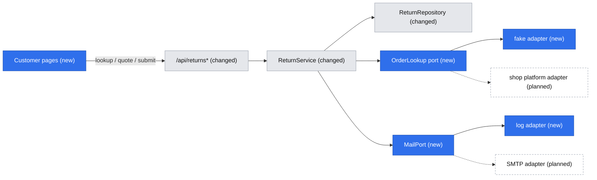
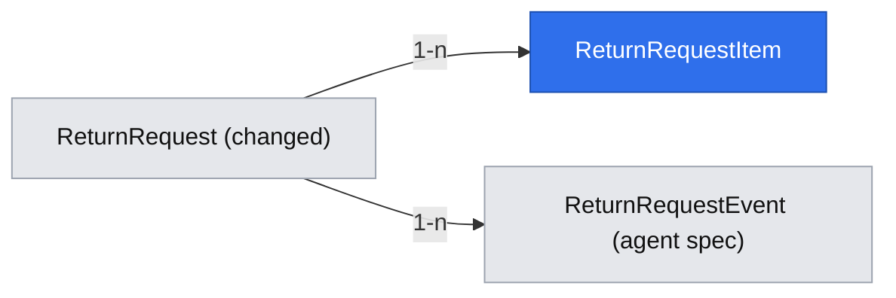

# Return customer portal: order lookup, return wizard, status tracker

## 📝 TLDR
Shop customers need to request a return with complete data and follow it without calling support. Today (current behavior) `/` is a three-field form (order number, e-mail, free-text reason) and the customer gets no reference number or status view. Proposed (future behavior): the customer side of the first slice — UC-01 identify the order, UC-02 return wizard (items, reasons, resolution, return method), UC-06 status tracker — on top of the status model, RMA and timeline from `2026-10-22-return-agent-decision.md`, which must merge first. The agent side of the same slice lives in that spec.

## 📝 Resolved decisions
| Id | Decision |
|---|---|
| Q2 | `OrderLookup` port in `core` plus a seeded fake adapter now; the real platform adapter comes later |
| Q3 | Items are in this slice: `return_request_items` |
| Q4 | Customer picks refund, store credit +10% or exchange; the system records the choice and a server-computed amount; money moves manually |
| Q5 | Guest lookup only (order number + e-mail → order-scoped session, 2 h); magic link later |
| Q6 | No auto-acceptance (R08 not implemented); every return goes to an agent |
| N1 | Return shipping fee is a flat `RETURN_SHIPPING_FEE` (PLN, default 0, documented in the README); store credit is always free |
| N2 | `MailPort` in `core` with a mock adapter only (logs template id and masked recipient, sends nothing); a real SMTP adapter is a later small PR |
| N3 | UI copy in English, strings colocated per page in one constant object |
| N4 | Vitest approved (installed by the prerequisite PR in the agent spec) |
| R1 | Agent side and customer side are separate specs |
| R2 | Phase 1 stays UI-less, verified by an API-level integration test of lookup → quote → submit |
| Brief | Single app, routes per shell (Q03); shop platform + e-mail only (Q11); tracker banners (Q09); 2-day reply target (Q10); read-only agent preview of the tracker is deferred with agent auth (Q06) |

## 📝 Problem Statement
Customers do not know which order lines are returnable, what evidence or choices are needed, or what happens next (brief, Problems). The belief that this causes repeated follow-up and is the main support cost is an assumption (A01) untested until the sample is collected, and the KPI baselines (Q02) are still being gathered. For returns, no evidence upload is needed (concept §2.2), so completeness means: right order, right lines and quantities, a reason per line, a chosen resolution and return method.

## 📝 Proposed Solution
- **Customer pages (Tailwind, public):** `/` order lookup (K-01) → `/returns` order overview with existing requests and "Start a return" → `/returns/new` wizard (items, reasons, resolution, return method, summary: Z-02…Z-06) → `/returns/[rma]` tracker (K-05, doubling as the confirmation Z-07). The Z-01 "type" step is dropped because only returns exist.
- **Core:** eligibility and quote as pure functions, a guest-session service, ports `OrderLookup` and `MailPort`, and `ReturnService.submit`.
- **Agent card:** extended to show items, resolution, amount and the customer's return method.

Alternatives that lost: client-side quote math in `ui` (`ui` cannot import `core`, amounts must be server-recomputed, so a quote endpoint is used); a per-claim reason instead of per-line reasons (does not match UC-02); a magic-link login now (Q5).

## 📝 Architecture
Primary module: the `returns` concept. New in `core`: an `orders` concept folder holding only the `OrderLookup` port, plus a `mail` port. Reused: `apiHandler`, `makeCrudRoute`, `apiCall`, feedback components, Awilix request scope, and from `2026-10-22-case-sample-lab-and-platform-primitives.md`: `Money` (`core/src/domain/money.ts`) for every amount and `ClaimKind`/`ClaimFacts` (`core/src/domain/`) as the eligibility and quote input.

Takeaway: every rule lives in `core` behind `ReturnService`; both integrations are replaceable ports, so the slice runs end to end with no external system.

Mechanics unique to this feature:
- **Eligibility** (pure): a line is returnable when the order is delivered, `returnable` is true (R06), delivery is within the window (R01: `RETURN_WINDOW_DAYS`, default 30, clamped to 14–365), and quantity is not already claimed by non-rejected requests for that order line.
- **Quote** (pure, `Money` in integer minor units; this spec adds `addMoney` and a half-up `applyRate` for the +10%): `refund = Σ qty × unitPrice − RETURN_SHIPPING_FEE`, floored at 0; `store_credit = Σ qty × unitPrice × 1.10`, no fee (R12); `exchange` has no amount, only an `exchangeNote` (for example a size). Recomputed on submit; client amounts are ignored.
- **Guest session:** `POST /api/returns/lookup` verifies order number + e-mail through `OrderLookup` and sets an `httpOnly`, `sameSite=lax`, `secure`-in-production cookie holding an HS256 JWT (`jose`, secret `GUEST_SESSION_SECRET` of at least 32 bytes, `exp` 2 h, claim = order number). A missing or short secret fails closed. Every customer read or write re-checks that the cookie's order matches the request's order; the customer e-mail always comes from the order, never from the request body.
- **Concurrency:** submit runs in one transaction that first takes a parameterised `pg_advisory_xact_lock(hashtext(orderNumber))` (the single sanctioned raw statement, inside `db`, no string concatenation), re-checks remaining quantities, then inserts. A unique `idempotency_key` makes a retried submit return the original request.
- **Rate limiting (R14):** one neutral error for any lookup failure, plus a per-IP in-memory fixed-window limiter (10 per minute) returning 429. CAPTCHA after five attempts is deferred (see Decisions in play).
- **Mail (mocked for now):** `return_submitted` after submit and `return_status_changed` after an agent transition, both through `MailPort`; a failure is logged (template id, masked recipient, never body or tokens) and never fails the request.

## 📝 Data Model
Changes to `return_requests` (expand-only, on top of the agent spec's columns):

| Column | Change |
|---|---|
| `reason` text | relaxed to nullable (not lossy); new submissions leave it null, legacy rows keep it |
| `resolution` varchar(16) | new, null; `refund` / `store_credit` / `exchange` |
| `resolution_amount` numeric(12,2), `currency` char(3) | new, null / default `PLN` |
| `exchange_note` text | new, null |
| `return_method` varchar(24) | new, null; `parcel_locker` / `courier` / `store` |
| `idempotency_key` uuid | new, null, unique |

New table `return_request_items`: `id`, `return_request_id` (FK, restrict), `line_ref` varchar(100) (order line id from the platform), `sku`, `name`, `quantity` int, `unit_price` numeric(12,2), `reason_code` varchar(32), `comment` text null; unique `(return_request_id, line_ref)`. Name and price are a snapshot: the platform stays the source of truth for orders (D03), the snapshot serves display and audit.

Sensitive data: `customer_email` (existing) stays the only personal field; no phone and no address are collected. Item `comment` is free text about a purchase: never logged, shown only to the owning customer's session and to agents. Retention and anonymisation after three years (R16) is not implemented (see Risks). Migration: a new MikroORM migration with a working `down` (drops the new columns and table; restores `reason not null` only when no row has a null reason, otherwise fails with an explicit message).

## 📝 API Contracts
Envelope and CSRF header as today; schemas in `core/src/validators/returns/`.

| Route | Who | Request | Response / errors |
|---|---|---|---|
| `POST /api/returns/lookup` | public | `{ orderNumber, email }` | sets the session cookie; `{ orderNumber, deliveredAt, eligibleLines[] }`. Any mismatch → 404 with one neutral message; limiter → 429; order not delivered → 200 with `{ tracking }` and no lines |
| `POST /api/returns/quote` | session | `{ items:[{lineRef, quantity}], resolution }` | `{ amount, currency, fee }`; 401 without session; 422 for ineligible lines |
| `POST /api/returns` | session | `{ items:[{lineRef, quantity, reasonCode, comment?}], resolution, exchangeNote?, returnMethod, acknowledged: true, idempotencyKey }` | `201 { rma, status, resolution, resolutionAmount }`; repeated `idempotencyKey` → 200 with the same body; 409 when quantity was claimed meanwhile |

Compatibility: `POST /api/returns` changes request shape (breaking, `BACKWARD_COMPATIBILITY.md` §1). It ships with every consumer in Phase 2 (legacy form removed) and is listed under "Breaking changes" in the PR body.

## 📝 UI/UX
Only what is unique; standard forms and feedback reuse existing components.
- **Wizard:** each step validates before "Next"; ineligible lines render disabled with the reason (outside window, already claimed, not returnable). The idempotency key is generated when the wizard mounts; on a network error the entered data stays and "Try again" resubmits with the same key.
- **Tracker (K-05):** five stages `Submitted → Approved → In transit → Received → Resolved` (`in_service` shows under Received); `awaiting_customer` is a banner on the current stage; `rejected` and `cancelled` replace the stages with a closed state and the reason (brief Q09). A "What now?" line per status, the timeline, and the chosen resolution with its amount; "We'll reply within 2 business days" for `submitted` (Q10).
- **Accessibility:** WCAG 2.1 AA target (R16): labelled inputs, focus moved to the step heading on step change, the stage list is an ordered list with `aria-current="step"`.
- **Copy language:** English (N3).

## 📝 Edge Cases & Failure Scenarios
- Wrong order number or wrong e-mail: the same neutral message; limiter at 10 per minute per IP.
- Order exists but is not delivered: information plus the tracking link, no wizard.
- The window passes between lookup and submit, or another request takes the quantity: server revalidates → 422/409 with an explanation, entered data stays.
- Double click or retry: the same `idempotencyKey` returns the original request, no second RMA.
- Two simultaneous submits for one order line: the advisory lock serialises them, the second gets 409.
- Session expired (2 h) on submit: 401 → "Your session expired"; the draft exists only while the page is open, the user re-identifies and starts again. Draft persistence is not built.
- Mail failure: logged, never fails the request or the transition.
- `GUEST_SESSION_SECRET` missing or short, or the fake adapter selected in production: fail closed on the first customer request with a configuration error, no cookie issued.

## 📝 Risks & Impact Review
Evidenced violations of repository rules: none found; `jose` is added to `core` as a framework-agnostic dependency and the single parameterised advisory-lock statement stays inside `db`.

Product direction calls and accepted risks:
- **Breaking API and schema** (`BACKWARD_COMPATIBILITY.md` §1, §2): the `POST /api/returns` shape and `reason` becoming nullable; expand-only migration with `down`, same-PR consumer update, rollback after new-format rows exist loses items and resolutions and the PR says so.
- **Depends on the agent spec** (statuses, RMA, events) and on the case-sample spec (`Money`, `ClaimFacts`); both must merge first.
- **No agent authentication** (carried over from the agent spec): the customer data in `/admin` is reachable by anyone who can reach the admin routes.
- **Fake order adapter** in production would let anyone "own" seeded orders: guarded by failing closed.
- **In-memory rate limiter** is per process: ineffective across instances and reset on restart; acceptable for a single instance, replace before scaling out.
- **R14 CAPTCHA deferred** and **R16 retention not implemented**: owner and legal decisions to confirm.
- **Hard-to-reverse:** the `return_request_items` snapshot columns and the resolution value names become long-term contracts.

## 📝 Decisions in play
Relies on: R01, R06, R12, R13, R14, R15 (tracker shows the rejection reason), R16, D02, D03, D05 (partially: guest session only), D06 (narrowed by Q13), N01–N04 (no B2B, external service, per-item resolution, English UI is the current language).
Proposes to supersede, with the owner who must approve (Adam Adamczyk; legal for R14 and R16): **R14**: CAPTCHA after five attempts is replaced by a hard 10-per-minute-per-IP limit until a CAPTCHA provider is chosen. R08 is not implemented (Q6) and its text is unchanged.

## 📋 Phasing
- **Phase 1:** customer backend — items table, `OrderLookup` port with fake adapter, session, rate limiting, eligibility, quote, `MailPort`, submit service. No UI change.
- **Phase 2:** customer UI and the breaking switch — lookup, overview, wizard, tracker, new `POST /api/returns`, legacy form removed, agent card extended.
- **Phase 3:** docs and hardening.

## 📋 Implementation Plan
Each step leaves the app working and ends with the validation gate; unit tests run under Vitest.

### Phase 1: Customer backend
1. **Items table.** `return_request_items` and the new `return_requests` columns, repository support, domain types. Test: insert and read with the unique `(return_request_id, line_ref)`.
2. **`OrderLookup` port and fake adapter.** Port in `core/src/services/orders/`, seeded in-memory adapter in `core/src/adapters/orders/`, selected by `ORDER_SOURCE`, fails closed in production unless explicitly set. Test: found, wrong e-mail and wrong order give the same result; production guard.
3. **Eligibility and quote.** Pure functions with env-driven config (`RETURN_WINDOW_DAYS` clamp, `RETURN_SHIPPING_FEE`). Tests: window edges (13/14/30/365 days), non-returnable lines, remaining quantity, all three resolutions, fee floor at 0.
4. **Guest session service.** `jose` HS256, 2 h, fail closed; cookie helpers in `app/src/server/`. Tests: sign and verify, expiry, tampering, wrong order.
5. **`MailPort` and notifications.** Port and mock adapter (logs only, sends nothing) with masked recipient, `return_status_changed` wired into `updateStatus`. Test: a failing port is swallowed and logged, the transition still succeeds.
6. **Lookup, quote and submit.** `POST /api/returns/lookup` (limiter, neutral error), `POST /api/returns/quote`, `ReturnService.submit` (advisory lock, quantity re-check, idempotency, server amount, `return_submitted` mail), exposed as `POST /api/returns/submit` until the Phase 2 switch so the legacy form keeps working. Integration test of lookup → quote → submit against a database (R2): neutral 404 for both failure kinds, 429 after 10, 401 without a session, duplicate key returns the original, over-quantity 409.

### Phase 2: Customer UI and the breaking switch
1. **Lookup `/` and overview `/returns`.** Replaces the legacy form page; lists the session order's existing requests plus "Start a return". Acceptance (manual): neutral error shown; redirect without a session.
2. **Wizard `/returns/new`.** Items → reasons → resolution with quote via `apiCall` → return method → summary; Tailwind components in `ui/src/public/returns/`. Acceptance (manual): step validation, ineligible lines disabled with reasons, a retry keeps data and key.
3. **Submit switch.** `POST /api/returns` takes the new schema and requires a session; `/api/returns/submit` and the legacy form are removed; all consumers updated; the PR body lists the breaking changes. Test: the Phase 1 integration test re-pointed at `POST /api/returns`; the legacy shape returns 422.
4. **Tracker `/returns/[rma]`.** Stages, banners, "What now?", timeline, resolution and amount; ownership check against the session. Acceptance (manual): another order's session gets 404; all nine statuses render.
5. **Agent card extension.** Items, resolution, amount and return method shown on `/admin/returns/[id]`. Acceptance (manual): a customer submission appears with its items and chosen resolution.

### Phase 3: Docs and hardening
1. **README and config.** Document `GUEST_SESSION_SECRET`, `ORDER_SOURCE`, `RETURN_WINDOW_DAYS`, `RETURN_SHIPPING_FEE`; update `AGENTS.md` "Current state".
2. **Acceptance walkthrough** in a browser (customer submit, agent approve, in transit, received, resolved, plus the failure cases above); results saved to `.ai/runs/`.
3. **Close-out.** Add lessons to `.ai/lessons.md` and move this spec to `.ai/specs/implemented/`.
