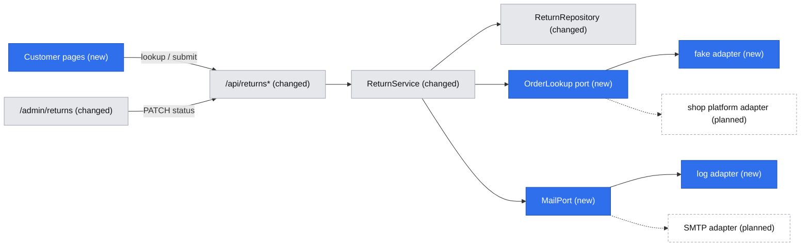
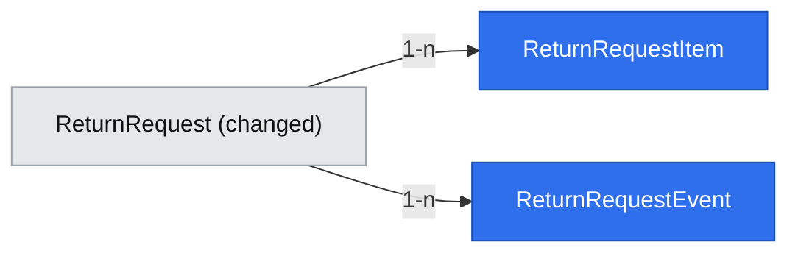

# Return end-to-end: customer wizard, status tracking, agent decision

## 📝 TLDR
Shop customers and the support agents who handle their returns need one place where a return is requested with complete data, tracked, and decided. Today (current behavior) `/` has a minimal form (order number, e-mail, free-text reason) and `/admin/returns` lists requests and lets anyone flip them between five statuses. Proposed (future behavior): the first slice of the returns portal concept — UC-01 identify the order, UC-02 return wizard, UC-06 status tracker, UC-10 agent decision — built by evolving the existing `ReturnRequest` concept (items, resolution choice, state machine, timeline), so agents stop chasing customers for missing data.

## ❓ Open Questions
Q1–Q8 were answered by accepting all proposals (2026-10-22); N1 and N2 likewise. They are recorded under **Resolved decisions** and are not reopened. Two new questions remain, both about things the draft assumes:

- **N3 — UI language.** The brief and concept are Polish (English is a later phase, N04), but the shipped app copy is English. Proposed: all new customer and agent copy in Polish, each page's strings colocated in one constant object (no i18n framework); the existing English strings on touched pages are replaced. Alternative: keep English now.
- **N4 — Test runner.** The repo has no test runner and the validation gate (`typecheck`, `lint`, `audit`, `build`) has no `test` command, but `om-auto-create-pr` requires tests for every code change. Proposed: add Vitest as a dev dependency of `@easyrms/core` (pure unit tests only, no database), plus a root `npm test` appended to `validation.commands` in `.ai/agentic.config.json`. This adds tooling the AGENTS.md stack table does not list, so it needs your explicit approval.

## Resolved decisions
| Id | Decision | Source |
|---|---|---|
| Q1 | One spec, phased; agent side ships first | accepted proposal |
| Q2 | `OrderLookup` port in `core` + seeded fake adapter now; real platform adapter later | accepted proposal |
| Q3 | Items are in the slice: `return_request_items` table | accepted proposal |
| Q4 | Customer picks refund / store credit +10% / exchange; system records choice and server-computed amount; money moves manually | accepted proposal |
| Q5 | Guest lookup only (order number + e-mail → order-scoped session, 2 h); magic link later | accepted proposal |
| Q6 | No auto-acceptance (R08 not implemented); every return goes to an agent | accepted proposal |
| Q7 | Agent moves a return manually `approved → in_transit → received → resolved` | accepted proposal |
| Q8 | No agent login in this slice; separate prerequisite spec; flagged as a risk | accepted proposal |
| N1 | Return shipping fee = flat `RETURN_SHIPPING_FEE` (PLN, default 0, documented in README); store credit is always free | accepted proposal |
| N2 | `MailPort` in `core` + log-only adapter; real SMTP adapter is a later small PR | accepted proposal |
| Brief Q03–Q06, Q09–Q13 | Single app with routes per shell; evolve `ReturnRequest`; `MANAGE_RULES` on `AGENT` (not used yet, no auth); read-only K-05 for agents (deferred with auth); tracker banners; 2-day target; shop platform + e-mail only; rules-only recommendation (no recommendation in this slice); slice = UC-01/02/06/10 | `product-brief.md` |

## 📝 Problem Statement
Support handles returns by e-mail and phone and repeatedly asks for order number, photos and serial numbers (brief, Problems). That follow-up being the main cost is an assumption (A01), untested until the ~50-case sample is collected, and KPI baselines (Q02) are still being gathered. This slice therefore ships the smallest end-to-end flow that makes the claim measurable, and does not claim the problem is proven. For returns, no evidence upload is required (concept §2.2), so completeness here means: right order, right items and quantities, a reason per item, a chosen resolution and return method.

## 📝 Proposed Solution
Evolve the `returns` concept instead of adding a parallel one:

- **Customer (Tailwind, public):** `/` order lookup (K-01) → `/returns` order overview with existing claims and "start a return" → `/returns/new` wizard (items, reasons, resolution, return method, summary: Z-02…Z-06) → `/returns/[rma]` tracker (K-05, doubles as the confirmation Z-07). The Z-01 "type" step is dropped because only returns exist in this slice.
- **Agent (shadcn, admin):** `/admin/returns` inbox (status filter, 2-business-day due marker) → `/admin/returns/[id]` card (items, customer's resolution and amount, timeline, decision actions).
- **Core:** a status state machine, eligibility and quote rules as pure functions, a guest-session service, and two ports (`OrderLookup`, `MailPort`).

Alternatives that lost: a new `Claim` entity beside `ReturnRequest` (duplicates the concept, Q04); the three-app layout (conflicts with AGENTS.md, Q03); client-side quote math in `ui` (`ui` cannot import `core`, and amounts must be server-recomputed — a quote endpoint is used instead).

## 📝 Architecture
Primary module: the existing `returns` concept across `db`, `core`, `app`, `ui`. New in `core`: an `orders` concept folder holding only the `OrderLookup` port, and a `mail` port. Reused primitives: `apiHandler`, `makeCrudRoute`, `apiCall`, `DataTable`, feedback components, Awilix request scope.

Takeaway: all business rules live in `core` and are reachable only through `ReturnService`; the two integrations are replaceable behind ports, so the slice runs end to end with no external system.

Key mechanics that are unique to this feature:

- **Status model** (lower snake_case, matching the existing convention): `submitted`, `awaiting_customer`, `approved`, `in_transit`, `received`, `in_service`, `resolved`, `rejected`, `cancelled`. Allowed transitions in this slice: `submitted → approved | rejected`, `approved → in_transit`, `in_transit → received`, `received → resolved`. `awaiting_customer`, `in_service`, `cancelled` exist in the enum (Q04) but have no transitions yet (they need UC-07/UC-08, ask-for-info and customer cancel). Anything else throws `ConflictError` (409). Legacy rows map `requested→submitted`, `refunded→resolved`; `approved`, `rejected`, `received` unchanged.
- **Eligibility** (pure, `core`): item is returnable when the order is delivered, `returnable` is true (R06), delivery is within the window (R01: `RETURN_WINDOW_DAYS`, default 30, clamped to 14–365), and quantity not already claimed by non-rejected claims for that order line. Quantities are checked on submit under a per-order lock (below).
- **Quote** (pure, `core`, integer minor units): `refund = Σ qty × unitPrice − RETURN_SHIPPING_FEE`, floored at 0; `store_credit = Σ qty × unitPrice × 1.10`, no fee (R12); `exchange` has no amount, only an `exchangeNote` (e.g. size). Recomputed on submit; client-supplied amounts are ignored.
- **Guest session**: `POST /api/returns/lookup` verifies order number + e-mail through `OrderLookup` and sets an `httpOnly`, `sameSite=lax`, `secure`-in-production cookie holding an HS256 JWT (`jose`, secret `GUEST_SESSION_SECRET` ≥ 32 bytes, `exp` 2 h, claim = order number). Missing or short secret fails closed. Every customer read/write re-checks that the cookie's order matches the claim's order. The customer e-mail is always taken from the order, never from the request body.
- **Concurrency**: submit runs in one transaction that first takes a parameterised `pg_advisory_xact_lock(hashtext(orderNumber))` (the single sanctioned raw statement, inside `db`, no string concatenation), then re-checks remaining quantities, then inserts. A unique `idempotency_key` makes a retried submit return the original claim.
- **RMA**: `RMA-YYYY-NNNNN` from a Postgres sequence (`return_rma_seq`), monotonic and not reset per year; unique index on `rma`.
- **Rate limiting** (R14): neutral error on any lookup failure, plus a per-IP in-memory fixed-window limiter (10 per minute) returning 429. CAPTCHA after five attempts is deferred (see Decisions in play).
- **Due marker**: `dueAt = createdAt + 2 business days` (Mon–Fri, no holiday calendar), a pure function; list and card show a red badge when `status = submitted` and `now > dueAt`. No escalation in this slice.

## 📝 Data Model
Changes to `return_requests` are expand-only in this slice:

| Column | Change |
|---|---|
| `rma` varchar(20) | new, `not null`, unique; backfilled for existing rows from the sequence in `created_at` order |
| `kind` varchar(16) | new, default `return` |
| `status` varchar(32) | default `submitted`; existing values rewritten by the migration; unknown values are rejected in code |
| `reason` text | relaxed to nullable (not lossy); new submissions leave it null, legacy rows keep it |
| `resolution` varchar(16) | new, null; `refund` / `store_credit` / `exchange` |
| `resolution_amount` numeric(12,2), `currency` char(3) | new, null / default `PLN` |
| `exchange_note` text | new, null |
| `return_method` varchar(24) | new, null; `parcel_locker` / `courier` / `store` |
| `decision_note` text | new, null; required (≥ 30 chars) on reject (R15) |
| `idempotency_key` uuid | new, null, unique |

New tables:

- `return_request_items`: `id`, `return_request_id` (FK, restrict), `line_ref` varchar(100) (order line id from the platform), `sku`, `name`, `quantity` int, `unit_price` numeric(12,2), `reason_code` varchar(32), `comment` text null. Unique `(return_request_id, line_ref)`. Name and price are a snapshot (D03: the platform stays the source of truth for orders; the snapshot exists for display and audit).
- `return_request_events`: `id`, `return_request_id` (FK), `type` (`submitted` | `status_changed`), `from_status` null, `to_status`, `note` null, `actor` (`customer` | `agent` | `system`), `created_at`. Feeds the K-05 timeline and the agent card. Agents are anonymous in this slice (Q8), so `actor = agent` carries no identity.

Sensitive data: `customer_email` (existing) is the only personal field; no phone, no free-text address is collected. Item `comment` and `decision_note` are free text about a person's purchase: never logged, never put in e-mail logs, shown only to the owning customer's session and to agents. Retention and anonymisation after 3 years (R16) is not implemented here (see Risks). Migration: a new MikroORM migration with a working `down` (drops the new columns/tables and sequence, restores `status` values and `reason not null` only when no row has a null reason, otherwise fails with an explicit message); the already merged migration is not edited.

## 📝 API Contracts
All responses use the existing `{ ok, data } | { ok: false, error }` envelope; all state-changing routes keep the `x-requested-with` check. Schemas live in `core/src/validators/returns/`.

| Route | Who | Request | Response / errors |
|---|---|---|---|
| `POST /api/returns/lookup` | public | `{ orderNumber, email }` | sets session cookie; `{ orderNumber, deliveredAt, eligibleLines[] }`. Any mismatch → 404 with one neutral message; limiter → 429; order not delivered → 200 with `{ tracking }` and no lines |
| `POST /api/returns/quote` | session | `{ items:[{lineRef, quantity}], resolution }` | `{ amount, currency, fee }`; 401 without session; 422 on ineligible items |
| `POST /api/returns` | session | `{ items:[{lineRef, quantity, reasonCode, comment?}], resolution, exchangeNote?, returnMethod, acknowledged: true, idempotencyKey }` | `201 { rma, status, resolution, resolutionAmount }`; repeat of `idempotencyKey` → 200 with the same body; 409 when quantity was claimed meanwhile |
| `GET /api/returns` | agent (open, Q8) | `?status=` optional | list with `rma`, items count, `resolution`, `dueAt`, `overdue` |
| `PATCH /api/returns/[id]` | agent (open, Q8) | `{ status, decisionNote? }` | updated claim; invalid transition → 409; reject without a ≥ 30-char note → 422 |

Compatibility (see Risks): `POST /api/returns` changes shape, and the `status` value set changes. This is the only intended breaking change, and it ships together with every consumer in Phase 3.

## 📝 UI/UX
Only what is unique; standard forms, tables and feedback reuse existing components.

- **Wizard states:** each step validates before "Next"; ineligible items render disabled with the reason (outside window, already claimed, not returnable). Idempotency key is generated when the wizard mounts; on a network error the entered data is kept and "Spróbuj ponownie" resubmits with the same key. If the window expires mid-flow the server rejects on submit and the summary shows the reason.
- **Tracker (K-05):** five stages `Zgłoszone → Zaakceptowane → W drodze → Odebrane → Rozwiązane` (`in_service` shows under Odebrane); `awaiting_customer` is a banner on the current stage; `rejected` and `cancelled` replace the stages with a closed state and the reason (Q09). A "Co teraz?" line per status, the timeline, and the chosen resolution with the amount. "Odpowiemy w ciągu 2 dni roboczych" is shown for `submitted` (Q10).
- **Agent card:** the customer's resolution and amount are shown next to the action buttons; only transitions the state machine allows are rendered; reject opens a required note field with a live ≥ 30-character counter.
- **Accessibility:** WCAG 2.1 AA target (R16): labelled inputs, focus moved to the step heading on step change, stage list as an ordered list with `aria-current="step"`.
- **Copy language:** see N3.

## 📝 Edge Cases & Failure Scenarios
- Wrong order number or wrong e-mail: the same neutral message and timing class; limiter at 10/min/IP.
- Order exists but is not delivered: information plus the tracking link, no wizard.
- Window passes between lookup and submit, or another claim takes the quantity: server revalidates → 422/409 with an explanation; entered data stays.
- Double click or retry: same `idempotencyKey` returns the original claim, no second RMA.
- Two simultaneous submits for the same order line: the advisory lock serialises them; the second gets 409.
- Session expired (2 h) on submit: 401 → the wizard shows "Sesja wygasła" and keeps the draft in memory only while the page is open; the user re-identifies and starts again. Draft persistence is not built.
- Agent clicks a transition that became invalid (another agent acted): 409 with the current status, the card refreshes.
- Mail port failure: logged with template id and masked recipient, never fails the request or rolls back the transition.
- `GUEST_SESSION_SECRET` missing or too short, or fake adapter selected in production: the app fails closed on the first customer request with a configuration error, no cookie issued.
- Migration with legacy rows: status rewrite and `rma` backfill run in one transaction; failure leaves the schema unchanged.

## 📝 Risks & Impact Review
Evidenced violations of repository rules (to be fixed, not discussed):
- None found in this draft against `doc/engineering-standards.md`; the two raw-ish items are called out (parameterised advisory lock only in `db`; `jose` added to `core` as a framework-agnostic dependency).

Product direction calls and accepted risks:
- **Breaking API/DB contract** (`BACKWARD_COMPATIBILITY.md` §1, §2): `POST /api/returns` request shape, `status` values, and `reason` becoming nullable. Required path: update schema and every consumer in the same PR (Phase 3), list under "Breaking changes" in the PR body, migration with `down`, expand-only schema (no drops) with rollback = run `down` before any new-format rows exist, after which rollback is data-lossy for items and is stated as such.
- **No agent authentication (Q8):** anyone who can reach `/admin` or `PATCH /api/returns/[id]` can approve or reject. Accepted only because the app is not exposed beyond local/demo use; must not be deployed publicly until the auth spec lands. Anonymous `actor = agent` events limit auditability.
- **Fake order adapter** in production would let anyone "own" seeded orders: guarded by failing closed outside non-production unless explicitly enabled.
- **In-memory rate limiter** is per-process: ineffective across several instances and reset on restart; acceptable for a single-instance MVP, replace before scaling out.
- **R14 CAPTCHA deferred** and **R16 retention/anonymisation not implemented**: both are owner/legal decisions to confirm.
- **Hard-to-reverse:** `rma` format and sequence, status value names, and the `return_request_items` snapshot columns become the long-term contract.
- **Tooling decision (N4):** adding a test runner changes the validation gate.

## 📝 Decisions in play
Relies on: R01 (window, `RETURN_WINDOW_DAYS`), R06, R12, R13, R14, R15, R16, D02, D03, D05 (partially: guest session only), D06 (narrowed to this slice by Q13), N01–N04 (no B2B, external service, per-item resolution, English).
Proposes to supersede, with the owner who must approve (Adam Adamczyk; legal for R14/R16):
- **R14:** CAPTCHA after 5 attempts is replaced by a hard 10/min/IP limit until a CAPTCHA provider is chosen.
- **R08:** not implemented in this slice (Q6); no change to its text.
- **D04:** already narrowed by brief Q03 (single app); recorded here for traceability.

## 📋 Phasing
- **Phase 1 — Agent decision on a real status model.** Migration, state machine, timeline, agent inbox and card. The legacy public form keeps working (creates `submitted` rows with an RMA). Independently shippable.
- **Phase 2 — Customer backend.** Order lookup port + fake adapter, guest session, rate limiting, eligibility, quote, items table, `MailPort`. APIs exist and are tested; no UI change yet.
- **Phase 3 — Customer UI and the breaking switch.** Lookup page, order overview, wizard, tracker; `POST /api/returns` takes the new shape and the legacy form is removed in the same PR.
- **Phase 4 — Docs and hardening.** README env vars, lessons, spec moved to `implemented/`, acceptance walkthrough.

## 📋 Implementation Plan
Each step leaves the app working and ends with the validation gate; unit tests assume N4 (Vitest) is approved, otherwise the step's checks run through typecheck, lint and a manual walkthrough.

### Phase 1: Agent decision on a real status model
1. **Test runner (N4).** Add Vitest to `@easyrms/core`, root `npm test`, append to `validation.commands`. Test: a trivial pure-function test runs under `npm test`.
2. **Status model in `core`.** `RETURN_STATUSES` (9 values), transition table, `canTransition`, `ReturnService.updateStatus` throws `ConflictError` on invalid moves, `decisionNote` rule for reject. Tests: every allowed and a sample of forbidden transitions; reject needs ≥ 30 chars.
3. **Migration + entities.** New columns, `return_request_events`, `return_rma_seq`, status rewrite, `rma` backfill, nullable `reason`, working `down`. Repository maps new fields, writes an event per change, generates `rma` on create. Test: migrate up on a DB with legacy rows, check mapping; run `down`.
4. **Due marker.** `dueAt`/`overdue` pure function (2 business days). Test: Friday submit → Tuesday, weekend boundaries.
5. **Agent inbox.** `/admin/returns` shows RMA, status badge, resolution, due marker, `?status=` filter via `GET /api/returns`. Test: service list filter; manual page check.
6. **Agent card.** `/admin/returns/[id]` Server Component with items (empty for legacy rows), timeline, allowed-transition buttons, reject note field; replaces the free status select. Test: page renders for legacy row; invalid transition shows the 409 message.

### Phase 2: Customer backend
1. **Items table + entities.** `return_request_items` migration, repository support, domain types. Test: insert/read with unique `(return_request_id, line_ref)`.
2. **`OrderLookup` port + fake adapter.** Port in `core/src/services/orders/`, seeded in-memory adapter in `core/src/adapters/orders/`, selected by `ORDER_SOURCE`, fails closed in production unless explicitly set. Test: found, wrong e-mail, wrong order give the same result; production guard.
3. **Eligibility and quote.** Pure functions with env-driven config (`RETURN_WINDOW_DAYS` clamp, `RETURN_SHIPPING_FEE`). Tests: window edges (13/14/30/365 days), non-returnable lines, remaining quantity, all three resolutions, fee floor at 0.
4. **Guest session service.** `jose` HS256, 2 h, fail closed on a missing or short secret; cookie helpers in `app/src/server/`. Tests: sign/verify, expiry, tampering, wrong order.
5. **Lookup + quote routes.** `POST /api/returns/lookup` (limiter, neutral error), `POST /api/returns/quote`. Test: 404 text identical for both failures; 429 after 10; 401 without session.
6. **Submit service (not yet routed).** `ReturnService.submit` with the advisory lock, quantity re-check, idempotency, server-side amount, events, `MailPort` call (`return_submitted`). `MailPort` + log adapter (masked recipient). Tests: duplicate key returns original; over-quantity 409; mail failure does not fail submit.

### Phase 3: Customer UI and the breaking switch
1. **Lookup page `/` and order overview `/returns`.** Replaces the legacy form page; shows existing claims for the session's order and a "start" button. Test: neutral error display; redirect without session.
2. **Wizard `/returns/new`.** Items → reasons → resolution (with quote via `apiCall`) → return method → summary; Tailwind components in `ui/src/public/returns/`. Test: step validation, disabled ineligible lines, retry keeps data and key.
3. **Submit switch.** `POST /api/returns` uses the new schema and requires a session; legacy form and the old schema are removed; all consumers updated; PR body lists the breaking changes. Test: end to end through the fake adapter; legacy shape returns 422.
4. **Tracker `/returns/[rma]`.** Stages, banners, "Co teraz?", timeline, resolution and amount; ownership check against the session. Test: another order's session gets 404, all nine statuses render.
5. **Status-change mail.** `PATCH` triggers `return_status_changed` via `MailPort`. Test: mail port failure is swallowed and logged.

### Phase 4: Docs and hardening
1. **README and config.** Document `GUEST_SESSION_SECRET`, `ORDER_SOURCE`, `RETURN_WINDOW_DAYS`, `RETURN_SHIPPING_FEE`; update `AGENTS.md` "Current state".
2. **Acceptance walkthrough** in a browser (customer submit → agent approve → in transit → received → resolved, and the failure cases above); results saved to `.ai/runs/`.
3. **Close-out.** Add lessons to `.ai/lessons.md`; move this spec to `.ai/specs/implemented/` and update the brief (Q-answers already recorded).
