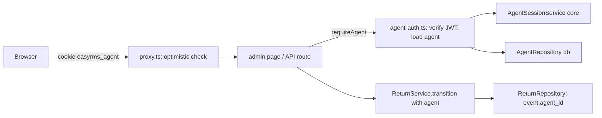

# Agent login and roles

Status: approved by the owner on 2026-10-24 (all Open Questions answered; author defaults and D10/D11 confirmed). Not implemented. Tracking: #30 (task of epic #29). Design authority: `.ai/specs/product-brief.md` (Q05, Q06, Q15, D09). Nothing here is implemented.

## 📝 TLDR
Agents who decide returns are anonymous today: `/admin` and `PATCH /api/returns/[id]` accept any request, and timeline events carry `actor = agent` with no identity (current behavior, `return-agent-decision` spec AD-A2). Proposed (future behavior): agents sign in with e-mail and password, every admin page and decision API requires a session, each timeline event names the agent, an admin screen invites and disables agents, agents get a read-only view of the customer tracker (K-05), and refunds above 2000 zł need the `MANAGE_RULES` permission. The reason is that the README forbids exposing the app publicly until this exists, and the customer portal shares the same app.

## 📝 Resolved decisions (owner answers, 2026-10-24)
Local ids; brief ids are written "brief Q05" etc.

| Id | Decision |
|---|---|
| Q1 | Login method: e-mail + password, credentials stored in our database |
| Q2 | Per-agent identity is required: events name the agent |
| Q3 | No interim production guard: login itself is the guard; the README "do not expose" warning stays until login ships |
| Q4 | Agent accounts are managed on an admin screen (invite, disable) |
| Q5 | Session: signed cookie, 8 h, explicit logout, no remember-me |
| Q6 | Only the `AGENT` role; `MANAGE_RULES` is a reserved permission held per agent (brief Q05) |
| Q7 | Read-only customer-view (K-05) for agents is in this spec (brief Q06) |
| Q8 | Customer guest sessions and agent sessions stay separate |
| Q9 | Audit is: agent id on each timeline event; no login, logout or failed-login records for now |
| Q10 | An agent holding `MANAGE_RULES` can invite and disable agents; the first agent is created by a one-off command |
| Q11 | An agent holding `MANAGE_RULES` can approve refunds above 2000 zł (brief R11); other agents cannot |
| Q12 | The admin screen shows a one-time invite link to copy and hand over; the invite also goes through `MailPort` (log adapter only for now) |

## 📝 Problem Statement
Anyone who can reach the app can approve or reject returns and the history cannot say who did it (README, AD-A2). That blocks public deployment and leaves refund decisions without accountability. `[PRODUCT]`: the harm is design-level; there is no incident or measured demand behind it.

## 📝 Proposed Solution
Hand-built, small, inside the existing layers: an `agents` table and a repository in `db`; password hashing, an agent session service and an agent service in `core`; an `authenticate` hook in the shared HTTP layer plus a guard helper for pages in `app`; a `proxy.ts` as a second, optimistic line of defense.

**Alternatives considered**
- *Auth library (Better Auth, Auth.js).* Market leaders ship password reset, MFA, session lists and invitations. Rejected for this slice: they bring their own tables and migrations outside MikroORM (the repo rule is that `db` owns all persistence and every schema change is a MikroORM migration), a new dependency needs owner approval (AGENTS.md), and this slice needs one role, one login method and a handful of screens. Revisit if SSO/OIDC, MFA or password reset are scheduled. (Based on prior knowledge of these libraries, not re-checked against their current releases for this draft.)
- *Shared secret in front of `/admin`.* Rejected by Q1 and Q2 (no identity).
- *Argon2id via a native package.* Rejected: native build in CI and Storybook paths for no gain here; `node:crypto` scrypt at OWASP parameters is acceptable and dependency-free.

**What we keep from the leaders**: one-way hashed invite tokens, uniform login errors, per-IP and per-account throttling, `HttpOnly`/`SameSite`/`Secure` cookies, checks next to the data and not only in the proxy.

## 📝 Architecture
Existing: `apiHandler` and `makeCrudRoute` (`packages/core/src/http/`) wrap every route; `GuestSessionService` (`core`, `jose` HS256) is the pattern for a stateless signed cookie; `RateLimiter` (`core/security`) throttles customer lookups; the container in `packages/app/src/server/container.ts` is the composition root; admin pages call `createRequestScope()` and render Server Components.

New (all planned, none exists):

Takeaway: the proxy only rejects requests with no valid signature; the authoritative check loads the agent from the database on every request, so disabling an agent takes effect on the next request.

- **Where code goes** (domain concept `agents`): `db/src/entities/agents/agent.entity.ts`, `db/src/repositories/agents/agent.repository.ts`; `core/src/services/agents/` (`agent.service.ts`, `agent-session.service.ts`, `password-hasher.ts`, `permissions.ts`), `core/src/validators/agents/`; `app/src/app/api/agents/**`, `app/src/app/admin/{login,invite,agents}/`, `app/src/server/agent-auth.ts`, `app/src/proxy.ts`.
- **Session**: HS256 JWT, claims `sub` (agent id), `ep` (session epoch), `aud: "agent"`, 8 h `exp`; cookie `easyrms_agent` (`HttpOnly`, `SameSite=Lax`, `Path=/`, `Secure` in production, via the existing `serializeCookie`). Secret `EASYRMS_AGENT_SESSION_SECRET` (at least 32 bytes), resolved lazily and failing closed outside development exactly like the guest secret (`next build` unaffected). **Separation (Q8)**: a different cookie name, a different secret, and a different `aud`, so a guest token fails agent verification and the reverse; both directions are tested.
- **`ep` (session epoch)**: an integer on the agent, incremented on disable and on re-invite. A token whose `ep` differs from the stored value is rejected, so an old cookie cannot come back to life when a disabled agent is re-invited within 8 h.
- **Authorization**: `AgentContext { id, email, displayName, permissions }`. `requireAgent(request)` (APIs) throws `UnauthorizedError` (401); `requireAgentPage()` (pages) redirects to `/admin/login?next=<path>`; `requirePermission(agent, "MANAGE_RULES")` throws `ForbiddenError` with code `forbidden` (403). Permissions are an allow-list validated by Zod; today only `MANAGE_RULES` exists.
- **Shared HTTP layer**: `apiHandler` and `makeCrudRoute` get an optional `authenticate: (request) => Promise<TPrincipal>` option, run after the CSRF check and before parsing; the principal is passed to the handler as the last argument. A route without it behaves exactly as today, so the customer routes are unchanged.
- **Page guard**: a layout is not re-run on every client navigation, so every admin page calls `requireAgentPage()` itself (per the Next.js authentication guide in `node_modules/next/dist/docs/01-app/02-guides/authentication.md`). The same call returns the `AdminShell` data (agent name, logout button), so a page that forgets the guard also lacks the chrome and is visibly wrong.
- **`proxy.ts`** (Next.js in this repo calls it `proxy`, not `middleware`; the file convention page must be read before writing it): runs the optimistic check — cookie present and JWT signature, audience and expiry valid, no database access — for `/admin/**` except `/admin/login` and `/admin/invite/**`, for `/api/agents/**` except `login` and `invite/accept`, for `/api/discovery/**`, and for `/api/returns/<id>` (digits only; the customer routes `lookup`, `quote`, `session` and the collection POST stay public). Pages get a redirect to login, APIs a 401 envelope.
- **Guard inventory check** (follow-up, outside the four phases): a node script (`scripts/check-agent-guards.mjs`, `npm run check:guards`) fails when an `admin/**/page.tsx` or a `route.ts` under the protected API prefixes lacks the guard call, except the explicit allow-list. It mitigates the main failure mode of an opt-in guard: a new admin route that ships open. Adding it to the validation gate is a follow-up, not a phase step; it is a change to `.ai/agentic.config.json` and needs the owner's yes (see Risks).
- **Composition**: `agentService`, `agentSessionService`, `passwordHasher` registered in the Awilix container; `agentRepository` registered scoped in `registerDb`. The scrypt adapter implements a `PasswordHasher` port declared in `core`.

## 📝 Data Model
Expand-only MikroORM migration in `packages/db`, `up` and `down`, frozen SQL like the existing ones.

`agents`
| Column | Notes |
|---|---|
| `id` serial pk | |
| `email` varchar(255), unique | stored trimmed and lower-cased; personal data, never logged |
| `display_name` varchar(100) | shown in timelines and the admin header |
| `password_hash` text null | `null` until the invite is accepted; self-describing format `scrypt$N$r$p$salt$hash` so parameters can be raised later |
| `permissions` text[] not null default `{}` | allow-list, today only `MANAGE_RULES` |
| `status` varchar(16) | `invited` / `active` / `disabled`, validated in code (matches the repo's varchar + code-check convention for statuses) |
| `session_epoch` int not null default 0 | see Architecture |
| `invite_token_hash` char(64) null, unique | SHA-256 hex of a 32-byte random token; the token itself is never stored; `null` once used or when no invite is open |
| `invite_expires_at` timestamptz null | 72 h after the invite is created |
| `created_at`, `updated_at` | |

At most one invite is live per agent (a re-invite replaces the token), and the brief asks for no invite history (Q9), so the token lives on `agents` and there is no separate invites table. Accepting is one conditional update (`where invite_token_hash = $1 and invite_expires_at > now()`) that sets the password, clears the hash and expiry, sets status `active` and increments `session_epoch`; zero rows updated means `invite_invalid`.

`return_request_events`: add `agent_id` int null, fk → `agents` (restrict). `actor` stays `agent`; legacy and system/customer events keep `agent_id` null. Agents are never deleted, only disabled, so the history stays readable.

Sensitive data: the hash and invite tokens never leave `db` and the service (repository reads that serve lists return a record type without them; credentials are read only by `findCredentialsByEmail`); an agent's e-mail is not written to logs (the existing logger context rules); the customer tracker and customer APIs never receive `agent_id` or the agent's name — `trackerEventView` maps every non-customer event to "team" and a test pins that.

Rollback: `down` drops `agent_id` and `agents`. It is safe only because nothing else references them; once agents have made decisions, `down` loses who decided, so it refuses (like the portal migration's `down`) when any event has `agent_id` set.

## 📝 API Contracts
All bodies are validated with Zod schemas in `core/src/validators/agents/` shared by routes and forms; responses use the standard `{ ok, data } | { ok: false, error }` envelope; every mutating route passes the existing CSRF check.

| Route | Auth | Behavior |
|---|---|---|
| `POST /api/agents/login` | public | `{ email, password }` → sets the cookie, returns `{ displayName }`. Every failure (unknown e-mail, wrong password, disabled, not yet invited-and-accepted) returns the same 401 `invalid_credentials`. Throttled: 10 attempts/min per IP and 5 failures per 10 min per (e-mail, IP), then 429, same shape as the customer lookup (brief R17). A missing agent still runs a dummy hash verification so response time does not reveal existence. |
| `POST /api/agents/logout` | agent | clears the cookie; idempotent |
| `GET /api/agents` | agent with `MANAGE_RULES` | list: id, e-mail, display name, status, permissions |
| `POST /api/agents` | agent with `MANAGE_RULES` | `{ email, displayName, permissions }` → creates (or re-invites a `disabled` or still-`invited` agent: new token replaces the stored hash, `session_epoch` +1, `permissions` replaced) and returns `{ agent, inviteToken }` once. An `active` e-mail answers 409. Sends `agent_invite` through `MailPort`. |
| `PATCH /api/agents/[id]` | agent with `MANAGE_RULES` | `{ status: "disabled" }`: sets disabled, `session_epoch` +1. 409 `last_manager` if it would leave no active agent with `MANAGE_RULES`; 409 `self_disable` for the caller's own id. |
| `POST /api/agents/invite/accept` | public | `{ token, password }` (password 12–128 characters, no composition rules) → sets the password, status `active`, `session_epoch` +1, issues a session. Unknown, expired and used tokens all return the same 400 `invite_invalid`. |
| `PATCH /api/returns/[id]` | agent (**now required**) | unchanged body; the agent is recorded on the event; approving a refund above the limit without `MANAGE_RULES` → 403 `approval_required`. Check order: authentication (401), note rules (400), existence (404), allowed move (409), approval limit (403), compare-and-set (409). |
| `/api/discovery/case-sample` | agent (**now required**) | unchanged otherwise. The route and its page were built to work without Postgres (`getCoreContainer()`, case-sample spec). `requireAgent` reads the agent from the database, so this access check does need Postgres; the service itself stays stateless. Decision: use the full check (immediate revocation, one rule everywhere); an agent cannot sign in without the database anyway. |

**Breaking change** (see `BACKWARD_COMPATIBILITY.md`): unauthenticated `PATCH /api/returns/[id]` and `/api/discovery/**` calls start returning 401. The only known callers are the admin UI pages; any script or test calling them must sign in. `ReturnService.transition` gains a required agent argument (internal to `core`/`app`).

**R11 limit**: `EASYRMS_REFUND_APPROVAL_LIMIT` (PLN, default `2000`), parsed in `app/src/server/return-config.ts` like the other return config, documented in the README. The rule applies when the transition target is `approved`, the request's `resolution` is `refund`, and `resolutionAmount` exceeds the limit. Store credit and exchange are never gated. (R11's "amount ≤ order value" is already enforced at submit by the server-computed quote.)

Invite link format: `<origin>/admin/invite/<token>`, assembled by the admin screen from the page origin so no public-URL configuration is needed; the invite page sends `Referrer-Policy: no-referrer` and the token travels in the POST body, not in later URLs.

## 📝 UI/UX
Polish only (brief D07), strings colocated per page in a `copy.ts`. Read `packages/ui/src/storybook/agent/dla-agenta-ai.mdx` and copy a skeleton from `storybook/patterns/ekrany.stories.tsx` before building; tokens only; reuse `DataTable`, `Dialog`, `Alert`, `Button`, `Input`, `Label` from `@easyrms/ui/admin`. Check whether `CrudForm` can render a password field; if not, extend it with a `password` field kind plus its story and docs page in the same change (`npm run docs:check`).

- **`/admin/login`**: e-mail, password, one neutral error ("Nieprawidłowy e-mail lub hasło"), 429 shows a wait message; `next` is honored only when it starts with `/admin` and not `//` (no open redirect). A signed-in agent opening the page is redirected on.
- **`/admin/invite/[token]`**: set password (12+ characters, show/hide), same neutral error for a bad token with a pointer to ask a colleague for a new invite.
- **Admin header (`AdminShell`)**: agent name, links (Zwroty, Agenci for `MANAGE_RULES`), "Wyloguj".
- **`/admin/agents`** (only `MANAGE_RULES`; others get 403 page): `DataTable` of agents with status badges; "Zaproś agenta" dialog (e-mail, display name, "może zarządzać agentami i regułami" checkbox) that on success shows the one-time link with a copy button and the warning that it is shown once; "Wyłącz" per row with confirmation; the disable button is absent for your own row and disabled-with-reason for the last manager.
- **Decision card**: shows the acting agent's name on timeline events; when a refund above the limit is awaiting approval and the agent lacks `MANAGE_RULES`, "Akceptuj" is disabled with the reason (server stays authoritative).
- **K-05 read-only preview** (`/admin/returns/[id]/customer-view`): the tracker body currently in `app/returns/[rma]/page.tsx` is extracted to a shared Server Component (second consumer, so it leaves colocation but stays in `app`, because it is data-bound) and rendered by both pages. The preview loads by id (`getDetail`), shows a banner "Podgląd widoku klienta — tylko do odczytu", has no customer links or actions, and links back to the decision card. States: unknown id → 404; not signed in → login.

## 📝 Edge Cases & Failure Scenarios
- **Wrong credentials, unknown e-mail, disabled agent, never-accepted invite**: identical 401 and timing; the throttle counts all of them.
- **Brute force**: 429 after the budgets in the API table; the limiter is in-memory per process (same limitation as the customer portal; a multi-instance deployment needs a shared store, noted in Risks).
- **Disabled while signed in**: the next request fails `requireAgent` (status check plus `ep`), the page redirects to login, an API call gets 401; a decision already committed stays.
- **Disabling the last manager or yourself**: 409 with the specific code; checked inside a transaction that locks the active manager rows, so two managers disabling each other concurrently cannot both succeed.
- **Invite**: token reuse, expiry, and a second accept racing the first return the same `invite_invalid` (the conditional update above checks the row count); re-inviting replaces the stored hash, so the earlier link stops working. Two concurrent first invites for the same e-mail hit the unique index and the loser answers 409, not 500.
- **Forgot password**: no self-service reset; a manager re-invites the same e-mail, which resets the password and ends sessions. If the only manager forgets it, the `agent:create` command can re-invite (it reuses the same service).
- **Secret missing in production**: login, invite accept and the proxy fail closed (opaque 500 logged, as for guests); `next build` is unaffected.
- **Guest cookie presented to admin, agent cookie presented to the customer portal**: both rejected (distinct secret and `aud`), and neither grants the other's scope.
- **Stale tab on a decision**: unchanged 409 flow from the agent-decision spec.
- **Mail failure on invite**: never fails the request (the `MailPort` contract); the link is still returned on screen.
- **Open redirect via `next`**: sanitized as above.
- **Cookie `Secure` over plain http in production**: login appears to succeed but no cookie is kept; documented in the README next to the existing proxy notes.

## 📝 Backward compatibility (`BACKWARD_COMPATIBILITY.md`)
| Surface | Change | Required path |
|---|---|---|
| §1 HTTP API | `PATCH /api/returns/[id]` and `/api/discovery/**` answer 401 without a session (new status mapping on existing routes); new `/api/agents/**` routes | "Breaking changes" heading in the PR body of Phase 2; the only known callers are the admin pages, updated in the same PR |
| §2 Database | New `agents` table and nullable `return_request_events.agent_id`; expand-only | New migration with a working, guarded `down` and a rollback plan in the PR body |
| §3 Internal packages | `apiHandler`/`makeCrudRoute` gain an optional `authenticate` option (non-breaking); `ReturnService.transition` and the `ReturnRepository` port gain a required agent argument; new DI registrations | Update every in-repo consumer in the same PR; check each existing route and page on the shared http layer (customer routes must behave exactly as before, covered by the existing `api-handler` tests plus the new unchanged-without-option test) |
| §4 Configuration | New `EASYRMS_AGENT_SESSION_SECRET` and `EASYRMS_REFUND_APPROVAL_LIMIT`; new scripts `agent:create` (and `check:guards` when approved) | Document in the README in the same PR; no existing variable or script is renamed |
| §5 Process | None (`tsx` and the gate change are separate approvals) | n/a |

## 📝 Risks & Impact Review
- **Authentication, data scoping and a schema migration: this change is `risk-high`**; the PRs need a QA reviewer (no self-QA) and a second person's review (`SDLC.md`).
- **The case sample lab loses its Postgres independence at the access layer** (see the API table): with the database down, signed-in agents cannot open it either. Accepted; a signature-only check would keep it up but let a disabled agent use it until the cookie expires.
- **Fail-open if a new admin route forgets the guard.** Mitigated by the proxy, the page-chrome tell, and the inventory script. Adding the script to the gate needs the owner's yes.
- **Locking yourself out.** After Phase 2 ships, `/admin` needs an agent. Anyone upgrading a dev database must run `npm run agent:create` first; the README and the PR say so, and the `last_manager` guard prevents the screen from removing the last manager.
- **R11 now enforced (Q11 = c)**: the approver is any agent with `MANAGE_RULES`, which is also the "manage agents" permission, so the person who can approve large refunds can also invite more approvers. That is the owner's call; the risk is concentration of power, not a bug. Flagged for the finance reviewer of R11 (brief: owner + finance).
- **Reserved permission carries two meanings** (rules now, agents and refunds too, Q10 = a). Splitting later means a data migration of the `permissions` array; accepted.
- **No password reset, no MFA, no login audit (Q9)**: an agent account is as strong as its password; the 12-character minimum and throttling are the only controls. Revisit with SSO/OIDC (brief D05).
- **Invite link on screen and in a log-only mailer**: whoever sees the screen sees the link; it is single-use and expires in 72 h.
- **Scrypt parameters** (N=2^16, r=8, p=2, about 64 MiB per hash) are a CPU and memory cost per login attempt. The rate limits bound one client, not many; a process-wide cap on concurrent hash operations (default 4; beyond it the request answers 503 `busy` without hashing) bounds memory in total. Parameters live in the stored hash, so they can be raised without a migration.
- **Hand-built authentication** is a known source of mistakes; the test plan pins the sensitive properties (separation, uniform errors, single-use, epoch revocation), and the security review the brief already requires for D08/R17 should include this spec.
- **Reversibility**: expand-only migration with a guarded `down`; the guard on routes is code and can be reverted, but reverting after agents decided returns loses nothing (events keep `agent_id`).

## 📝 Decisions in play
- Brief Q05 — `MANAGE_RULES` on `AGENT`, no `MANAGER` role (owner: Adam Adamczyk). Extended by Q10/Q11 here: the same permission also gates agent management and large refunds.
- Brief Q06 — K-05 read-only for agents (owner: Adam Adamczyk); in scope, Phase 4.
- Brief D05 — customer link login is superseded by D08; this spec does not revive it. Staff SSO/OIDC, also named in D05, is not chosen (Q1); it is a later option, not a supersession.
- Brief D09 — single Next.js app, `/admin` route (owner: Adam Adamczyk).
- Brief R11 — refund ceiling; implemented as the approval limit with `MANAGE_RULES` as the approver (Q11).
- Brief R17 — throttle shape reused for the login.
- Brief D07 — Polish only.
- Brief Q15 — this spec answers it; the brief entry is closed at the end of Phase 4.
- New brief decisions, confirmed by the owner on 2026-10-24 and to be recorded in the brief at close-out: **D10** agents authenticate with e-mail and password in our database (Q1, review by security before public deployment); **D11** `MANAGE_RULES` also gates agent management and refunds above the limit (Q10, Q11, owner + finance). No existing active decision is superseded.

**Design defaults chosen by the author, confirmed by the owner on 2026-10-24:** 12-character password minimum; 72 h invite lifetime; scrypt parameters above; login throttle numbers copied from R17; the R11 gate applies to `approved` on a refund resolution; invite re-use of a disabled agent's row instead of a re-enable action; agents' permissions are set at invite time only.

## 📋 Phasing
Each phase ships on its own PR and leaves the app working. Until Phase 2 merges, behavior is unchanged and the README warning stays.
1. **Accounts and sessions** — tables, services, sessions, login/logout/accept APIs, login and invite pages, first-agent command. No route is guarded yet.
2. **Guard and identity** — `authenticate` hook, page guard, `proxy.ts`, events carry the agent, admin header with logout, README. This is the phase that closes the Q15 blocker.
3. **Agent management** — `/admin/agents`, invite and disable with the last-manager guard.
4. **Refund limit, K-05 preview and close-out** — R11 approval limit, shared tracker view and the preview route; docs, brief, lessons, run log.

## 📋 Implementation Plan
Conventions for every step: tests listed are added in the same step; run the validation gate (`typecheck`, `test`, `lint`, `audit`, `docs:check`, `storybook:build`, production `build`) before each PR; `test:db` for steps touching `db`.

### Phase 1 — Accounts and sessions
1. **Password hashing.** `PasswordHasher` port and `scrypt` adapter (`hash`, `verify` in constant time, `needsRehash`), self-describing format. Tests: round trip, wrong password, tampered hash, format parse, parameters read from the stored hash.
2. **Session service and secret resolution.** `AgentSessionService` (issue/verify with `aud`, `ep`, 8 h) and `resolveAgentSessionSecret` mirroring the guest one. Tests: expiry, tampering, wrong `aud`, a guest token rejected by the agent service and the reverse, missing/short secret fails closed in production only.
3. **Entity and migration.** `Agent` (with the invite columns) and `agent_id` on events; migration with guarded `down`. `test:db`: up/down, unique e-mail, unique token hash, down refuses when events carry an agent.
4. **Repository.** `AgentRepository` (port in `core`, MikroORM adapter in `db`, scoped): `findCredentialsByEmail`, `findActiveById`, `list`, `createInvited`, invite set/consume (conditional update on `agents`), `disable`, manager counts under lock. `test:db`: single-use invite under concurrency, duplicate-e-mail first invite maps to 409, last-manager guard under concurrency.
5. **Agent service.** The hasher is wrapped by a concurrency limiter (default 4 concurrent, 503 beyond). `invite`, `acceptInvite`, `login` (throttle, dummy hash, neutral error), `logout` is cookie-only, `disable`. Zod validators. Tests against in-memory fakes: uniform failure for every login failure, throttle budgets, invite lifecycle, re-invite resets password and epoch, `MailPort` called with the link, mail failure swallowed.
6. **Composition and routes.** Register services; `POST /api/agents/login`, `/logout`, `/invite/accept` through `apiHandler`; the `EASYRMS_AGENT_SESSION_SECRET` docs in the README. Verified by `curl` against a seeded Postgres.
7. **First-agent command.** `npm run agent:create -- --email … --name …` creates (or re-invites) an agent with `MANAGE_RULES` and prints the invite link. It builds a small container from `registerCore`/`registerDb` (it cannot import `container.ts`, which imports `server-only`); add `tsx` as a devDependency of `@easyrms/app` (`tsx` is already in the repo via `@easyrms/db`, but a new dependency of `app` needs the owner's yes). Run-log entry in `.ai/runs/`.
8. **Pages.** `/admin/login` and `/admin/invite/[token]` per UI/UX, with copy files and a `docs:check`-compatible password field if `CrudForm` needs one. Browser check of both flows with screenshots in `doc/previdences/pr-<number>/`.

### Phase 2 — Guard and identity
1. **`authenticate` hook.** Extend `apiHandler` and `makeCrudRoute`; unauthenticated routes unchanged. Tests in `api-handler.test.ts`: order (CSRF, then auth, then parse), principal passed through, `AppError` mapping, unchanged behavior without the option.
2. **`agent-auth.ts`.** `requireAgent`, `requireAgentPage`, `requirePermission`, `AdminShell` data; open-redirect sanitizer in `core` with tests.
3. **Guard the existing surface.** Add the guard to `/admin/returns`, `/admin/returns/[id]`, `/admin/discovery/case-sample`, `PATCH /api/returns/[id]`, `/api/discovery/case-sample`; admin header with logout.
4. **Identity on events.** `ReturnService.transition(id, status, note, agent)`, repository writes `agent_id`, `getDetail` returns the agent's display name for the admin timeline only; `trackerEventView` keeps mapping to "team". Tests: event carries the agent; the customer tracker view contains no agent data.
5. **`proxy.ts`.** Read `node_modules/next/dist/docs/01-app/03-api-reference/03-file-conventions/proxy.md` first. Optimistic check and the route lists above, secret resolved lazily. Verified with `curl` (401/redirect without cookie, a guest cookie rejected, an agent cookie accepted) and a production build.
6. **Close the blocker.** README: replace the "Agents are anonymous" warning with the login requirement and the `agent:create` upgrade note; update `doc/platform-primitives.md` (identity row). QA by a human reviewer with evidence (risk-high).

### Phase 3 — Agent management
1. **List and invite API.** `GET/POST /api/agents` with `requirePermission`; the token is returned once. Tests for 403 without the permission and 409 on an active e-mail.
2. **Disable API.** `PATCH /api/agents/[id]` with `self_disable` and `last_manager`; concurrency test in `test:db`.
3. **`/admin/agents` screen.** `DataTable`, invite dialog with the one-time link and copy button, disable with confirmation. Browser check with screenshots.

### Phase 4 — Refund limit, K-05 preview and close-out
1. **R11 limit.** `EASYRMS_REFUND_APPROVAL_LIMIT` config, check in `ReturnService.transition`, the decision card disables Accept with the reason. Tests: boundary (limit and limit + 0.01), store credit and exchange never gated, `MANAGE_RULES` approves, order of checks. Needs the finance reviewer named in brief R11.
2. **Shared tracker view.** Extract the body of `returns/[rma]/page.tsx` into a Server Component used by both pages; the customer page's behavior is unchanged (compare screenshots before and after).
3. **Preview route.** `/admin/returns/[id]/customer-view` with banner and no actions; link from the decision card.
4. **Close-out.** Answer brief Q15 and add D10/D11 (after the owner confirms), update the README and `.ai/lessons.md`, record the `test:db` result and the manual run in `.ai/runs/`, move this spec to `.ai/specs/implemented/`, and ask for the security review the brief already requires for D08/R17 to cover D10.
