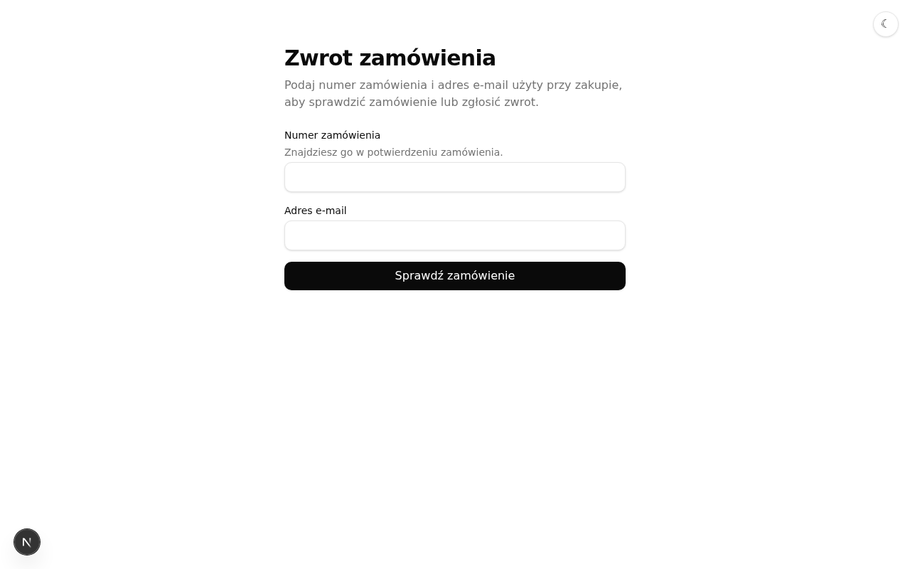
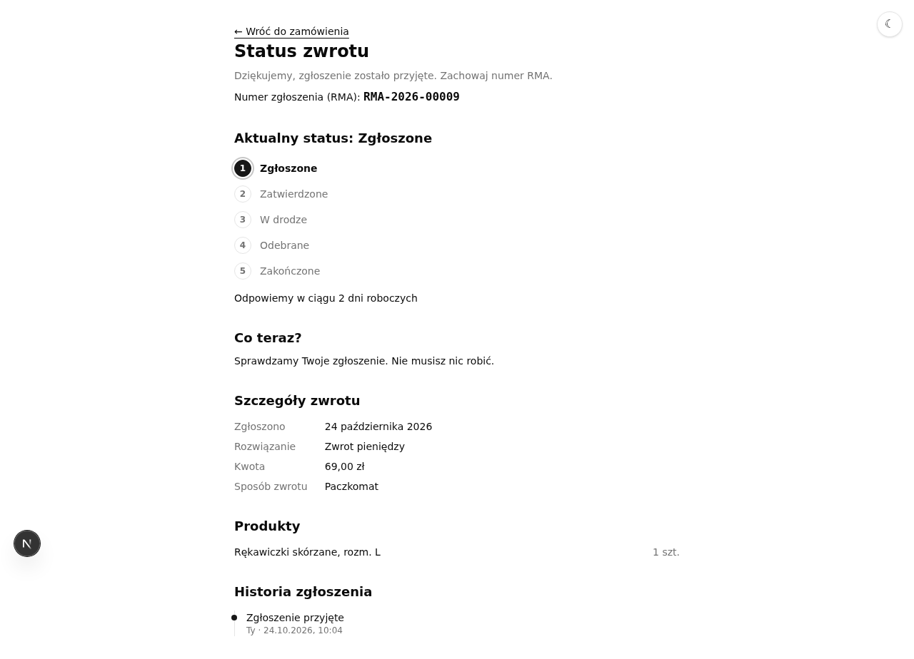
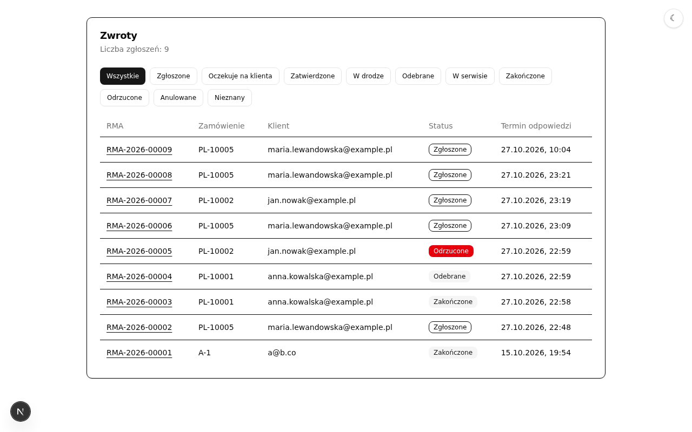
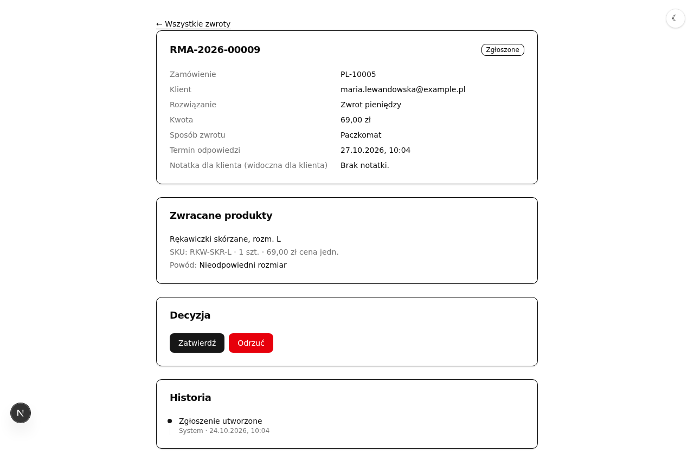
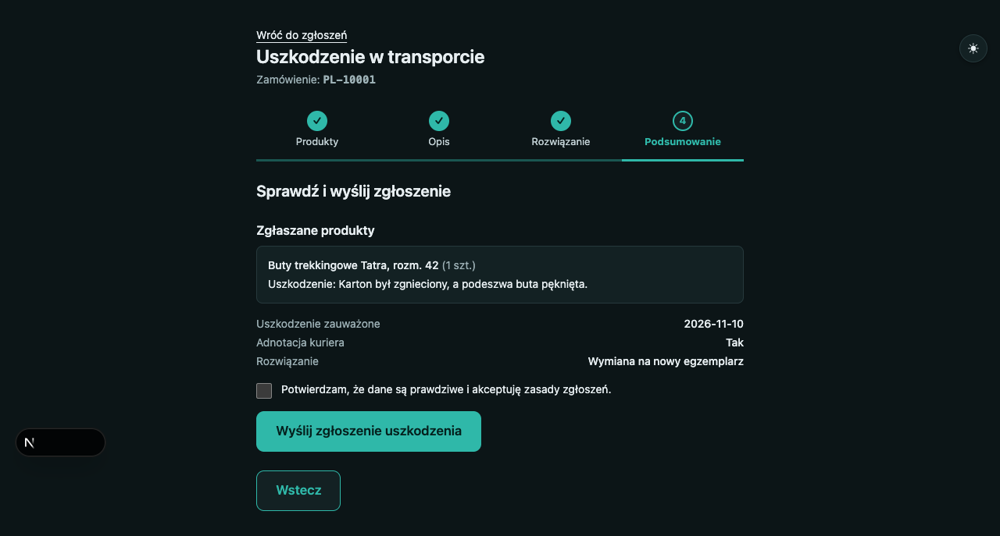

<div align="center">

# 🧾 EasyRMS

**Easy Return Management System** — returns, complaints and delivery issues, handled in one place.

🧾 Returns · 📣 Complaints · 🚚 Transport damage · 📦 Vendor claims

</div>

## ✨ What it does

- 🔎 **Customer self-service** — find an order by number and e-mail, then file a return, complaint, transport-damage or missing-item report in a guided wizard.
- 🆔 **RMA number and live status** — every report gets an `RMA-YYYY-NNNNN` number and a clear timeline of what happens next.
- 📸 **Photo evidence, handled safely** — 1–6 photos per damage report, virus-scanned with ClamAV and stripped of metadata before storage.
- 🧑‍💼 **Agent back office** — a filterable inbox with deadlines and escalation, plus a decision card to approve, reject or route each case.
- 📮 **Vendor claims** — send a claim e-mail to the supplier, track its status and record the credit note.
- 📊 **Rules lab** — analyse a sample of past support cases and simulate rule thresholds before shipping them.
- 🔐 **Agent accounts** — invite-based sign-in, 8-hour sessions and permission-based access.
- 🌗 **Two themes, two audiences** — a Tailwind customer portal and a shadcn/ui admin panel, both responsive.

## 🖼️ Screenshots

| 🙋 Customer portal | 📈 Status tracker |
|:---:|:---:|
|  |  |

| 📥 Agent inbox | ✅ Decision card |
|:---:|:---:|
|  |  |

<details>
<summary>📦 More screenshots</summary>



</details>

> 📷 Screenshots come from QA runs and integration-test artifacts in [`doc/previdences/`](doc/previdences/) and [`.ai/qa/`](.ai/qa/).

## 🚀 Getting started

Copy .env.example file to .env and modify environment settings if needed

```bash
cp .env.example .env
```

> `@easyrms/app` scripts (`npm run dev`, `build`, `start`, `seed:dev`, etc.) preload variables from the repository root `/.env`, so for local work you can keep config in one place.

generate secretes session values in .eve for
EASYRMS_GUEST_SESSION_SECRET
EASYRMS_AGENT_SESSION_SECRET

by executing 2x and copy values 
```bash
openssl rand -hex 32
```

Run docker compose to start postgres db and malvare scanner (clamav)

```bash
docker-compose up-d
```

Run npm install & setups

```bash
npm install
npm run setup    # install, migrate and seed a local dev database
npm run dev      # start the app
```

Open [http://localhost:3000](http://localhost:3000). Agents sign in at `/admin/login`; for the customer demo use the seeded order `PL-10001`. In development the admin header has a "Resetuj bazę" button that restores the seeded dev state (see `GettingStarted.md`). Photo uploads also need the local scanner: `docker compose up -d --wait clamav`.

That's the short version — the details are in the docs 👇

## 📚 Documentation

| Want to… | Go to |
|---|---|
| Install and run locally | [GettingStarted.md](./GettingStarted.md) |
| Understand the architecture, workflows and rules | [Technical overview](./doc/TECHNICAL-OVERVIEW.md) |
| Configure environment variables | [Configuration.md](./Configuration.md) |
| Run database and integration tests | [DatabaseTests.md](./DatabaseTests.md) · [IntegrationTests.md](./IntegrationTests.md) |
| Browse the UI kit | [Storybook.md](./Storybook.md) |
| Work on the code | [AGENTS.md](./AGENTS.md) |

> ⚠️ **Status:** the foundations and first end-to-end flows are in place; the production customer flow still needs a real order adapter. See the [technical overview](./doc/TECHNICAL-OVERVIEW.md) for the current limits.
