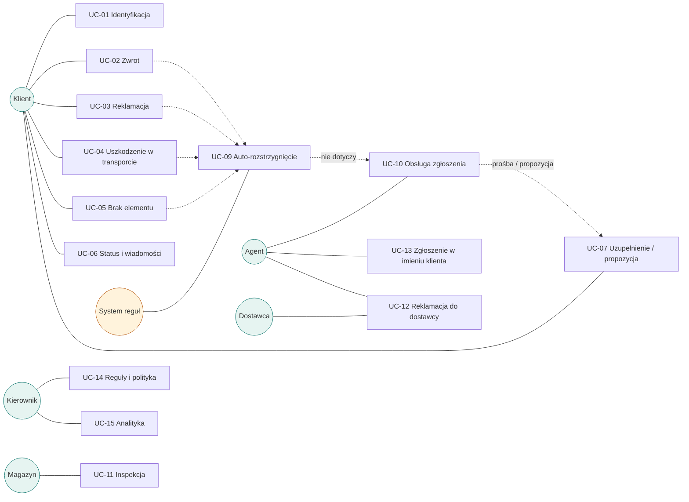
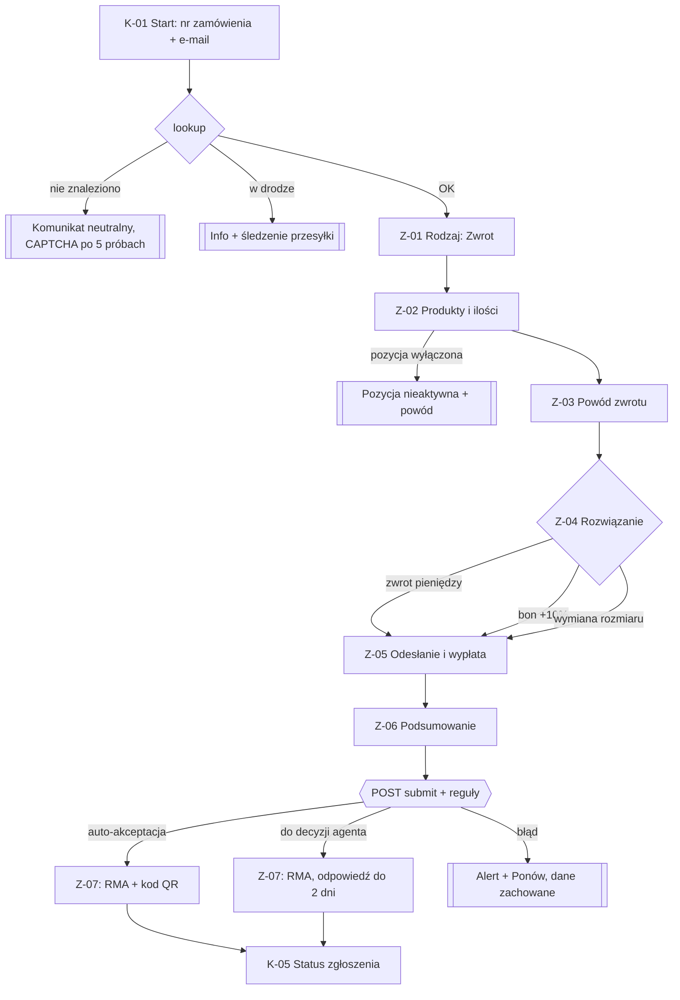
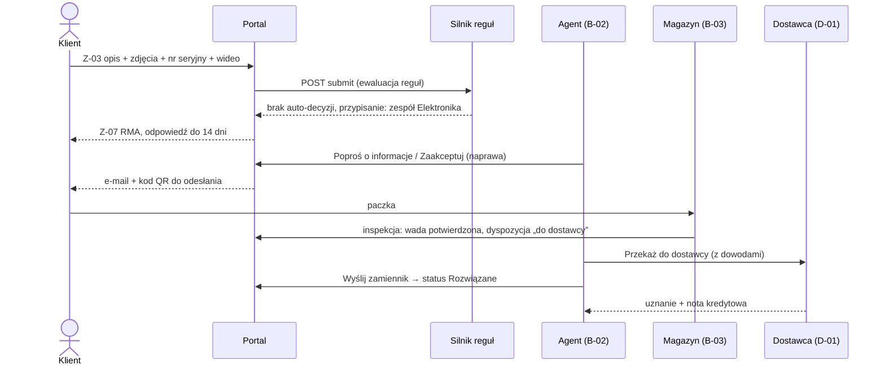
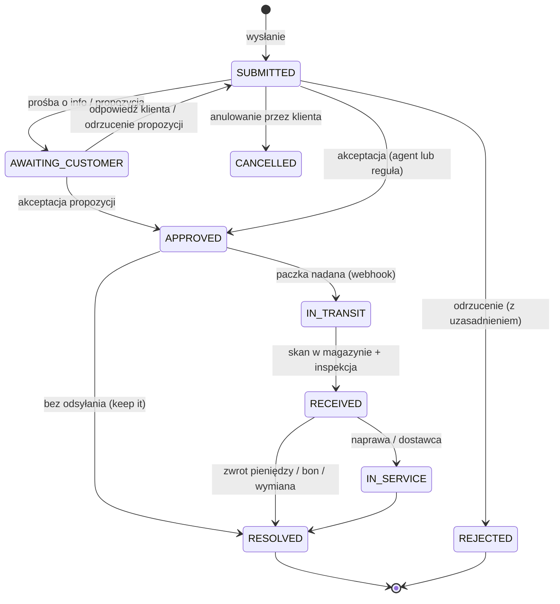
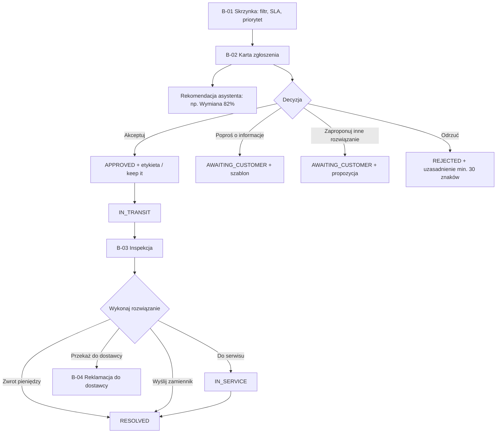

# 2. Use case'y i przepływy użytkownika

Identyfikatory ekranów (`K-xx` portal klienta, `Z-xx` kreator zgłoszenia, `B-xx` back-office, `D-xx` portal dostawcy) odpowiadają [mapie ekranów](03-mapa-ekranow-i-nawigacja.md). Diagramy — Mermaid.

## 2.1. Lista use case'ów

| ID | Use case | Aktor | Priorytet | Ekrany |
|---|---|---|---|---|
| UC-01 | Identyfikacja zamówienia / logowanie linkiem e-mail | Klient | MVP | K-01, K-02, K-03 |
| UC-02 | Zwrot towaru (odstąpienie od umowy) | Klient | MVP | Z-01…Z-07 |
| UC-03 | Reklamacja wadliwego produktu | Klient | MVP | Z-01…Z-07 |
| UC-04 | Zgłoszenie uszkodzenia w transporcie | Klient | MVP | Z-01…Z-07 |
| UC-05 | Brak elementu / błędny produkt w paczce | Klient | MVP | Z-01…Z-07 |
| UC-06 | Śledzenie statusu i korespondencja | Klient | MVP | K-04, K-05 |
| UC-07 | Uzupełnienie informacji / decyzja o propozycji sklepu | Klient | MVP | K-05 |
| UC-08 | Anulowanie zgłoszenia | Klient | MVP | K-05 |
| UC-09 | Automatyczne rozstrzygnięcie regułą | System | MVP | Z-07, B-02 |
| UC-10 | Obsługa zgłoszenia przez agenta | Agent | MVP | B-01, B-02 |
| UC-11 | Przyjęcie zwrotu i inspekcja w magazynie | Magazyn | MVP | B-03 |
| UC-12 | Reklamacja do dostawcy i odzysk kosztów | Agent, Dostawca | MVP | B-02, B-04, D-01 |
| UC-13 | Zgłoszenie w imieniu klienta (telefon / sklep stacjonarny) | Agent | MVP | B-01, Z-00, Z-01…Z-07 |
| UC-14 | Konfiguracja reguł automatyzacji i polityki zwrotów | Kierownik | MVP | B-05, B-07 |
| UC-15 | Analityka zwrotów i reklamacji | Kierownik | MVP | B-06 |
| UC-16 | Zgłoszenia B2B (zbiorcze) | Partner B2B | Faza 2 | — |

## 2.2. Kwalifikowalność (reguły biznesowe wspólne dla UC-02…UC-05)

| Typ zgłoszenia | Dostępny, gdy | Wyłączenia pozycji | Wymagane dowody |
|---|---|---|---|
| **Zwrot** | ≤ okno zwrotu od dostawy (domyślnie 30 dni, min. ustawowe 14) | produkty higieniczne, na zamówienie (`returnable=false`) | brak |
| **Reklamacja** | ≤ 24 mies. od dostawy | — | zdjęcia (min. 1); nr seryjny i/lub wideo — jeśli wymaga produkt / dostawca / reguła |
| **Uszkodzenie w transporcie** | ≤ 14 dni od dostawy | — | zdjęcia produktu i opakowania |
| **Brak elementu / błędny produkt** | ≤ 14 dni od dostawy | — | zdjęcie zawartości paczki |
| (dowolny) | zamówienie dostarczone | zamówienie w drodze → informacja + link do śledzenia przesyłki | — |

## 2.3. UC-01 Identyfikacja zamówienia / logowanie

**Scenariusz główny (gość):** K-01 → nr zamówienia + e-mail → `POST /portal/orders/lookup` → token sesji ograniczony do zamówienia (2 h) → Z-01.
**Scenariusz alternatywny (konto):** K-01 → „Zaloguj się linkiem” → K-02 e-mail → `POST /portal/auth/magic-link` → klik w link → `POST /portal/auth/magic-link/verify` → K-03 lista zamówień i zgłoszeń.
**Wyjątki:** brak zamówienia lub niezgodny e-mail → komunikat neutralny „Nie znaleźliśmy zamówienia dla podanych danych” (bez wskazania, które pole); po 5 próbach — CAPTCHA; zamówienie w drodze → informacja z linkiem do śledzenia przesyłki.

## 2.4. UC-02 Zwrot towaru (przepływ referencyjny kreatora)

1. **Z-01 Rodzaj zgłoszenia** — system pokazuje dostępne typy z terminami („Zwrot możliwy do 12.11.2026”).
2. **Z-02 Produkty** — wybór pozycji i ilości; pozycje niekwalifikowane są nieaktywne z wyjaśnieniem.
3. **Z-03 Powód** — per pozycja: powód ze słownika, opcjonalny komentarz.
4. **Z-04 Rozwiązanie** — zwrot na pierwotną metodę płatności / **bon sklepowy +10%** / **wymiana** (np. inny rozmiar). System liczy kwotę (`POST …/quote`): wartość pozycji − koszt odesłania (jeśli dotyczy; dla bonu — gratis).
5. **Z-05 Odesłanie i wypłata** — paczkomat (kod QR, bez drukowania) / kurier z odbiorem / sklep stacjonarny; nr rachunku tylko przy płatności za pobraniem; kontakt.
6. **Z-06 Podsumowanie** — przegląd, oświadczenie, „Wyślij zgłoszenie”.
7. **Z-07 Potwierdzenie** — nr RMA; jeśli zadziałała reguła auto-akceptacji: od razu **kod QR / etykieta** i instrukcja; w przeciwnym razie: „Odpowiemy w ciągu 2 dni roboczych”.
8. Dalej: paczka nadana (webhook przewoźnika) → dostarczona do magazynu → inspekcja (UC-11) → zwrot pieniędzy / bon / wysyłka wymiany → status „Rozwiązane”.

**Wyjątki:** termin minął w trakcie wypełniania → błąd walidacji serwerowej na Z-06 z wyjaśnieniem; wariant wymiany niedostępny (brak na stanie) → opcja nieaktywna z informacją „Brak w magazynie — wybierz zwrot pieniędzy lub bon”; błąd sieci przy wysyłce → zgłoszenie zachowane jako wersja robocza, „Spróbuj ponownie” (idempotencja).

## 2.5. UC-03 Reklamacja wadliwego produktu

Różnice względem UC-02:
- Z-03: powód wady, opis (min. 20 znaków), **data wykrycia wady**, **zdjęcia (wymagane)**; **nr seryjny** — jeśli produkt go wymaga; **nagranie wideo** — jeśli wymaga dostawca lub reguła (np. elektronika). Wymagania pobierane z `GET /portal/requirements` (łączy dane produktu, wytyczne dostawcy i reguły).
- Z-04: zgodnie z ustawą — **naprawa** lub **wymiana** jako pierwszy wybór; **obniżenie ceny** / **zwrot pieniędzy** z dopiskiem „jeśli naprawa lub wymiana nie będą możliwe”; dla zestawów — **wysyłka części**.
- SLA: odpowiedź do 14 dni (licznik widoczny dla agenta, eskalacja po 10 dniach).
- Dalej: decyzja agenta → (odesłanie) → inspekcja → naprawa w serwisie / wymiana / przekazanie dostawcy (UC-12).

## 2.6. UC-04 Uszkodzenie w transporcie / UC-05 Brak elementu

- **UC-04:** Z-03 wymaga zdjęć produktu i opakowania, pytania: „Czy przyjęto paczkę z adnotacją u kuriera / spisano protokół?”. Reguła R3 → **priorytet wysoki**, zespół „Transport”. Rozwiązania: wymiana / zwrot pieniędzy. Często „zatrzymaj produkt” (reguła *keep it* dla tanich pozycji — bez odsyłania).
- **UC-05:** Z-03: który element brakuje (lista elementów zestawu lub tekst), zdjęcie zawartości. Rozwiązania: **dosłanie brakującej części** / dosłanie produktu / zwrot pieniędzy za pozycję. Odesłanie zwykle niepotrzebne.

## 2.7. UC-06 / UC-07 / UC-08 Status, korespondencja, działania klienta

- **K-05** pokazuje: status w 5 etapach (Zgłoszone → Rozpatrywane → Odesłanie → W magazynie → Rozwiązane), **„Co teraz?”** (jedna, jasna instrukcja), kod QR / etykietę, pozycje, oś czasu, wiadomości.
- **Prośba o informacje** (status `AWAITING_CUSTOMER`): baner + formularz (pliki, wiadomość) → `POST /portal/claims/{id}/responses` → status wraca do `SUBMITTED`, agent dostaje oznaczenie „Odpowiedź klienta”.
- **Propozycja sklepu** (np. obniżenie ceny o 150 zł zamiast zwrotu): „Akceptuję” / „Odrzucam” (z komentarzem) → `POST /portal/claims/{id}/offer/accept|decline`.
- **Anulowanie** — dostępne do momentu nadania paczki; modal potwierdzenia.

### Model statusów

| Kod | Etykieta dla klienta | Etykieta w back-office | „Co teraz?” dla klienta |
|---|---|---|---|
| SUBMITTED | Zgłoszone | Nowe / do decyzji | „Odpowiemy w ciągu 2 dni roboczych.” |
| AWAITING_CUSTOMER | Potrzebujemy Twojej odpowiedzi | Czeka na klienta | „Uzupełnij informacje / odpowiedz na propozycję.” |
| APPROVED | Zaakceptowane — odeślij produkt | Zaakceptowane | „Nadaj paczkę z kodem QR do DD.MM.” |
| IN_TRANSIT | Paczka w drodze | W drodze | „Paczka jest w drodze do nas.” |
| RECEIVED | Sprawdzamy produkt | Przyjęte / inspekcja | „Sprawdzamy produkt — zwykle 1–2 dni.” |
| IN_SERVICE | W naprawie | W serwisie / u dostawcy | „Produkt jest w naprawie.” |
| RESOLVED | Rozwiązane | Rozwiązane | „Zwrot X zł zlecony / zamiennik wysłany.” |
| REJECTED | Odrzucone | Odrzucone | „Sprawdź uzasadnienie. Możesz odpowiedzieć.” |
| CANCELLED | Anulowane | Anulowane | — |

## 2.8. UC-09 Automatyczne rozstrzygnięcie regułą

Reguły ewaluowane przy wysyłce zgłoszenia (kolejność wg priorytetu, wszystkie pasujące akcje są stosowane):

| Reguła (przykład) | Warunki | Akcja |
|---|---|---|
| R1 Szybki zwrot drobnych produktów | typ = Zwrot, wartość ≤ 150 zł | auto-akceptacja + etykieta |
| R2 Zatrzymaj tani produkt | typ ∈ {Reklamacja, Transport}, wartość ≤ 60 zł | auto-akceptacja bez odsyłania, rozwiązanie wykonane |
| R3 Uszkodzenia transportowe | typ = Transport | priorytet wysoki, zespół „Transport” |
| R4 Elektronika — nagranie wideo | typ = Reklamacja, kategoria ∈ {Elektronika, AGD} | wymagaj wideo w formularzu |
| R5 Wysoka wartość | wartość ≥ 2000 zł | przypisz: Kierownik |

Agent widzi w B-02 sekcję „Zastosowane reguły”. Kierownik może przetestować regułę na danych historycznych (B-05 „Symuluj”).

## 2.9. UC-10 Obsługa zgłoszenia przez agenta

Wyjątki: zwrot pieniędzy powyżej kwoty zgłoszenia — blokada; błąd bramki płatności → alert „Zwrot nieudany — ponów lub wybierz bon”; brak zamiennika na stanie → propozycja alternatywy.

## 2.10. UC-11 Przyjęcie i inspekcja w magazynie

1. B-03: skan kodu RMA / etykiety (pole z autofokusem; skaner działa jak klawiatura).
2. System pokazuje oczekiwane pozycje i ilości.
3. Inspekcja: stan (nowy / otwarty / używany / uszkodzony), kompletność, ocena **A/B/C**, dla reklamacji — „wada potwierdzona?”, zdjęcia, dyspozycja (**na stan / outlet / do dostawcy / utylizacja**).
4. „Zatwierdź przyjęcie” → status `RECEIVED`, zadanie dla agenta „Wykonaj rozwiązanie” (lub automatycznie: zwrot pieniędzy dla ocen A/B przy zwrotach).
**Wyjątki:** nieznany kod → „Nie znaleziono przesyłki — utwórz przyjęcie bez RMA”; niezgodna ilość / inny produkt → oznaczenie rozbieżności, agent decyduje.

## 2.11. UC-12 Reklamacja do dostawcy

1. Agent w B-02: „Przekaż do dostawcy” → system dołącza dowody (zdjęcia, opis, nr seryjny, wynik inspekcji, dowód zakupu) i sprawdza **wytyczne dostawcy** (np. wymagane wideo) → pozycja trafia do zbiorczej reklamacji dostawcy (status `DRAFT`).
2. B-04: „Wyślij do dostawcy” → `SENT` (e-mail z linkiem do portalu dostawcy / EDI).
3. D-01 (dostawca): uznaje (kwota noty kredytowej) lub odrzuca (uzasadnienie) → `ACCEPTED` / `REJECTED` → `CREDITED` po zaksięgowaniu.
4. Analityka (B-06) pokazuje odzyskaną kwotę.

## 2.12. UC-13 Zgłoszenie w imieniu klienta

B-01 „Nowe zgłoszenie” → Z-00 wyszukanie zamówienia (nr / e-mail / telefon) + kanał (telefon, sklep stacjonarny, e-mail) → ten sam kreator Z-01…Z-06 (bez oświadczeń klienta — zamiast tego „Klient potwierdził dane ustnie”) → Z-07 → powrót do B-02 utworzonego zgłoszenia. Klient dostaje e-mail z linkiem do statusu.

## 2.13. UC-14 / UC-15 Konfiguracja i analityka

- **B-05:** lista reguł (włącz/wyłącz, kolejność, liczba trafień), edytor „JEŚLI … TO …” bez kodu, symulacja na zgłoszeniach z ostatnich 90 dni.
- **B-07:** okno zwrotu, koszt odesłania, bonus za bon, kategorie wyłączone ze zwrotu, szablony odpowiedzi.
- **B-06:** KPI (liczba zgłoszeń, wskaźnik zwrotów, % automatyzacji, średni czas, odzysk od dostawców), top powody, top produkty, trend tygodniowy, struktura rozwiązań; filtr okresu i typu.
