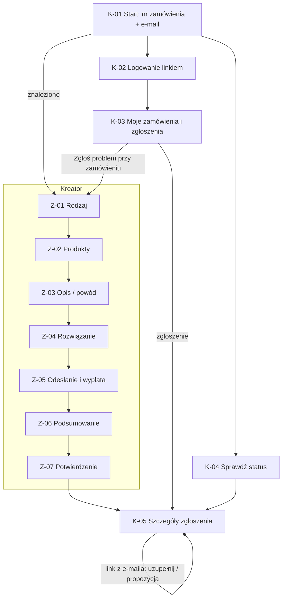
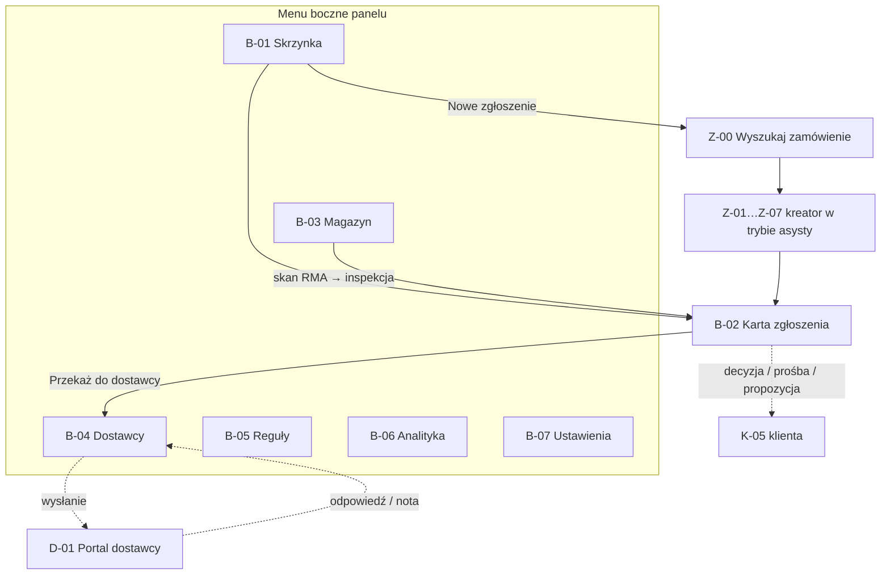

# 3. Mapa ekranów i nawigacja

System składa się z trzech aplikacji o osobnych powłokach (shell):

| Aplikacja | Użytkownicy | Powłoka | Adres docelowy |
|---|---|---|---|
| **Portal klienta** (white-label) | gość, klient z kontem | nagłówek sklepu, wąska kolumna treści, mobile-first | `zwroty.twojsklep.pl` |
| **Panel obsługi** (back-office) | agent, kierownik, magazyn | boczne menu (sidebar), widoki tabelaryczne, desktop/tablet | `panel.twojsklep.pl` |
| **Portal dostawcy** | dostawca / producent | uproszczony nagłówek, lista + szczegóły | `dostawcy.twojsklep.pl` |

## 3.1. Inwentarz ekranów

| ID | Ekran | Trasa w mockupie | Dostęp |
|---|---|---|---|
| K-01 | Start portalu: znajdź zamówienie | `#/` | publiczny |
| K-02 | Logowanie linkiem e-mail | `#/logowanie` | publiczny |
| K-03 | Moje zamówienia i zgłoszenia | `#/konto` | klient |
| K-04 | Sprawdź status zgłoszenia | `#/status` | publiczny |
| K-05 | Szczegóły zgłoszenia (status, etykieta, wiadomości, działania) | `#/zgloszenia/:id` | klient (właściciel), agent |
| Z-00 | Wyszukaj zamówienie klienta (tryb asysty) | `#/obsluga/nowe` | agent |
| Z-01 | Kreator: rodzaj zgłoszenia | `#/zgloszenie/1` | klient, agent |
| Z-02 | Kreator: produkty | `#/zgloszenie/2` | j.w. |
| Z-03 | Kreator: opis problemu / powód | `#/zgloszenie/3` | j.w. |
| Z-04 | Kreator: rozwiązanie | `#/zgloszenie/4` | j.w. |
| Z-05 | Kreator: odesłanie i wypłata | `#/zgloszenie/5` | j.w. |
| Z-06 | Kreator: podsumowanie | `#/zgloszenie/6` | j.w. |
| Z-07 | Potwierdzenie (RMA, wynik reguł, kod QR) | `#/zgloszenie/potwierdzenie` | j.w. |
| B-01 | Skrzynka zgłoszeń | `#/obsluga` | agent |
| B-02 | Karta zgłoszenia | `#/obsluga/zgloszenia/:id` | agent |
| B-03 | Przyjęcia magazynowe i inspekcja | `#/magazyn` | magazyn, agent |
| B-04 | Reklamacje do dostawców | `#/obsluga/dostawcy` | agent |
| B-05 | Reguły automatyzacji | `#/obsluga/reguly` | agent (edycja: kierownik) |
| B-06 | Analityka | `#/obsluga/analityka` | agent, kierownik |
| B-07 | Ustawienia: polityka zwrotów i szablony | `#/obsluga/ustawienia` | kierownik |
| D-01 | Portal dostawcy: reklamacje i odpowiedzi | `#/dostawca` | dostawca |
| X-01 | Nie znaleziono (404 / brak dostępu) | `*` | wszyscy |
| X-03 | Logowanie pracownika / dostawcy (SSO) | `#/panel-logowanie` | publiczny |
| X-02 | Modal: sesja wygasła | nakładka | zalogowani |

## 3.2. Mapa nawigacji — portal klienta

## 3.3. Mapa nawigacji — panel obsługi i portal dostawcy

## 3.4. Nawigacja globalna

**Portal klienta — nagłówek:** logo sklepu (→ sklep), „Zwroty i reklamacje” (→ K-01), „Sprawdź status” (→ K-04), „Moje konto” / „Zaloguj się”. Stopka: polityka zwrotów, kontakt, regulamin.

**Panel obsługi — sidebar (desktop) / menu „☰” (tablet, telefon):** Skrzynka (z licznikiem nowych i przekroczonych SLA), Magazyn, Dostawcy, Reguły, Analityka, Ustawienia; na dole: użytkownik, wyloguj. Przycisk główny „＋ Nowe zgłoszenie”. Magazynier widzi tylko „Magazyn”.

**Kreator:**
- stepper 6 kroków (ukończone klikalne), pasek akcji przyklejony do dołu („Wstecz” / „Dalej”);
- **podsumowanie zamówienia** w bocznej kolumnie (desktop) / zwijanym pasku (mobile);
- „Dalej” waliduje krok — błędy: podsumowanie na górze + komunikaty przy polach;
- dane kreatora są zapisywane po każdym kroku (wersja robocza 2 h dla gościa, 30 dni dla konta);
- wyjście z kreatora z niezapisanymi zmianami → potwierdzenie;
- **W trybie asysty** (agent) w nagłówku kreatora baner „Zgłoszenie w imieniu klienta: Anna Kowalska” i kanał.

**Linki głębokie (e-mail):** `#/zgloszenia/:id` (status), `#/zgloszenia/:id?akcja=uzupelnij`, `#/zgloszenia/:id?akcja=propozycja`. Bez sesji → K-04 z prefiksem numeru (podanie e-maila).

**Ochrona tras:** brak sesji → K-01 / K-02 (`returnUrl`); niewłaściwa rola → X-01 (bez ujawniania istnienia zasobu).
