## 📸 UI QA evidence — PARTIAL

**Verdict:** ⚠️ PARTIAL — the customer portal happy path, validation/error states, session isolation, mobile layout and the admin inbox and decision card all passed with no failures. Some state-matrix steps were not exercised (see below).
**Verified:** feat/return-customer-portal @ c3965df (local mode, no PR); `http://localhost:3000`, no login (the app has none), browser `agent-browser` v0.35.2.

| # / Priority | Route and action | Expected | Observed | Result / Evidence |
|---|---|---|---|---|
| 1 / P1 | `/` cold load, desktop | Lookup form with labelled order number and e-mail fields | Rendered, labels and hint present | PASS — 01 |
| 2 / P0 | `/` PL-10001 + wrong e-mail | Generic not-found error, no hint whether the order exists | Generic Polish error, values kept, stayed on `/` | PASS — 02 |
| 3 / P1 | `/` `pl-10004` (lowercase), undelivered | Not-delivered notice and tracking link | Notice shown, order number matched case-insensitively, link `https://tracking.example.pl/przesylka/PL10004` | PASS — 03 |
| 4 / P1 | `/` PL-10001 + valid e-mail (mixed case) | Redirect to `/returns` with the order's requests | `/returns` lists RMA-2026-00004 and RMA-2026-00003 with statuses and dates | PASS — 04 |
| 5 / P1 | `/returns/new`, order already fully covered | Lines disabled with a reason, info banner | All 3 lines disabled "Ten produkt jest już objęty zgłoszeniem zwrotu" | PASS — 05 |
| 6 / P1 | "Dalej" with nothing selectable | Inline validation, no step change | "Wybierz co najmniej jeden produkt.", stayed on step 1 | PASS — 06 |
| 7 / P1 | Log out, sign in PL-10005, select gloves | Quantity stepper capped at the remaining quantity | "Maksymalnie 1 szt."; the covered hat line stays disabled | PASS — 07 |
| 8–9 / P1 | Reasons step, "Dalej" with no reason | Reasons listed, validation error | 6 reasons plus optional comment (0/500); "Wybierz powód zwrotu." | PASS — 08, 09 |
| 10–11 / P1 | Method and resolution steps | Three methods and three resolutions, stepper progress | Rendered as expected, completed steps checked | PASS — 10, 11 |
| 12 / P0 | Summary | Correct line, reason, method, amount, fee | Gloves ×1, size reason, Paczkomat, refund, 69,00 zł, fee 0,00 zł (default config) | PASS — 12 |
| 13 / P1 | "Wyślij zgłoszenie" without consent | Blocked with an error | "Zaznacz potwierdzenie, aby wysłać zgłoszenie." | PASS — 13 |
| 14 / P0 | Tick consent and submit | Redirect to the tracker with a new RMA and timeline | `/returns/RMA-2026-00009`: status Zgłoszone, stepper, details, products, history | PASS — 14 |
| 15 / P0 | PL-10005 session opens `/returns/RMA-2026-00004` (PL-10001's); anonymous `/returns/new` and tracker | Other order's RMA not disclosed; anonymous redirected | 404 page; anonymous requests get 307 to `/` | PASS — 15 |
| 16 / P1 | 375px wide: tracker, overview, wizard | No horizontal overflow, readable | scrollWidth − clientWidth = 0 on all three | PASS — 16, 17 |
| 17 / P1 | `/admin/returns` | New RMA listed with order, customer, status, deadline | RMA-2026-00009 first, filters and status badges render | PASS — 18 |
| 18 / P1 | `/admin/returns/10` | Decision card with details, items, actions, history | Details, items, Zatwierdź/Odrzuć and history render | PASS — 19 |

### 📸 Screenshots
All files are in `doc/previdences/pr-27/`:
- 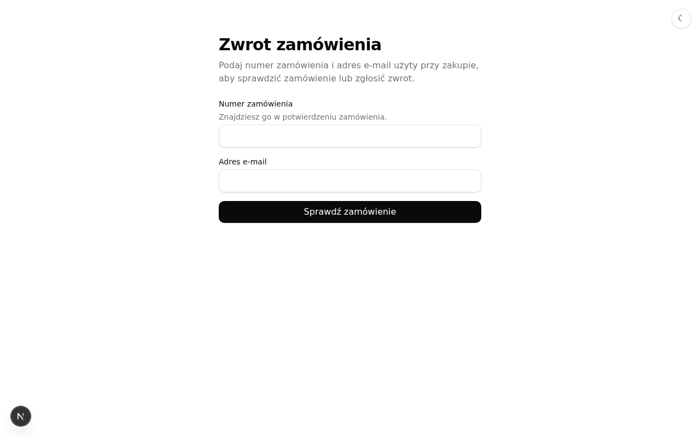 01: form renders.
- 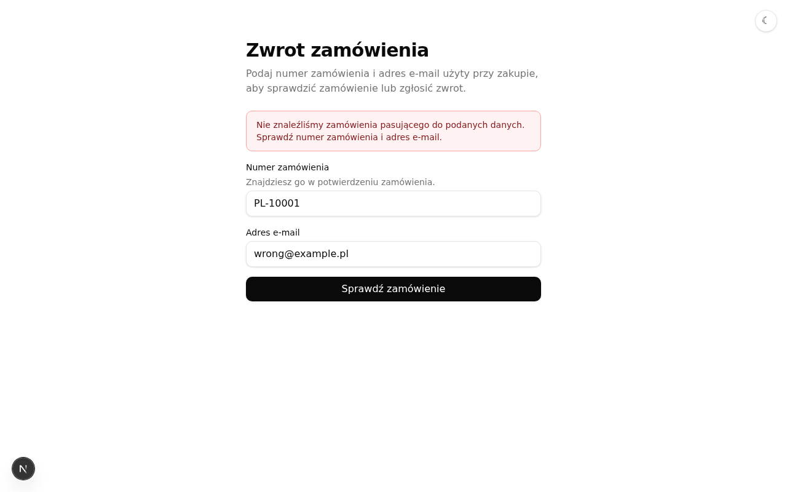 02: generic error.
- 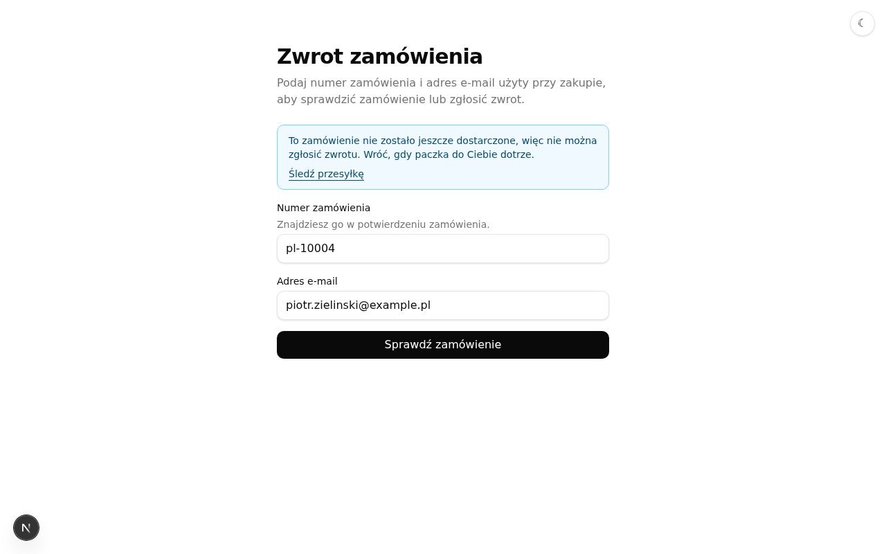 03: notice plus tracking link.
- 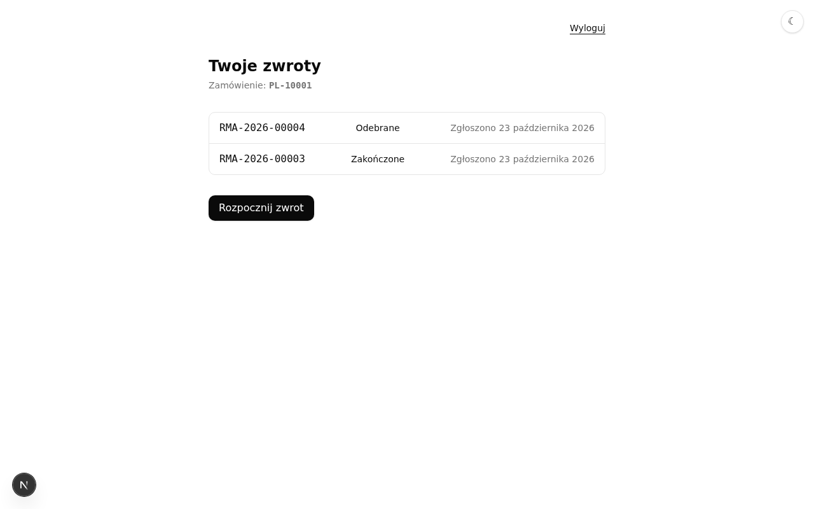 04: the order's requests.
- 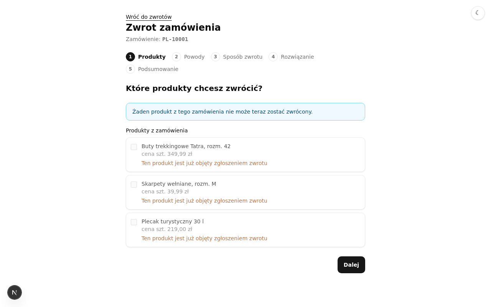 05, 06: covered lines and validation.
- 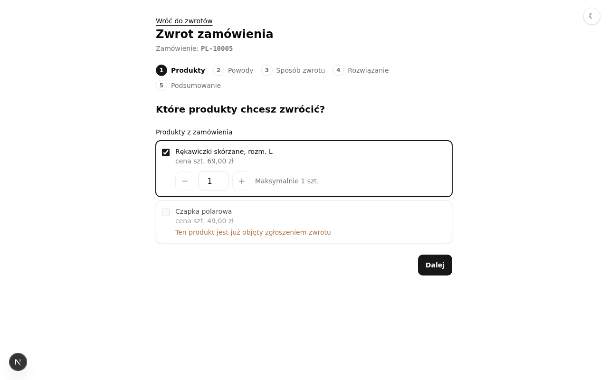 07: quantity cap.
- 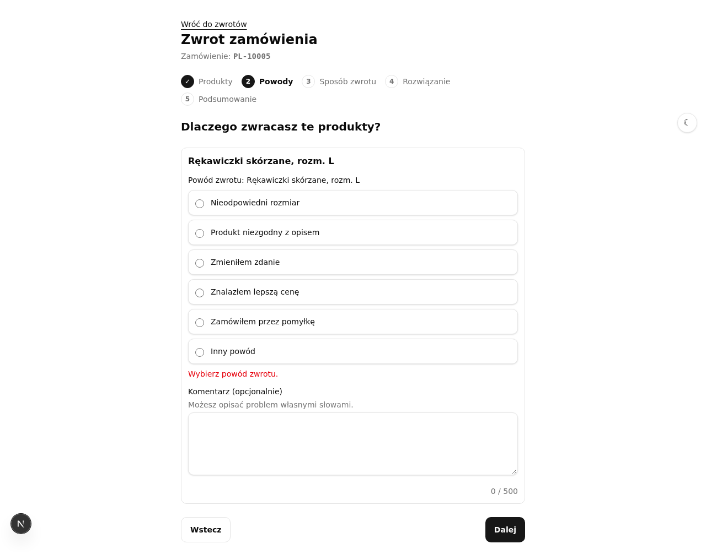 08, 09: reasons step.
- 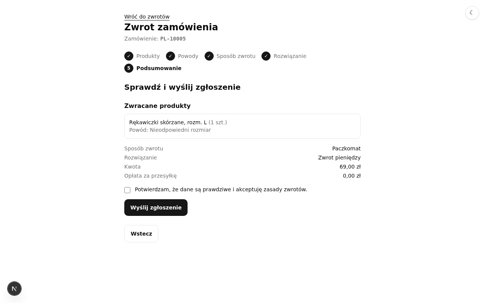 10 to 13: method, resolution, summary, consent.
- 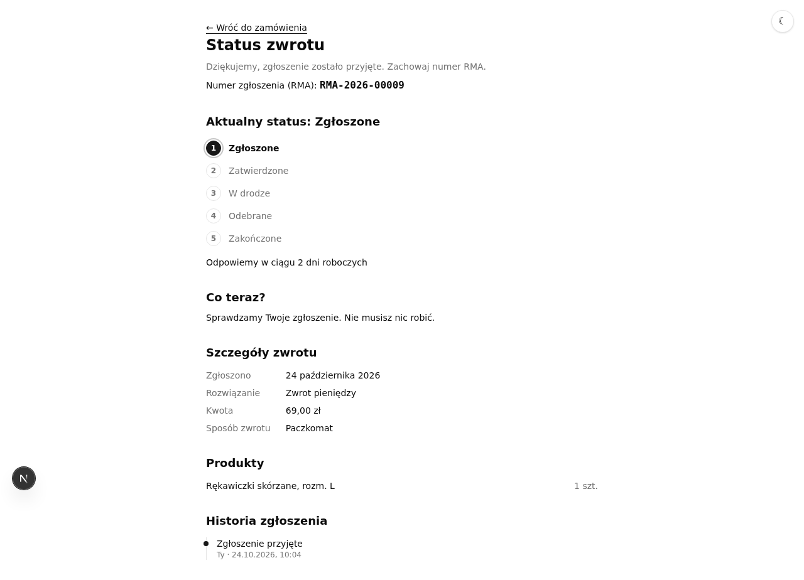 14: new RMA.
- 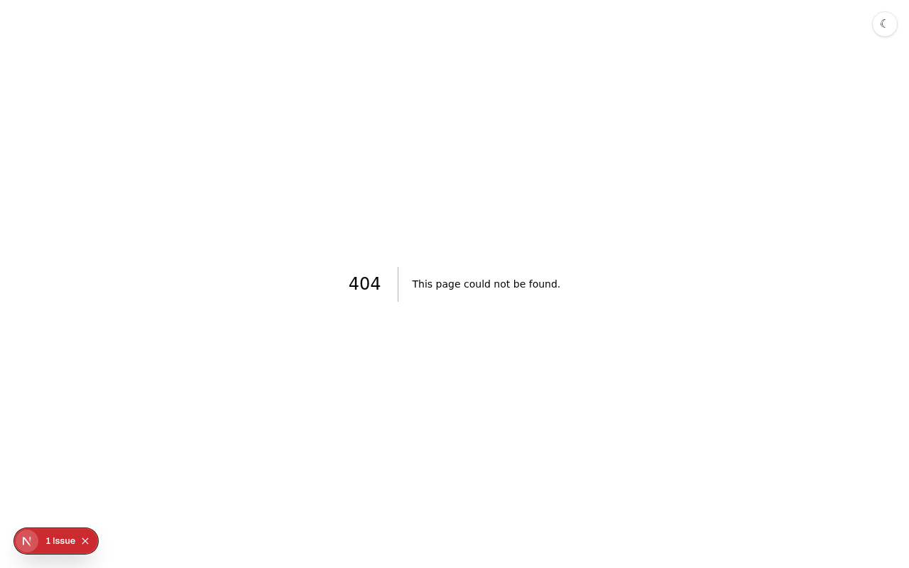 15: 404.
- 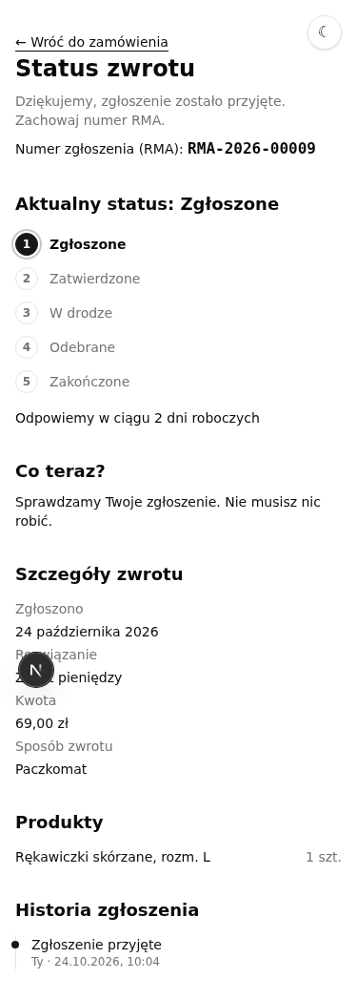 16, 17: 375px layouts.
- 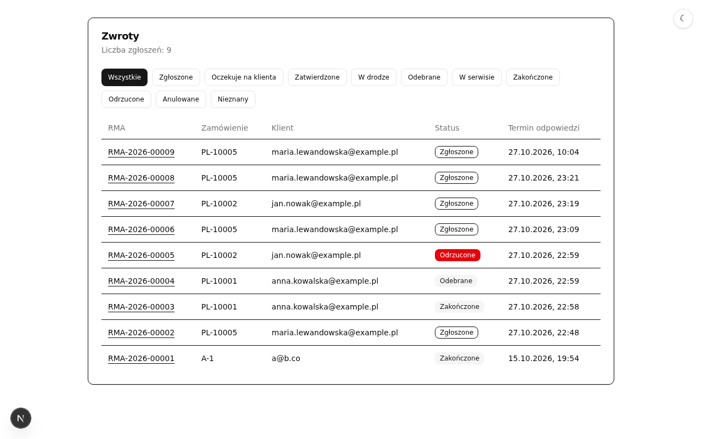 18, then 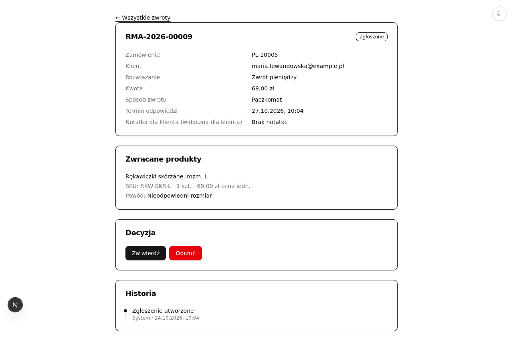 19.

### Observations (not failures)
- The 404 for a foreign RMA is the default Next.js not-found page, not the portal's styling.
- The step heading shows a visible focus box after each step change (programmatic focus); fine for accessibility, but check that it is intended.
- The `/admin/*` pages need no login; the README documents that agents have no authentication yet.

### ⚠️ Not exercised
- Dark theme, and the loading and server-error states (the DB was healthy; no fault injection).
- `PL-10003` (outside the 30-day window) and the exchange and store-credit resolutions, plus the quantity stepper above 1 unit; earlier requests on the dev database had consumed those quantities.
- Admin "Zatwierdź" / "Odrzuć" (would mutate state) and the customer's view of a decided request.
- Long-content cases (500-character comment) and keyboard-only navigation.
- No `.uxproof/` contract exists, so the contract-conformance step was skipped.
- The environment was an already-running `next dev` server with a pre-populated database, so counts and RMA numbers depend on earlier runs.

### 🧪 Follow-up: add a UI/integration test
The change ships no browser-level test. Automate this scenario with `om-integration-tests`: use a fresh database schema, seeded order PL-10005, the lookup → wizard → submit → tracker flow (steps 4–14), the wrong-e-mail and foreign-RMA negative cases (steps 2 and 15), and an assertion that the new RMA appears in `/admin/returns`. Delete every created request during teardown. Also cover `PL-10003` (window expired) and the exchange resolution.
