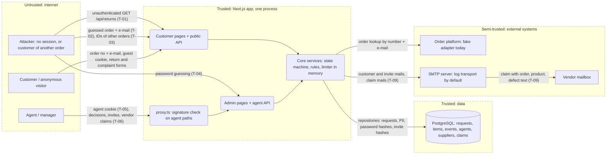

# Threat model: EasyRMS

**Scope:** whole system (`packages/app` is the only deployable unit)
**Last updated:** 2026-11-10
**Owner:** EasyRMS team (to be named)

EasyRMS handles product returns and complaints: customers file them in a portal after proving an order with order number plus e-mail, agents decide them in a back office, and managers invite agents and send vendor claims. It stores customer e-mail addresses, order data and defect descriptions, and agent password hashes. The two things that matter most today: **`GET /api/returns` answers anyone on the internet with every customer's e-mail, order number and defect text (T-01)**, and **agent login has no second factor, no revocation on logout and an in-memory throttle (T-04, T-05)**. Production has no working customer flow yet (the order adapter is `fake`), so most customer-side threats are about the design, not a live deployment.

## 1. What are we working on?

### System profile

| Application | Type | Stack | Deployed as | Auth | Tenancy | AI |
| --- | --- | --- | --- | --- | --- | --- |
| `@easyrms/app` | Browser web app + HTTP API (library packages `core`, `db`, `ui` are modelled through it) | Next.js 16 App Router, React, TypeScript, MikroORM, Awilix, Zod | Not defined: `Dockerfile` is a stub, no CI (`.github/` absent) | Agents: e-mail + scrypt password, signed 8 h JWT cookie `easyrms_agent`, re-checked against the database. Customers: signed 2 h guest cookie `easyrms_guest` bound to one order number | Single tenant. Object scoping for customers is the order number in the guest session; agents see everything, with `MANAGE_RULES` as the only elevated permission | None |

Architecture: modular monolith. `proxy.ts` is an optimistic signature check for a hand-kept list of agent paths (`isAgentProtectedPath`); every protected page and route then loads the agent from the database (`requireAgent`, `requireAgentPage`). Mutations go through API routes with a CSRF check (`x-requested-with` plus `Origin` against host).
Data stores: PostgreSQL (requests, items, events, agents with password and invite-token hashes, suppliers, supplier claims). In-memory rate limiter and hash-slot limiter per process.
External systems: order platform (only a seeded `fake` adapter; fails closed in production), SMTP (default transport `log` delivers nothing), vendor mailboxes reached through SMTP.
Multi-tenancy: none. Cross-"tenant" here means cross-order (customer A reads or acts on order B) and cross-role (agent without `MANAGE_RULES` does manager actions).

### Assets (what we protect)

- Customer PII: e-mail addresses, order numbers, order contents, defect descriptions and serial numbers.
- Agent accounts: password hashes, invite tokens, session secret `EASYRMS_AGENT_SESSION_SECRET`, `EASYRMS_GUEST_SESSION_SECRET`, `EASYRMS_SMTP_URL` credentials.
- Integrity of decisions: request status, refund approvals above the limit, timeline, vendor claims and credit amounts.
- Availability of the lookup, login and decision flows (all rate limits are in memory).

### Actors

| Actor | Access | Motivation |
| --- | --- | --- |
| Anonymous internet user | Public pages and APIs | Harvest customer data, enumerate orders, lock agents out |
| Customer of order A (guest session) | One order's requests | Read or file against order B, abuse remedies and refunds |
| Agent without `MANAGE_RULES` | Decisions, vendor claims | Approve large refunds, manage agents and vendors |
| Attacker with a stolen agent cookie or leaked invite link | Full agent access for up to 8 h | Account takeover, data theft |
| Untrusted content the system reads | Customer free text (defect description, comments) shown to agents and mailed to vendors; uploaded CSV in the case-sample lab | Stored XSS, mail abuse, parser abuse |
| Compromised dependency or deploy pipeline | Build and runtime | Supply chain |

### Entry points

| Entry point | Auth required | Notes |
| --- | --- | --- |
| `POST /api/returns/lookup` | no | Order number + e-mail; issues guest cookie; throttled per IP and per (order, IP) |
| `POST /api/returns/quote`, `POST /api/returns` | guest cookie | Order comes from the cookie; amounts recomputed server-side |
| **`GET /api/returns?status=&kind=`** | **no** | Lists every request with PII; not in `isAgentProtectedPath` |
| `DELETE /api/returns/session` | no | Clears cookie |
| `/`, `/returns/**` pages | guest cookie | Tracker maps another order's RMA to the same 404 |
| `PATCH /api/returns/[id]` | agent | Status moves; refund above limit needs `MANAGE_RULES` |
| `POST /api/agents/login`, `POST /api/agents/invite/accept` | no | Throttled; one error for every failure |
| `GET/POST /api/agents`, `PATCH /api/agents/[id]` | agent + `MANAGE_RULES` | Invite, disable |
| `/api/suppliers/**`, `/api/supplier-claims/**` | agent (`MANAGE_RULES` for vendor writes) | Claim e-mail to a vendor, `send` retries a draft |
| `POST /api/discovery/case-sample` | agent | Stateless CSV analysis, body size capped |
| `GET /api/health` | no | Runs `select 1`, returns `{status}` |
| `/admin/**` pages | agent | Each page calls `requireAgentPage` |
| `npm run agent:create` | shell access | Prints single-use invite link |

### Data flow and trust boundaries

Boundaries: browser ↔ app (cookies, CSRF header), proxy ↔ routes (two layers of agent check), app ↔ database, app ↔ order platform, app ↔ SMTP ↔ vendor, customer free text ↔ agent screens and vendor mail.
Diagram source: `docs/security/threat-model.mmd` (not rendered to SVG: no `mmdc` was available; render with `npx @mermaid-js/mermaid-cli -i docs/security/threat-model.mmd -o docs/security/threat-model.svg`).

### AI components

None. No LLM SDK, prompt, tool or MCP server in the repository; the lethal trifecta and Rule of Two checks are not applicable. Re-run this model if one is added.

### Assumptions and open questions

- [ ] Deployment target, TLS termination and reverse proxy are unknown (Dockerfile is a stub). `EASYRMS_TRUST_PROXY` semantics are taken from the README, not tested against a real proxy.
- [ ] The real order platform adapter does not exist; its auth, error behaviour and rate limits are unknown (T-11).
- [ ] Whether the QA scripts in `.ai/qa/` rely on the unauthenticated `GET /api/returns` (the lessons file says they use it to check state). Fixing T-01 will need those scripts to log in first.
- [x] Retention period for customer data (R16) is one year (legal, 2026-11-11), set by `EASYRMS_RETENTION_DAYS`; the job must be scheduled by the operator; mail delivery is off by default.
- [ ] Whether the database is reachable from outside the host in production (compose publishes 5433 with default credentials `easyrms/easyrms`).
- [ ] Not checked: rendering of customer free text in every admin component (only one `dangerouslySetInnerHTML` was found, the theme script in `layout.tsx`, which takes no user input).

## 2. What can go wrong?

| ID | Threat | STRIDE | Where | L | I | Response | Control today | How we verify | OWASP / CWE |
| --- | --- | --- | --- | --- | --- | --- | --- | --- | --- |
| T-01 | Anonymous visitor calls `GET /api/returns` (optionally `?status=`, `?kind=`) and receives every return and complaint with `customerEmail`, `orderNumber`, `defectDescription`, status and RMA, unpaginated | I | `app/api/returns/route.ts` (GET); `isAgentProtectedPath` in `core/src/http/agent-routes.ts` and the `proxy.ts` matcher list `/api/returns/:id` only; comment calls `/api/returns` "public" (stale since agent login) | H | H | Mitigate: give the GET handler `authenticate: requireAgent`, make the proxy list method-aware or move the list under an agent-only path; keep `POST` public. Decide whether the admin inbox needs the API at all (it reads server-side) | None: handler has no `authenticate`; the route-coverage test lists it as public | Integration test: no cookie → 401, guest cookie → 401, agent cookie → 200; update `agent-routes.test.ts` and the coverage test to be per method; DAST probe without session | A01:2025, API1:2023, API5:2023, CWE-306, CWE-200 |
| T-02 | Attacker enumerates or brute-forces order number + e-mail pairs on `POST /api/returns/lookup` to obtain a guest session for someone else's order | S, I | `return-lookup.service.ts` `lookup`; limiter in `core/src/security/rate-limiter.ts` | M | M | Mitigate: keep the neutral error, make the limiter shared (Redis or Postgres) before running more than one instance; document that without a trusted proxy all clients share one bucket | Per-IP and per-(order, IP) fixed windows, one `not_found` for wrong order and wrong e-mail, constant-time compare in the fake adapter | Unit test with N+1 attempts; manual: two IPs behind a proxy that appends `x-forwarded-for` must not mint new buckets | A07:2025, API2:2023, CWE-307 |
| T-03 | Customer of order A reads or files against order B (tracker, quote, submit, list) | I, E | `ReturnService.getByRma`, `listForOrder`, `submit`; tracker page `returns/[rma]/page.tsx` | L | H | Mitigate (control exists): keep the order number from the verified cookie only, never from body or query | Order read from the session; `getByRma` returns the same 404 as an unknown RMA; submit passes `session.orderNumber` | Integration test with two seeded orders (`PL-10001`, `PL-10005`): session A requests RMA of order B → 404, body carrying B's order number is ignored | A01:2025, API1:2023, CWE-639 |
| T-04 | Credential stuffing or password guessing against `/api/agents/login`; no MFA; throttle is in memory, so a restart or a second instance resets it; per-e-mail lockout lets anyone lock a known agent out for up to an hour | S, D | `agent.service.ts` `login`, `agent-session.service.ts`; README "Before exposing the app publicly" | M | H | Mitigate: shared throttle store, MFA or SSO before public exposure, alert on repeated failures; accept the lockout trade-off with a named owner | scrypt hashing, 10/min per IP, 5 per 10 min per (e-mail, IP), 20/h per e-mail, one error for every failure, dummy hash for unknown e-mails | Unit tests exist; add timing comparison of known vs unknown e-mail; manual: restart server, confirm budgets reset (documents the gap) | A07:2025, API2:2023, CWE-307, CWE-308 |
| T-05 | Stolen agent cookie (XSS elsewhere, shared machine, proxy log) stays valid until it expires (8 h) because logout only clears the cookie | S, E | `api/agents/logout/route.ts`, `agent-session.service.ts` | M | H | Mitigate: bump `session_epoch` on logout and on password or role change; shorten TTL or add idle timeout; keep `HttpOnly`, `Secure`, `SameSite` | HttpOnly, SameSite=Lax, Secure in production, epoch check on every request so disable and re-invite revoke | Integration test: login, copy cookie, logout, replay cookie → 401 (today it passes; this is the failing test to write) | A07:2025, CWE-613 |
| T-06 | Agent without `MANAGE_RULES` performs manager actions (invite or disable agents, edit vendors, approve a refund above the limit); a new route that forgets `requirePermission` ships open | E | `api/agents/**`, `api/suppliers/**`, `ReturnService.transition` approval check | M | H | Mitigate: keep per-route `requirePermission`; add a test that enumerates every agent route and asserts a manager-only matrix; consider a declarative `permission` option on `apiHandler` | `requirePermission` in each manager route; refund limit enforced in the service (403 `approval_required`) | Integration test with two seeded agents (plain, manager) across every `/api/agents`, `/api/suppliers`, `PATCH /api/returns/[id]` approve-over-limit; code review checklist item | A01:2025, API5:2023, CWE-862 |
| T-07 | Cross-site request forges an agent action (CSRF) or a poisoned `Origin` sets the base of a mailed invite link | T, S | `core/src/http/csrf.ts`, `api/agents/route.ts` (`inviteLinkBase` from `Origin`) | L | M | Accept with monitoring: the `x-requested-with` header forces preflight, the Origin must match the host; review `EASYRMS_ALLOWED_ORIGINS` as a trust list | Header + Origin check on every mutating method, SameSite=Lax; `Origin: null` rejected | Existing `csrf.test.ts`; manual: POST from another origin with and without the header → 403; check that `EASYRMS_ALLOWED_ORIGINS` is empty in production | A01:2025, CWE-352 |
| T-08 | Invite link (72 h, single use) leaks through the CLI output, the on-screen link, browser history or a plaintext mail, and lets an attacker set the password and take the account | S, E | `agent.service.ts` `invite`/`acceptInvite`, `/admin/invite/[token]`, `agent-create.ts` | M | H | Mitigate: shorten validity for managers, deliver over a channel the invitee controls, show who accepted and when, make the accept step visible in the audit log | Only SHA-256 of the token is stored, `Referrer-Policy: no-referrer` on the invite page, accept throttled per IP, all invalid tokens look alike | Unit tests exist; manual: reuse a token, use an expired token, check page `Referer` header | A07:2025, CWE-640 |
| T-09 | Turning on `EASYRMS_MAIL_TRANSPORT=smtp` starts mailing customer data for the first time; a supplier claim carries order, product, serial number and the customer's defect text to a third party, and an agent's free-text note can add more | I | `server/mail.ts`, `supplier-claims/compose.ts`, `mail-templates.ts` | M | M | Mitigate: decide retention (R16) first; send only fields on an allow-list; show the exact mail before sending (exists as preview); use TLS-only SMTP URL | Log transport by default, logs mask the recipient and never print the body, customer address excluded from claim mail, preview before send | Unit test that the rendered claim mail has no customer e-mail; manual with a local SMTP sink and synthetic data | A02:2025, CWE-359 |
| T-10 | No audit trail: login successes and failures, invite creation, agent disable and vendor claim actions are not recorded with actor, IP and time (the timeline records decisions only) | R | `agent.service.ts` (no logging of logins), `supplier-claim.service.ts` | M | M | Mitigate: append-only `audit_events` table in `db` and a log line per security event | Decision events on the request timeline name the agent | Integration test: each sensitive action produces one audit row with actor and target | A09:2025, CWE-778 |
| T-11 | Real order-platform adapter (unscheduled) introduces SSRF, trust of upstream data, or an availability dependency on every lookup | S, T, D | `OrderLookup` port, `EASYRMS_ORDER_SOURCE` | M | M | Mitigate when built: fixed base URL from config, timeouts, response schema validation, credentials from env only, circuit breaker | Port plus `fake` adapter that fails closed in production; `unavailable` refunds limiter budget | Contract tests with a stub server returning malformed bodies and slow responses | A01:2025 (SSRF), API10:2023, CWE-918 |
| T-12 | Missing security headers (CSP, `X-Frame-Options`/`frame-ancestors`, HSTS, `X-Content-Type-Options`) allow clickjacking on admin pages and widen the impact of any XSS | T, E | `packages/app/next.config.ts` (only `Referrer-Policy` on the invite path) | M | M | Mitigate: add global headers (frame-ancestors none, nosniff, HSTS at the proxy), then a nonce-based CSP | None except the invite referrer policy | `curl -I` on `/`, `/admin/login`, an API route against the expected set; DAST header scan | A02:2025, CWE-1021, CWE-693 |
| T-13 | Resource exhaustion: unauthenticated unpaginated list (T-01), concurrent scrypt hashing starving login slots, 16 KB customer bodies, the case-sample CSV, a shared rate-limit bucket that one client can exhaust for everyone | D | `GET /api/returns`, `hash-limiter.ts`, `api/discovery/case-sample` | M | M | Mitigate: auth on the list plus a page limit; keep body caps; use a shared limiter with per-client keys | Body size caps (`maxBytes`), hash-slot limiter, accept throttle | Load test against the list with 10k synthetic rows; confirm the CSV cap returns 413 | API4:2023, A06:2025, CWE-400 |
| T-14 | Supply chain and configuration: no CI or scan pipeline, `audit` only runs locally, dev database credentials `easyrms/easyrms` on a published port, `Dockerfile` unfinished, required secrets fail closed only on first request (not at boot) | T, I | repo root, `docker-compose.yml`, `audit-allowlist.json` | M | M | Mitigate: CI with `npm run audit` and lint as a gate, boot-time config check, never reuse dev compose in production | `npm run audit` with an allowlist, secrets only from env, fail-closed secret resolution | Review `audit-allowlist.json` entries each release; deployment checklist test that production boots with missing secrets and reports it | A03:2025, A02:2025, CWE-1104, CWE-798 |

## 3. Test scope

| Method | What to try | Threats |
| --- | --- | --- |
| Integration tests | `GET /api/returns` with no cookie, guest cookie, agent cookie; guest A requests order B's RMA and sends B's order number in the body; logout then replay of the agent cookie; manager-only matrix with a plain and a manager agent; claim mail content | T-01, T-03, T-05, T-06, T-09 |
| SAST / review | Every `route.ts` handler either has `authenticate` or is on a reviewed public list per method; no `instanceof` on core errors; grep for `dangerouslySetInnerHTML` and raw SQL outside `db` | T-01, T-06, T-12 |
| DAST (no session, then agent session) | Crawl without cookies and list every 200; security header scan; throttle behaviour from two source addresses | T-01, T-02, T-04, T-12, T-13 |
| Manual, two accounts | Two seeded orders, two agents (plain and manager); invite token reuse and expiry; restart the server and see throttle reset | T-02, T-03, T-04, T-06, T-08 |
| Config review | Production env: `EASYRMS_TRUST_PROXY`, empty `EASYRMS_ALLOWED_ORIGINS`, secrets present, database not published | T-02, T-07, T-14 |
| Prompt injection | Not applicable, no AI components | none |

**Out of scope:** the order platform and the SMTP provider themselves, volumetric DoS, social engineering of agents, any production system, shared QA or DEV environments.

**Rules of engagement:** isolated local environment only (`npm run db:start`, `next dev` or a built app), synthetic data only (the five seeded orders `PL-10001`–`PL-10005`, agents created with `npm run agent:create`), mail transport left on `log` or pointed at a local sink. Nothing is tested against real customer data. The throttles are per process, so wait between runs or restart instead of working around them.

## 4. Did we do a good job?

- [x] Every application in scope has a row in the System profile
- [x] Every entry point and every boundary crossing was walked through all six STRIDE letters (S: T-02, T-04, T-08; T: T-07, T-12; R: T-10; I: T-01, T-03, T-09; D: T-13; E: T-05, T-06)
- [x] Every AI component has a Rule of Two verdict (none exist)
- [x] Every High threat has a mitigation and a verification (T-01, and the High-impact T-03 to T-06, T-08)
- [x] Cross-tenant (cross-order, T-03) and cross-role (T-06) threats are present
- [x] Threat IDs are annotated on the diagram's flows (T-07, T-10 to T-14 sit on the whole app boundary, not one flow)
- [x] Assumptions are marked, not presented as facts
- [x] The document contains no attack instructions, payloads or exploit code
- [x] Out of scope and rules of engagement are written down

Gap worth saying out loud: no dynamic test was run for this model. T-01 is confirmed by reading the route and the path list (`GET` has no `authenticate`, the path is not protected), not by calling a running server.

## 5. Feature model: file uploads (R07, D21)

**Scope:** the transport damage and missing items slice with photo uploads (brief D21, R07, Q14, Q23). Reuses the profile, actors and boundaries above; only what uploads touch is added. **Added:** 2026-11-10. Nothing is built yet, so every "control today" below is the state of the repository, not of an implementation.

**What changes:** customers (guest session) send files, agents view them in the inbox, and managers may attach them to a supplier claim mail. Today the app accepts only JSON bodies capped at 16 KB (`parseJsonBody`, `MAX_BODY_BYTES`), has no file store (the `Dockerfile` is a stub, `docker-compose.yml` has only the database volume), and the mail port has no attachment concept. The brief's concept mocked AV scanning.

**AI components:** none added; Rule of Two not applicable.

### Assets added

- Customer photos: may show a home, a person, a delivery address or a label, and carry EXIF metadata (location, device).
- File store credentials or path, and the content hashes that prove a photo was not changed after a decision.
- Agent sessions: a file that runs script on the app origin acts as the agent.

### New entry points

| Entry point | Auth | Notes |
| --- | --- | --- |
| Upload route (customer) | guest cookie | multipart body; the only place a request body is not small JSON |
| File download route | guest cookie (own order) or agent | the one place bytes leave the store |
| Attach files to a claim | agent + `MANAGE_RULES` | files go to a third party by mail |
| Retention or erasure job | internal (operator runs the script) | deletes files and personal text after the R16 period (1 year, `EASYRMS_RETENTION_DAYS`) |

Diagram: `doc/security/threat-model-uploads.mmd` (not rendered; no `mmdc` available, render with `npx @mermaid-js/mermaid-cli -i doc/security/threat-model-uploads.mmd -o doc/security/threat-model-uploads.svg`).

### Threats

| ID | Threat | STRIDE | Where | L | I | Response | Control today | How we verify | OWASP / CWE |
| --- | --- | --- | --- | --- | --- | --- | --- | --- | --- |
| T-15 | A file served from the app origin runs script in an agent's session (HTML, SVG or a PDF opened inline; wrong content type; type sniffing), so a customer takes over an agent action | T, E | download route, inbox photo view | M | H | Mitigate: allow-list by detected content (not the client's type or extension), no SVG or HTML, serve with `X-Content-Type-Options: nosniff` and `Content-Disposition`, ideally from a separate origin or sandboxed with a strict CSP | Implemented in Phase 2 (PR #142, not yet used by the product): type by magic bytes only (JPEG, PNG, WebP; SVG, HTML, PDF refused with 400), every file re-encoded, download only through `GET /api/evidence/[id]` with the row's type, `nosniff`, a generated `Content-Disposition` name, `default-src 'none'; sandbox` and `private, no-store`. Not closed: no global security headers (T-12), and files are served from the app origin, not a separate one | Upload synthetic files whose real type differs from the name and declared type; assert rejection; check download response headers; DAST header scan | A05:2025, CWE-434, CWE-79 |
| T-16 | A malware-carrying file reaches an agent's machine or a vendor's mailbox | T, I | upload route, claim mail | M | H | Mitigate: scan before a file becomes visible (quarantine state until clean), fail closed when the scanner is down, never attach an unscanned file to mail | Implemented in Phase 2: clamd (`docker compose` service `clamav`) scans the original before anything is stored; scanner down, slow or answering anything but `OK` or `FOUND` is 503 `scanner_unavailable` and nothing is stored (verified with the container stopped). Unscanned bytes are never persisted, so there is no quarantine state. Not yet: the claim mail does not attach files, so the mail half of T-16 has nothing to check | Upload the standard EICAR test string as a synthetic file; assert it stays quarantined and the agent view and claim mail omit it; stop the scanner and assert uploads are refused | A06:2025, CWE-434, CWE-506 |
| T-17 | A customer of order A (or an anonymous visitor) reads, replaces or deletes order B's photo through a guessed or reused file id or URL; or adds files to a request that is already closed | I, T, E | download route, upload route | M | H | Mitigate: serve only through a route that checks the guest session's order or the agent session; random unguessable ids; no public store URLs; allow uploads only to the session's own open request | Implemented in Phase 2: ids are random UUIDs; `GET` serves an agent session or the guest session of the file's own order, and every other case (no cookie, another order, unknown, malformed or deleted id) is the same 404 with the same body; upload takes the order from the session; attach only takes staged files of the same order and unattached, under the order lock. Not yet: uploads to a request that is already closed (attach arrives with Phase 3) | Integration test with two seeded orders (`PL-10001`, `PL-10005`) and two agents: A requests B's file id, a file id with no cookie, and an upload to B's RMA or a closed request; all return the same 404 or 401 | A01:2025, API1:2023, CWE-639 |
| T-18 | Storage and CPU exhaustion: a guest session (cheap to obtain, T-02) uploads many or huge files; the body is read whole into memory; one client fills the store | D | upload route, store | H | M | Mitigate: stream with a cap before buffering, limits per file, per request, per order and in total, rate limit per client, delete orphaned uploads | JSON body cap and per-IP, per-order throttles exist (Postgres store, #87). Implemented in Phase 2: the route reads the stream with a hard cap (5 MB plus framing, from `Content-Length` and while streaming) and is kept out of `proxy.ts`, which would truncate silently at 10 MB; per-file, per-report (6 staged) and per-order (20 MB) limits enforced in one SQL statement under the order lock; 20 uploads per 10 minutes per order and IP; orphaned staged files deleted on the next upload once older than the guest session | Oversized, many-file and slow-body synthetic requests against a local app: each returns 413 or 429 and memory stays flat; confirm the quota per order | API4:2023, A06:2025, CWE-400, CWE-770 |
| T-19 | A client-supplied file name is used in a storage path, a download header or a mail header (traversal, header injection, odd characters) | T, I | upload and download routes, claim mail | M | M | Mitigate: server-generated storage names; keep the original name only as a sanitized label; encode it in headers | Implemented in Phase 2: files are stored under a random UUID; the client name is reduced to its last path segment without control characters, quotes or separators (120 characters) and shown only as a label; the download name is built from the id | Upload synthetic names with path separators, control characters and very long names; assert the stored path is the generated id and headers are intact | A05:2025, CWE-22, CWE-113 |
| T-20 | Image parsing abuse (decompression or pixel flood) in a thumbnail or re-encode step exhausts memory; EXIF metadata (GPS, device) leaks the customer's location to agents and vendors | D, I | scanner and re-encoder | M | M | Mitigate: pixel and dimension limits before decoding, re-encode and strip metadata, run image work with a timeout | Implemented in Phase 2: the header is read first and anything above 40 megapixels is rejected before a full decode; the decode runs under the same pixel limit and a 10 s timeout; every image is re-encoded without EXIF, XMP or ICC, with the orientation applied first (verified with a GPS EXIF fixture) | Upload a synthetic image with extreme dimensions and one with GPS EXIF: the first is rejected, the second is served without metadata | A06:2025, CWE-409, CWE-200 |
| T-21 | Retention and erasure: photos and customer text kept forever, no way to delete them for a customer's erasure request, and old files stay readable | I | store, retention job | H | M | Mitigate: legal set the period (1 year, 2026-11-11); delete files with the request, test the erasure path; document what the vendor keeps | Implemented (PR for issue #145, spec `.ai/specs/implemented/2026-11-11-evidence-retention-and-erasure.md`): `npm run retention:run` (scheduled by the operator) anonymizes a request closed for more than `EASYRMS_RETENTION_DAYS` (default 365): deletes its photos and audit rows, erases e-mail, free text and linked supplier-claim text in one transaction per request, keeps order number, SKUs, amounts, statuses and timestamps; open requests are never touched; `npm run retention:erase -- --rma <RMA>` erases one request on demand (runbook `doc/security/erasure-runbook.md`). Residual: nothing runs until the operator schedules the script; database backups and supplier mail already sent are not reached (T-24, T-22); a customer who still holds the session of the order sees the request's status, without text or photos | Database tests (`npm run test:db`): a closed old request loses files, audit rows and personal text while another request is untouched, a failed statement rolls everything back, a rerun does nothing; unit tests for the period setting and the job; review the schedule in the deployment | A02:2025, CWE-359, CWE-212 |
| T-22 | A supplier claim mail sends customer photos (faces, addresses, labels) to a third party, or attaches files the customer never meant for a vendor | I | claim composition and mail adapter | M | M | Mitigate: the agent picks files in the preview, allow-list of fields and file types, size limit, no customer e-mail, TLS-only SMTP | Claim mail excludes the customer e-mail and has a preview (T-09); no attachments, and photos never reach the mail composition (Q9: no carrier or supplier claim in this slice; the claim code does not read evidence). Re-assess when a photo is ever attached to a claim | Unit test that the rendered claim has only selected, clean files and no customer e-mail; manual with a local SMTP sink and synthetic images | A02:2025, CWE-359 |
| T-23 | A photo is replaced or removed after the agent's decision, and nothing shows who added or viewed it (the timeline has no payload column, see the 2026-11-08 lesson) | R, T | file metadata, timeline | L | M | Mitigate: store a content hash, make files immutable after submission, write an event for add, remove and download | Partly implemented (PR #142, #143): files are immutable once attached (no update route; an attached file cannot be deleted by the customer, tested), the SHA-256 of the stored bytes is kept, a photo is attached once in the submit transaction. Audit trail implemented (PR #146): a separate `evidence_audit_events` table (the request timeline cannot carry it: no payload column, and the customer tracker shows every event) records a guest add, a guest take-back of a staged file and an agent download (once per agent and file per 10 minutes), written in the same transaction as an add or take-back (fail closed) and without blocking an agent read when the write fails (logged); rows have no foreign key to the file, so they outlive it, and agents see them on the decision card, never customers or the customer preview. Not recorded: a customer reading their own photo, a removal after submit (not possible), and the erasure path (no caller yet, T-21) | Test that a file cannot be changed after submit and that each add appears on the timeline with the agent or guest identity | A08:2025, CWE-345, CWE-778 |
| T-24 | The store is misconfigured or leaks: public bucket or directory, credentials in the repository or logs, files in the same volume as the app, no backup rules | I | file store, deployment | M | H | Mitigate: private store, server-mediated access, credentials only from environment (`Configuration.md`), fail closed when unset, document backups | Partly implemented in Phase 2: files live in Postgres behind `EvidencePort`, so there is no directory or bucket to misconfigure; access is server-mediated only; the scanner address is required in production (`EASYRMS_CLAMAV_HOST`) and the limits come from the environment (`Configuration.md`). Not closed: database growth and backup rules, and the deployment itself (T-14) | Config review: production env check for the store settings; request a stored file without a session and assert denial; scan logs for paths and credentials | A02:2025, CWE-798, CWE-732 |

### Proposed answers to Q23 (for the owner, security and legal to confirm; these are recommendations, not decisions)

- Types: JPEG, PNG and WebP images only at first; video (R10b, electronics) is a separate decision because it multiplies size, scanning and retention cost.
- Limits: a per-file size, a file count per request and a total per order (the numbers are the owner's to set; T-18 needs all three).
- Scanning: required, with quarantine and fail-closed behaviour (T-16); this adds a dependency or a service to run, so it needs the owner's approval.
- Store: server-mediated, private, location decided with deployment (T-24); the brief does not say where the app will run.
- Retention: legal set one year for R16 (2026-11-11); the vendor's copy is still open (T-22).
- Access: guest session for own order, agents for all, vendors only through the claim mail (T-17, T-22).

### Test scope for this feature

| Method | What to try | Threats |
| --- | --- | --- |
| Integration tests | Two seeded orders and two agents: cross-order file read, upload and delete; upload to a closed request; no-cookie download; quarantined file invisible to agents and claim mail | T-16, T-17, T-23 |
| File-handling tests with synthetic files | Wrong type vs name, oversized and many-file bodies, odd file names, extreme image dimensions, image with GPS EXIF, the standard EICAR test string | T-15, T-16, T-18, T-19, T-20 |
| DAST | Response headers on the download route (`nosniff`, `Content-Disposition`, CSP), unauthenticated crawl of file URLs | T-15, T-17 |
| Review | Store settings and credentials, retention job, erasure path, claim mail allow-list | T-21, T-22, T-24 |

**Out of scope and rules of engagement:** as in section 3. Synthetic files only, local environment only (`npm run db:start`, local app, local SMTP sink); never real customer photos. This section is a plan; no test has been run.

### Gaps to say out loud

- The feature has no spec yet, so threats are about the design the brief implies. Re-run this section when the upload spec exists.
- Not assessed: the base model's T-01, T-04 to T-06 and T-08 have fix commits (#86, #87, #89, #91, #93) after 2026-11-02, but their rows above still describe that date and were not re-checked here.
- Uploads add a dependency (scanner, image library) that needs the supply-chain check in T-14.

## Changelog

- 2026-11-11 Retention and erasure (issue #145, part 1) close T-21: a scheduled script anonymizes requests closed for more than one year (legal's period, configurable) and a command erases one request on demand. Residual items are named in the T-21 row.
- 2026-11-11 Audit events for evidence photos (PR #146) close the audit half of T-23: who added, took back or (as an agent) opened a photo is recorded and shown to agents only. T-21 (retention, erasure) is unchanged.
- 2026-11-11 Phase 3 of the uploads slice (PR #143): photos are attached on submit and shown to agents and customers. T-21 is partly closed (deletion paths, no automatic call, no retention period), T-22 has nothing to check while no photo reaches mail, T-23 is partly closed (immutable once attached, hash kept, no audit events).
- 2026-11-11 Phase 2 of the uploads slice (PR #142) implements the controls of T-15 to T-20 and part of T-24 in the evidence backend, which no screen uses yet. T-21 (retention: a deletion method exists, nothing calls it), T-22 and T-23 (no audit events; files are immutable once attached) stay open for Phase 3 and later. Residual items are named in each row's control cell.
- 2026-11-02 Initial model
- 2026-11-10 Added section 5, feature model for file uploads (R07, D21, Q23): threats T-15 to T-24, diagram `threat-model-uploads.mmd`. Base rows T-01 to T-14 not re-assessed.
