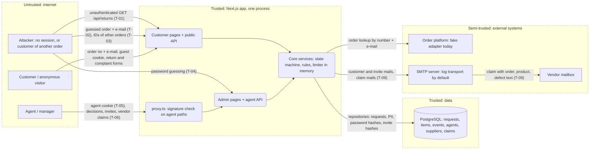

# Threat model: EasyRMS

**Scope:** whole system (`packages/app` is the only deployable unit)
**Last updated:** 2026-11-02
**Owner:** EasyRMS team (to be named)

EasyRMS handles product returns and complaints: customers file them in a portal after proving an order with order number plus e-mail, agents decide them in a back office, and managers invite agents and send vendor claims. It stores customer e-mail addresses, order data and defect descriptions, and agent password hashes. The two things that matter most today: **`GET /api/returns` answers anyone on the internet with every customer's e-mail, order number and defect text (T-01)**, and **agent login has no second factor, no revocation on logout and an in-memory throttle (T-04, T-05)**. Production has no working customer flow yet (the order adapter is `fake`), so most customer-side threats are about the design, not a live deployment.

## 1. What are we working on?

### System profile

| Application | Type | Stack | Deployed as | Auth | Tenancy | AI |
| --- | --- | --- | --- | --- | --- | --- |
| `@easyrms/app` | Browser web app + HTTP API (library packages `core`, `db`, `ui` are modelled through it) | Next.js 16 App Router, React, TypeScript, MikroORM, Awilix, Zod | Not defined: `Dockerfile` is a stub, no CI (`.github/` absent) | Agents: e-mail + scrypt password, signed 8 h JWT cookie `easyrms_agent`, re-checked against the database. Customers: signed 2 h guest cookie `easyrms_guest` bound to one order number | Single tenant. Object scoping for customers is the order number in the guest session; agents see everything, with `MANAGE_RULES` as the only elevated permission | None |

Architecture: modular monolith. `proxy.ts` is an optimistic signature check for a hand-kept list of agent paths (`isAgentProtectedPath`); every protected page and route then loads the agent from the database (`requireAgent`, `requireAgentPage`). Mutations go through API routes with a CSRF check (`x-requested-with` plus `Origin` against host).
Data stores: PostgreSQL (requests, items, events, agents with password and invite-token hashes, suppliers, supplier claims). In-memory rate limiter and hash-slot limiter per process.
External systems: order platform (only a seeded `fake` adapter; fails closed in production), SMTP (default transport `log` delivers nothing), vendor mailboxes reached through SMTP.
Multi-tenancy: none. Cross-"tenant" here means cross-order (customer A reads or acts on order B) and cross-role (agent without `MANAGE_RULES` does manager actions).

### Assets (what we protect)

- Customer PII: e-mail addresses, order numbers, order contents, defect descriptions and serial numbers.
- Agent accounts: password hashes, invite tokens, session secret `EASYRMS_AGENT_SESSION_SECRET`, `EASYRMS_GUEST_SESSION_SECRET`, `EASYRMS_SMTP_URL` credentials.
- Integrity of decisions: request status, refund approvals above the limit, timeline, vendor claims and credit amounts.
- Availability of the lookup, login and decision flows (all rate limits are in memory).

### Actors

| Actor | Access | Motivation |
| --- | --- | --- |
| Anonymous internet user | Public pages and APIs | Harvest customer data, enumerate orders, lock agents out |
| Customer of order A (guest session) | One order's requests | Read or file against order B, abuse remedies and refunds |
| Agent without `MANAGE_RULES` | Decisions, vendor claims | Approve large refunds, manage agents and vendors |
| Attacker with a stolen agent cookie or leaked invite link | Full agent access for up to 8 h | Account takeover, data theft |
| Untrusted content the system reads | Customer free text (defect description, comments) shown to agents and mailed to vendors; uploaded CSV in the case-sample lab | Stored XSS, mail abuse, parser abuse |
| Compromised dependency or deploy pipeline | Build and runtime | Supply chain |

### Entry points

| Entry point | Auth required | Notes |
| --- | --- | --- |
| `POST /api/returns/lookup` | no | Order number + e-mail; issues guest cookie; throttled per IP and per (order, IP) |
| `POST /api/returns/quote`, `POST /api/returns` | guest cookie | Order comes from the cookie; amounts recomputed server-side |
| **`GET /api/returns?status=&kind=`** | **no** | Lists every request with PII; not in `isAgentProtectedPath` |
| `DELETE /api/returns/session` | no | Clears cookie |
| `/`, `/returns/**` pages | guest cookie | Tracker maps another order's RMA to the same 404 |
| `PATCH /api/returns/[id]` | agent | Status moves; refund above limit needs `MANAGE_RULES` |
| `POST /api/agents/login`, `POST /api/agents/invite/accept` | no | Throttled; one error for every failure |
| `GET/POST /api/agents`, `PATCH /api/agents/[id]` | agent + `MANAGE_RULES` | Invite, disable |
| `/api/suppliers/**`, `/api/supplier-claims/**` | agent (`MANAGE_RULES` for vendor writes) | Claim e-mail to a vendor, `send` retries a draft |
| `POST /api/discovery/case-sample` | agent | Stateless CSV analysis, body size capped |
| `GET /api/health` | no | Runs `select 1`, returns `{status}` |
| `/admin/**` pages | agent | Each page calls `requireAgentPage` |
| `npm run agent:create` | shell access | Prints single-use invite link |

### Data flow and trust boundaries

Boundaries: browser ↔ app (cookies, CSRF header), proxy ↔ routes (two layers of agent check), app ↔ database, app ↔ order platform, app ↔ SMTP ↔ vendor, customer free text ↔ agent screens and vendor mail.
Diagram source: `docs/security/threat-model.mmd` (not rendered to SVG: no `mmdc` was available; render with `npx @mermaid-js/mermaid-cli -i docs/security/threat-model.mmd -o docs/security/threat-model.svg`).

### AI components

None. No LLM SDK, prompt, tool or MCP server in the repository; the lethal trifecta and Rule of Two checks are not applicable. Re-run this model if one is added.

### Assumptions and open questions

- [ ] Deployment target, TLS termination and reverse proxy are unknown (Dockerfile is a stub). `EASYRMS_TRUST_PROXY` semantics are taken from the README, not tested against a real proxy.
- [ ] The real order platform adapter does not exist; its auth, error behaviour and rate limits are unknown (T-11).
- [ ] Whether the QA scripts in `.ai/qa/` rely on the unauthenticated `GET /api/returns` (the lessons file says they use it to check state). Fixing T-01 will need those scripts to log in first.
- [ ] Retention period for customer data (R16) is undecided; mail delivery is off by default.
- [ ] Whether the database is reachable from outside the host in production (compose publishes 5433 with default credentials `easyrms/easyrms`).
- [ ] Not checked: rendering of customer free text in every admin component (only one `dangerouslySetInnerHTML` was found, the theme script in `layout.tsx`, which takes no user input).

## 2. What can go wrong?

| ID | Threat | STRIDE | Where | L | I | Response | Control today | How we verify | OWASP / CWE |
| --- | --- | --- | --- | --- | --- | --- | --- | --- | --- |
| T-01 | Anonymous visitor calls `GET /api/returns` (optionally `?status=`, `?kind=`) and receives every return and complaint with `customerEmail`, `orderNumber`, `defectDescription`, status and RMA, unpaginated | I | `app/api/returns/route.ts` (GET); `isAgentProtectedPath` in `core/src/http/agent-routes.ts` and the `proxy.ts` matcher list `/api/returns/:id` only; comment calls `/api/returns` "public" (stale since agent login) | H | H | Mitigate: give the GET handler `authenticate: requireAgent`, make the proxy list method-aware or move the list under an agent-only path; keep `POST` public. Decide whether the admin inbox needs the API at all (it reads server-side) | None: handler has no `authenticate`; the route-coverage test lists it as public | Integration test: no cookie → 401, guest cookie → 401, agent cookie → 200; update `agent-routes.test.ts` and the coverage test to be per method; DAST probe without session | A01:2025, API1:2023, API5:2023, CWE-306, CWE-200 |
| T-02 | Attacker enumerates or brute-forces order number + e-mail pairs on `POST /api/returns/lookup` to obtain a guest session for someone else's order | S, I | `return-lookup.service.ts` `lookup`; limiter in `core/src/security/rate-limiter.ts` | M | M | Mitigate: keep the neutral error, make the limiter shared (Redis or Postgres) before running more than one instance; document that without a trusted proxy all clients share one bucket | Per-IP and per-(order, IP) fixed windows, one `not_found` for wrong order and wrong e-mail, constant-time compare in the fake adapter | Unit test with N+1 attempts; manual: two IPs behind a proxy that appends `x-forwarded-for` must not mint new buckets | A07:2025, API2:2023, CWE-307 |
| T-03 | Customer of order A reads or files against order B (tracker, quote, submit, list) | I, E | `ReturnService.getByRma`, `listForOrder`, `submit`; tracker page `returns/[rma]/page.tsx` | L | H | Mitigate (control exists): keep the order number from the verified cookie only, never from body or query | Order read from the session; `getByRma` returns the same 404 as an unknown RMA; submit passes `session.orderNumber` | Integration test with two seeded orders (`PL-10001`, `PL-10005`): session A requests RMA of order B → 404, body carrying B's order number is ignored | A01:2025, API1:2023, CWE-639 |
| T-04 | Credential stuffing or password guessing against `/api/agents/login`; no MFA; throttle is in memory, so a restart or a second instance resets it; per-e-mail lockout lets anyone lock a known agent out for up to an hour | S, D | `agent.service.ts` `login`, `agent-session.service.ts`; README "Before exposing the app publicly" | M | H | Mitigate: shared throttle store, MFA or SSO before public exposure, alert on repeated failures; accept the lockout trade-off with a named owner | scrypt hashing, 10/min per IP, 5 per 10 min per (e-mail, IP), 20/h per e-mail, one error for every failure, dummy hash for unknown e-mails | Unit tests exist; add timing comparison of known vs unknown e-mail; manual: restart server, confirm budgets reset (documents the gap) | A07:2025, API2:2023, CWE-307, CWE-308 |
| T-05 | Stolen agent cookie (XSS elsewhere, shared machine, proxy log) stays valid until it expires (8 h) because logout only clears the cookie | S, E | `api/agents/logout/route.ts`, `agent-session.service.ts` | M | H | Mitigate: bump `session_epoch` on logout and on password or role change; shorten TTL or add idle timeout; keep `HttpOnly`, `Secure`, `SameSite` | HttpOnly, SameSite=Lax, Secure in production, epoch check on every request so disable and re-invite revoke | Integration test: login, copy cookie, logout, replay cookie → 401 (today it passes; this is the failing test to write) | A07:2025, CWE-613 |
| T-06 | Agent without `MANAGE_RULES` performs manager actions (invite or disable agents, edit vendors, approve a refund above the limit); a new route that forgets `requirePermission` ships open | E | `api/agents/**`, `api/suppliers/**`, `ReturnService.transition` approval check | M | H | Mitigate: keep per-route `requirePermission`; add a test that enumerates every agent route and asserts a manager-only matrix; consider a declarative `permission` option on `apiHandler` | `requirePermission` in each manager route; refund limit enforced in the service (403 `approval_required`) | Integration test with two seeded agents (plain, manager) across every `/api/agents`, `/api/suppliers`, `PATCH /api/returns/[id]` approve-over-limit; code review checklist item | A01:2025, API5:2023, CWE-862 |
| T-07 | Cross-site request forges an agent action (CSRF) or a poisoned `Origin` sets the base of a mailed invite link | T, S | `core/src/http/csrf.ts`, `api/agents/route.ts` (`inviteLinkBase` from `Origin`) | L | M | Accept with monitoring: the `x-requested-with` header forces preflight, the Origin must match the host; review `EASYRMS_ALLOWED_ORIGINS` as a trust list | Header + Origin check on every mutating method, SameSite=Lax; `Origin: null` rejected | Existing `csrf.test.ts`; manual: POST from another origin with and without the header → 403; check that `EASYRMS_ALLOWED_ORIGINS` is empty in production | A01:2025, CWE-352 |
| T-08 | Invite link (72 h, single use) leaks through the CLI output, the on-screen link, browser history or a plaintext mail, and lets an attacker set the password and take the account | S, E | `agent.service.ts` `invite`/`acceptInvite`, `/admin/invite/[token]`, `agent-create.ts` | M | H | Mitigate: shorten validity for managers, deliver over a channel the invitee controls, show who accepted and when, make the accept step visible in the audit log | Only SHA-256 of the token is stored, `Referrer-Policy: no-referrer` on the invite page, accept throttled per IP, all invalid tokens look alike | Unit tests exist; manual: reuse a token, use an expired token, check page `Referer` header | A07:2025, CWE-640 |
| T-09 | Turning on `EASYRMS_MAIL_TRANSPORT=smtp` starts mailing customer data for the first time; a supplier claim carries order, product, serial number and the customer's defect text to a third party, and an agent's free-text note can add more | I | `server/mail.ts`, `supplier-claims/compose.ts`, `mail-templates.ts` | M | M | Mitigate: decide retention (R16) first; send only fields on an allow-list; show the exact mail before sending (exists as preview); use TLS-only SMTP URL | Log transport by default, logs mask the recipient and never print the body, customer address excluded from claim mail, preview before send | Unit test that the rendered claim mail has no customer e-mail; manual with a local SMTP sink and synthetic data | A02:2025, CWE-359 |
| T-10 | No audit trail: login successes and failures, invite creation, agent disable and vendor claim actions are not recorded with actor, IP and time (the timeline records decisions only) | R | `agent.service.ts` (no logging of logins), `supplier-claim.service.ts` | M | M | Mitigate: append-only `audit_events` table in `db` and a log line per security event | Decision events on the request timeline name the agent | Integration test: each sensitive action produces one audit row with actor and target | A09:2025, CWE-778 |
| T-11 | Real order-platform adapter (unscheduled) introduces SSRF, trust of upstream data, or an availability dependency on every lookup | S, T, D | `OrderLookup` port, `EASYRMS_ORDER_SOURCE` | M | M | Mitigate when built: fixed base URL from config, timeouts, response schema validation, credentials from env only, circuit breaker | Port plus `fake` adapter that fails closed in production; `unavailable` refunds limiter budget | Contract tests with a stub server returning malformed bodies and slow responses | A01:2025 (SSRF), API10:2023, CWE-918 |
| T-12 | Missing security headers (CSP, `X-Frame-Options`/`frame-ancestors`, HSTS, `X-Content-Type-Options`) allow clickjacking on admin pages and widen the impact of any XSS | T, E | `packages/app/next.config.ts` (only `Referrer-Policy` on the invite path) | M | M | Mitigate: add global headers (frame-ancestors none, nosniff, HSTS at the proxy), then a nonce-based CSP | None except the invite referrer policy | `curl -I` on `/`, `/admin/login`, an API route against the expected set; DAST header scan | A02:2025, CWE-1021, CWE-693 |
| T-13 | Resource exhaustion: unauthenticated unpaginated list (T-01), concurrent scrypt hashing starving login slots, 16 KB customer bodies, the case-sample CSV, a shared rate-limit bucket that one client can exhaust for everyone | D | `GET /api/returns`, `hash-limiter.ts`, `api/discovery/case-sample` | M | M | Mitigate: auth on the list plus a page limit; keep body caps; use a shared limiter with per-client keys | Body size caps (`maxBytes`), hash-slot limiter, accept throttle | Load test against the list with 10k synthetic rows; confirm the CSV cap returns 413 | API4:2023, A06:2025, CWE-400 |
| T-14 | Supply chain and configuration: no CI or scan pipeline, `audit` only runs locally, dev database credentials `easyrms/easyrms` on a published port, `Dockerfile` unfinished, required secrets fail closed only on first request (not at boot) | T, I | repo root, `docker-compose.yml`, `audit-allowlist.json` | M | M | Mitigate: CI with `npm run audit` and lint as a gate, boot-time config check, never reuse dev compose in production | `npm run audit` with an allowlist, secrets only from env, fail-closed secret resolution | Review `audit-allowlist.json` entries each release; deployment checklist test that production boots with missing secrets and reports it | A03:2025, A02:2025, CWE-1104, CWE-798 |

## 3. Test scope

| Method | What to try | Threats |
| --- | --- | --- |
| Integration tests | `GET /api/returns` with no cookie, guest cookie, agent cookie; guest A requests order B's RMA and sends B's order number in the body; logout then replay of the agent cookie; manager-only matrix with a plain and a manager agent; claim mail content | T-01, T-03, T-05, T-06, T-09 |
| SAST / review | Every `route.ts` handler either has `authenticate` or is on a reviewed public list per method; no `instanceof` on core errors; grep for `dangerouslySetInnerHTML` and raw SQL outside `db` | T-01, T-06, T-12 |
| DAST (no session, then agent session) | Crawl without cookies and list every 200; security header scan; throttle behaviour from two source addresses | T-01, T-02, T-04, T-12, T-13 |
| Manual, two accounts | Two seeded orders, two agents (plain and manager); invite token reuse and expiry; restart the server and see throttle reset | T-02, T-03, T-04, T-06, T-08 |
| Config review | Production env: `EASYRMS_TRUST_PROXY`, empty `EASYRMS_ALLOWED_ORIGINS`, secrets present, database not published | T-02, T-07, T-14 |
| Prompt injection | Not applicable, no AI components | none |

**Out of scope:** the order platform and the SMTP provider themselves, volumetric DoS, social engineering of agents, any production system, shared QA or DEV environments.

**Rules of engagement:** isolated local environment only (`npm run db:start`, `next dev` or a built app), synthetic data only (the five seeded orders `PL-10001`–`PL-10005`, agents created with `npm run agent:create`), mail transport left on `log` or pointed at a local sink. Nothing is tested against real customer data. The throttles are per process, so wait between runs or restart instead of working around them.

## 4. Did we do a good job?

- [x] Every application in scope has a row in the System profile
- [x] Every entry point and every boundary crossing was walked through all six STRIDE letters (S: T-02, T-04, T-08; T: T-07, T-12; R: T-10; I: T-01, T-03, T-09; D: T-13; E: T-05, T-06)
- [x] Every AI component has a Rule of Two verdict (none exist)
- [x] Every High threat has a mitigation and a verification (T-01, and the High-impact T-03 to T-06, T-08)
- [x] Cross-tenant (cross-order, T-03) and cross-role (T-06) threats are present
- [x] Threat IDs are annotated on the diagram's flows (T-07, T-10 to T-14 sit on the whole app boundary, not one flow)
- [x] Assumptions are marked, not presented as facts
- [x] The document contains no attack instructions, payloads or exploit code
- [x] Out of scope and rules of engagement are written down

Gap worth saying out loud: no dynamic test was run for this model. T-01 is confirmed by reading the route and the path list (`GET` has no `authenticate`, the path is not protected), not by calling a running server.

## Changelog

- 2026-11-02 Initial model
